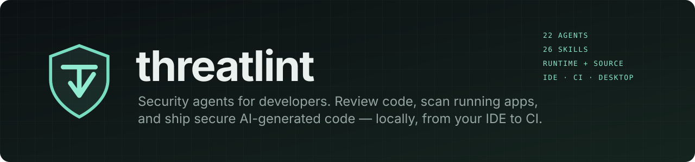
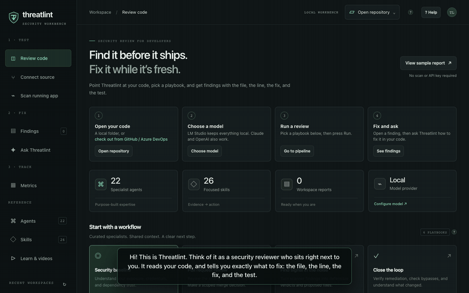
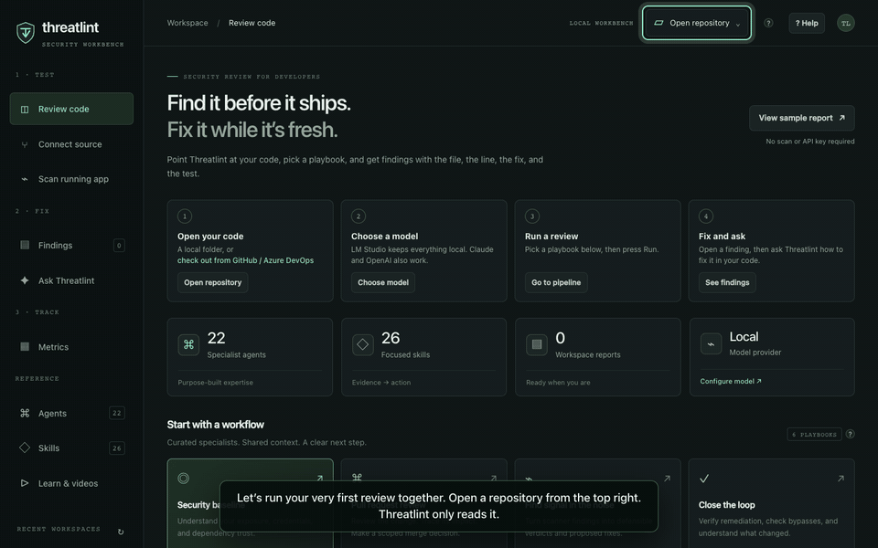
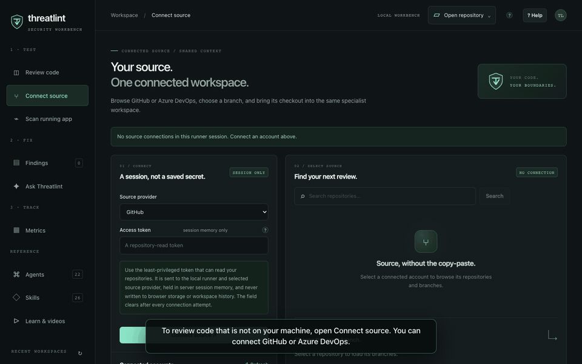
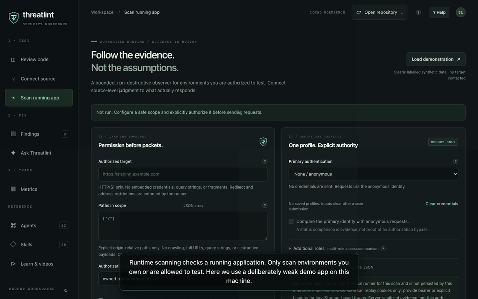
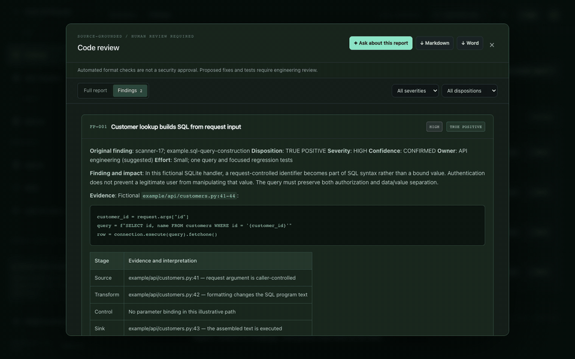
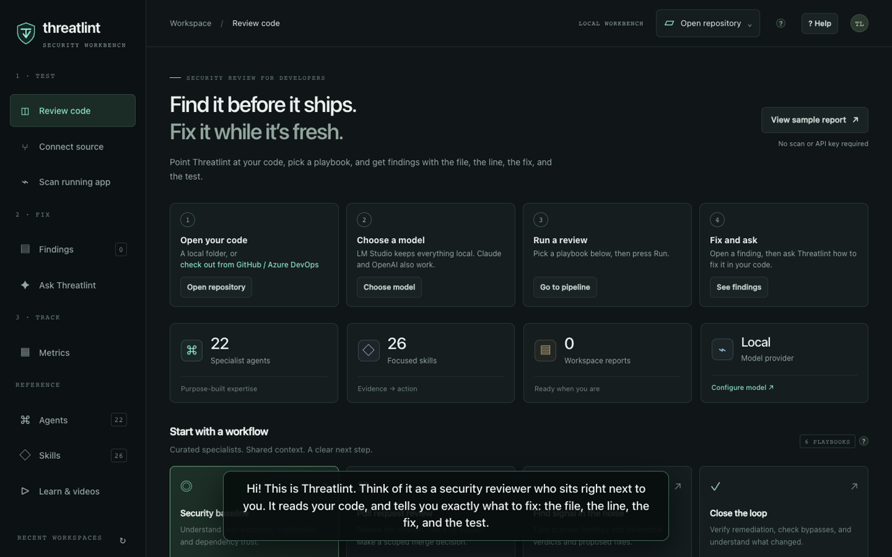
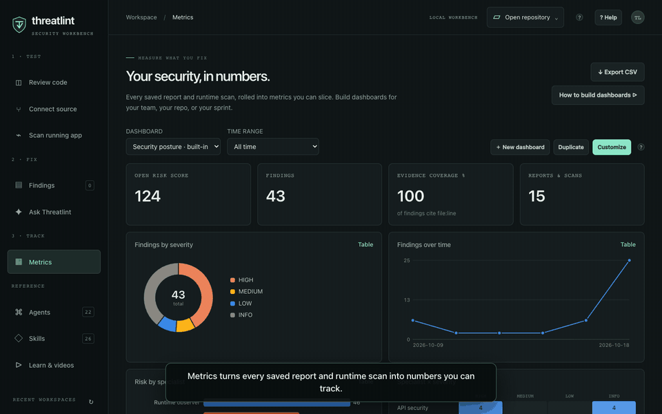
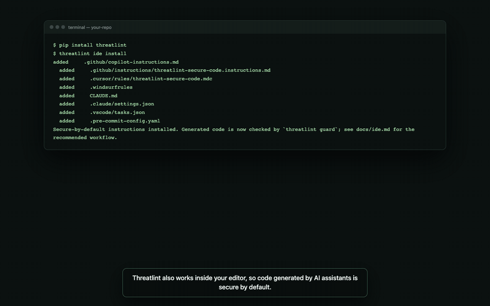

<p align="center">
  <picture>
    <source media="(prefers-color-scheme: dark)" srcset="docs/media/banner.svg">
    <source media="(prefers-color-scheme: light)" srcset="docs/media/banner-light.svg">
    
  </picture>
</p>

<p align="center">


<br>


</p>

#  threatlint

### A security reviewer that sits next to you, not at the end of the release.

**The core idea, in one line:** *Threatlint finds the security bug while the code is still in your
editor, and hands you the fix and the test.*

#### The problem you already know

It's Thursday, 4:40 pm. Your pull request has two approvals. Then the security scan comes back:
**312 findings.** Most are noise, a few are real, and none of them say which. Do you merge, or do
you lose your Friday?

Here's what usually happens: the real one gets merged with the noise. In the code below, an
AI assistant wrote a "quick" customer lookup in under a second:

```python
customer_id = request.args["id"]
query = f"SELECT * FROM customers WHERE id = '{customer_id}'"    # api/customers.py:42
```

Any visitor who types `' OR '1'='1` into that `id` gets every customer record. The scanner flagged
it as finding #187 of 312. Nobody reached #187.

#### What Threatlint does instead

Threatlint is the colleague who reads your diff before anyone else does, and tells you **one thing**:

> **CR-001 · HIGH · `api/customers.py:42`** — SQL built from request input.
> **Fix:** `cursor.execute("SELECT * FROM customers WHERE id = %s", (customer_id,))`
> **Test:** `test_lookup_rejects_injection` — passes `' OR '1'='1`, expects zero rows.

A file, a line, a fix, and a test. Then you can ask why: *"Is this reachable without login?"*,
*"Where else do we do this?"*, and it answers from your actual code.

#### Why that's different

The surprise is what Threatlint **doesn't** do. It doesn't give you a longer list. It gives you a
shorter, verified one, and it never touches your code. Every agent is read-only, every finding
must point to a real `path:line`, and anything it couldn't verify is labeled as an assumption
instead of being dressed up as fact.

#### Don't take our word for it. Run it on a deliberately broken app.

```bash
npm --prefix web ci && npm --prefix web run demo-app   # a weak app on 127.0.0.1:4010
npm --prefix web start                                  # open http://127.0.0.1:3000 → Scan running app
```

In about a minute you'll watch it sign in as an admin (OAuth), a developer, and an anonymous visitor, and catch the anonymous order leak,
the reflected CORS origin, the session cookie without `HttpOnly`, and the stack trace on `/debug`,
each drawn as an attack chain from *who you are* to *what an attacker gets*.

#### The same idea everywhere you work

| Where you are | What Threatlint does there |
| --- | --- |
| **Writing code with an AI assistant** | `threatlint ide install` teaches Copilot, Cursor, Windsurf, and Claude Code to write secure code by default, and an offline guard makes the assistant rewrite insecure code as it types |
| **Before you push** | The workbench runs a playbook (PR review, AI-generated code, secrets, dependencies, APIs, auth…) with 22 specialists on your branch, local or from GitHub / Azure DevOps |
| **Testing the running app** | Authenticated runtime scans with every common login flow, including SSO/MFA by hand, and role-vs-role comparison to catch broken access control |
| **In the pull request** | CI templates post findings as a comment and **warn by default** (they don't block you until you choose). Reply `/threatlint why is CR-001 high?` and it answers in the thread |
| **When you're stuck** | *Ask Threatlint* in the app: a conversation grounded in your repository, with file:line answers |
| **Proving progress** | Metrics and dashboards that show risk going down, sprint over sprint |

**Remember three words: _find, fix, prove._** Find the bug before it ships, fix it with the patch
and test you were handed, and prove it with a dashboard instead of a spreadsheet.

## See it in action

Each video below has a voiceover and is also available offline in the app under **Learn & videos**.
The GIFs are silent previews; click one to play the narrated MP4.

| | |
| --- | --- |
| [](web/public/media/overview.mp4)<br>**Threatlint in two minutes** · [▶ narrated MP4](web/public/media/overview.mp4) | [](web/public/media/first-review.mp4)<br>**Your first review** · [▶ narrated MP4](web/public/media/first-review.mp4) |
| [](web/public/media/connect-source.mp4)<br>**Connect GitHub / Azure DevOps** · [▶ narrated MP4](web/public/media/connect-source.mp4) | [](web/public/media/runtime-scan.mp4)<br>**Authenticated runtime scan + attack chain** · [▶ narrated MP4](web/public/media/runtime-scan.mp4) |
| [](web/public/media/ask.mp4)<br>**Ask Threatlint how to fix it** · [▶ narrated MP4](web/public/media/ask.mp4) | [](web/public/media/overview.mp4)<br>**All videos are also in the app** under Learn & videos |
| [](web/public/media/dashboards.mp4)<br>**Metrics and custom dashboards** · [▶ narrated MP4](web/public/media/dashboards.mp4) | [](web/public/media/ide.mp4)<br>**Secure-by-default code in the IDE** · [▶ narrated MP4](web/public/media/ide.mp4) |

Every frame is a real screenshot of the app, recorded against local fixtures: a deliberately weak
loopback demo app, a demonstration source account, and the bundled synthetic report. To re-record
after UI changes, run `npm --prefix web run videos` (needs Playwright Chromium, ffmpeg, and macOS
`say` or `espeak-ng`). The narrator is the friendly US-English female voice *Samantha (Enhanced)* when installed, falling back to *Samantha*; override with `THREATLINT_VOICE`.

## Developer quick start

```bash
# 1. Workbench (desktop or browser — same code, same features)
npm --prefix web ci
npm --prefix web run desktop          # or: npm --prefix web start → http://127.0.0.1:3000

# 2. Secure-by-default AI coding in your repo
pip install threatlint                # or: pip install -e . from this checkout
threatlint ide install                # Copilot, Cursor, Windsurf, Claude Code, VS Code, pre-commit
threatlint guard --staged             # offline check of what you are about to commit

# 3. Gate pull requests (GitHub) — .github/workflows/security.yml
#    jobs.threatlint.uses: InfoSec-Actions/threatlint/.github/workflows/threatlint-reusable.yml@<sha>
```

Then, in the workbench: open a repository → choose **Pull request review** → **Run**. No model yet?
Use LM Studio for fully local analysis, or **View sample report** to see the output first.

## What's new

| Capability | Where | Docs |
| --- | --- | --- |
| **Source code managers**: connect GitHub (fine-grained PAT or app installation token) or Azure DevOps (PAT), browse repositories and branches, and open a hook-free shallow checkout with provider/branch/commit provenance | Workbench → **Sources** | [Workbench guide](docs/workbench.md#source-code-managers) |
| **Runtime scanning** with every common auth workflow, anonymous and multi-role comparison, status assertions, passive header/cookie/CORS/debug checks, and Markdown/HTML/JSON evidence export | Workbench → **Runtime** | [Runtime scanning](docs/workbench.md#runtime-scanning) |
| **Attack-chain visualization**: target → identity → request → response/control → finding → impact hypothesis, with full-chain highlighting and a “finding chains only” filter | Workbench → **Runtime** | [Attack chain](docs/workbench.md#reading-the-attack-chain) |
| **Metrics & dashboards**: KPIs, severity/agent/workspace/time breakdowns, heatmaps, custom dashboards, CSV export | Workbench → **Metrics** | [Dashboards guide](docs/dashboards.md) |
| **Ask Threatlint**: conversations grounded in your repository, started from a finding, report, or runtime scan; plus `/threatlint` replies on GitHub and Azure DevOps PRs | Workbench → **Ask Threatlint**, your PRs | [Ask Threatlint](#ask-threatlint) |
| **Warn, don't block (by default)**: every pipeline template annotates findings and keeps the build green; set `gate-mode: fail` when you're ready | Your pipelines | [CI templates](docs/ci-templates.md) |
| **Developer-first navigation**: Test → Fix → Track, with a get-started checklist | Workbench | [Workbench guide](docs/workbench.md) |
| **In-app help**: tooltips on every key control, task guides, glossary, and a narrated video library (`?` opens it) | Workbench → **Learn & videos** | [Workbench guide](docs/workbench.md) |
| **IDE + secure-by-default code generation**: `threatlint ide install`, `threatlint guard` (21 offline rules with CWE and secure alternative; text/JSON/SARIF), Claude Code hook, VS Code extension, pre-commit | Your editor | [IDE guide](docs/ide.md) |
| **Reusable CI**: GitHub reusable workflow + composite action; Azure DevOps job and steps templates; SARIF upload, PR comments, severity gate | Your pipelines | [CI templates](docs/ci-templates.md) |
| **New specialists**: `appsec-secure-codegen-reviewer` (SG) and `appsec-privacy-reviewer` (PD), plus runtime, business-logic, client, crypto, AI/LLM, and security-test-plan specialists | Everywhere | [Agents](docs/agents.md) |
| **One codebase for web and desktop**: Electron loads the same `server.js`, `lib/`, and `public/` as the browser runner, so every change ships to both | `web/` | [Shared architecture](docs/workbench.md#one-codebase-for-browser-and-desktop) |

---

## Table of Contents

- [See it in action](#see-it-in-action)
- [Ask Threatlint (in the app and on PRs)](#ask-threatlint)
- [Developer quick start](#developer-quick-start)
- [What's new](#whats-new)
- [Using Threatlint in your IDE](#using-threatlint-in-your-ide)
- [Metrics and dashboards](#metrics-and-dashboards)
- [Large media and Git LFS](#large-media-and-git-lfs)
- [What Is Included](#what-is-included)
- [Desktop and Browser Workbench](#desktop-and-browser-workbench)
- [Agent Skills and Professional Findings Reports](#agent-skills-and-professional-findings-reports)
- [Requirements](#requirements)
- [Quick Start With Claude Code](#quick-start-with-claude-code)
- [Quick Start With Local Models (LM Studio)](#quick-start-with-local-models-lm-studio)
- [Quick Start With Codex / AGENTS.md Tools](#quick-start-with-codex--agentsmd-tools)
- [Quick Start With GitHub Copilot Chat](#quick-start-with-github-copilot-chat)
- [Quick Start With Microsoft Teams](#quick-start-with-microsoft-teams)
- [Installing on Another Repository](#installing-on-another-repository)
  - [Claude Code — Global](#claude-code--global-no-per-repo-import-required)
  - [Claude Code — Per-Repository](#claude-code--per-repository-team-use)
  - [Local Models (LM Studio)](#local-models-lm-studio)
  - [Codex / AGENTS.md — Global](#codex--agentsmd--global-no-per-repo-import-required)
  - [Codex / AGENTS.md — Per-Repository](#codex--agentsmd--per-repository-team-use)
  - [GitHub Copilot Chat](#installing-copilot-chat-agents-in-another-repository)
  - [Microsoft Teams](#installing-the-teams-bot)
  - [Verifying Any Installation](#verifying-any-installation)
- [Word Document Output](#word-document-output)
- [Analysis Posture](#analysis-posture)
- [Start Without Application Context](#start-without-application-context)
- [Agents](#agents)
- [Slash Commands](#slash-commands)
- [Read-Only Safety Boundaries](#read-only-safety-boundaries)
- [GitHub Actions](#github-actions)
  - [Gating](#gating)
  - [Auto-Fix](#auto-fix)
- [Azure Pipelines](#azure-pipelines)
- [Suggested Team Workflows](#suggested-team-workflows)
- [Customization](#customization)
- [Repository Layout](#repository-layout)
- [Troubleshooting](#troubleshooting)
- [Building the Business Case](#building-the-business-case)

---

## Desktop and Browser Workbench

The Electron desktop app and the browser workbench are **one codebase**. `web/desktop/main.cjs`
starts the same `createWorkbench()` from `web/server.js` on a private loopback port and loads the
same `web/public` UI; there is no desktop-only engine or UI. Any change to `server.js`, `lib/`, or
`public/` ships to both. The desktop shell only adds native pickers, sandboxing, and packaging.

**Requirements:** Node.js 22+ and npm. Python is optional (Word export needs `python-docx`).

```bash
npm --prefix web ci
npm --prefix web run desktop        # desktop app
npm --prefix web start              # browser: http://127.0.0.1:3000
```

| View | What you do there |
| --- | --- |
| **Workbench** | Open a repo, pick a playbook (PR review, AI-generated code, baseline, triage, verify, runtime → source), run, and follow live activity |
| **Sources** | Connect GitHub / Azure DevOps with a read-only token, search repositories, pick a branch, check out |
| **Runtime** | Authorize a target, choose an auth workflow, add roles, scan, and explore the attack chain |
| **Agent library / Skills** | Browse the 22 specialists and the exact skill workflows each one loads |
| **Reports** | Read findings with severity/disposition filters; download Markdown or Word |
| **Metrics** | Dashboards over every report and scan; build your own; export CSV |
| **Learn & videos** | Narrated walkthroughs, task guides, and a glossary. Press `?` anywhere |

Hover any **?** next to a control for a one-line explanation. In VS Code, **Terminal → Run Task**
has browser, desktop, test, and packaging tasks. See [the workbench guide](docs/workbench.md).

### Keeping the desktop app current

The desktop app runs the shared code, so `npm --prefix web run desktop` always shows your latest
changes. Three mechanisms keep the **packaged** app (`web/release`) from falling behind:

| When | What happens | Command |
| --- | --- | --- |
| While developing | Saving a file in `web/public` reloads the desktop window; saving `server.js`, `web/lib`, or `web/desktop` relaunches it | `npm --prefix web run desktop:dev` |
| After `git pull`, checkout, commit, or rebase | A git hook rebuilds the local package in the background, but only if the code changed (log: `web/release/desktop-sync.log`) | `npm --prefix web run hooks:install` (once per clone) |
| On every change to `main` or a PR touching `web/` | CI tests and packages macOS, Windows, and Linux builds, verifies they match the source, and uploads them as artifacts | [`.github/workflows/desktop-build.yml`](.github/workflows/desktop-build.yml) |

Every package carries a build stamp (a hash of `server.js`, `lib/`, `public/`, `desktop/`,
examples, and agent data). `npm --prefix web run desktop:verify` exits non-zero when a package is
stale; `npm --prefix web run desktop:sync` rebuilds only if needed. The sidebar footer shows the
version and commit of the running build, or `live` when running from source. CI builds are
unsigned; signing and notarization still need your certificates.

### A complete review workflow

1. **Open a repository** from the top bar, or check one out from **Sources**.
2. **Configure a model** in Model & settings: LM Studio (local), Anthropic, or OpenAI.
3. **Choose a playbook** or assemble/reorder specialists from the agent library.
4. **Attach findings** for triage (SARIF, Semgrep JSON, Markdown, or text, up to 5 MB).
5. **Run and follow the evidence** in the live activity stream. Stop at any time.
6. **Read the report**: every finding has a file:line, severity, confidence, proposed fix, and
   regression test. Download Markdown or Word.

### Runtime scanning and the attack chain

Runtime scans only send `GET` requests to explicit paths you list, within a request budget, after
you confirm authorization. Private and loopback targets need a second opt-in, DNS answers are
validated and pinned, and redirects are not followed. Credentials stay in runner memory for one
scan and never appear in snapshots or exports.

| Auth workflow | Notes |
| --- | --- |
| None, Bearer, HTTP Basic, API key (header/query), custom headers, Cookie | Sent as configured |
| OAuth client credentials, refresh token, resource-owner password | Runner exchanges at your trusted token endpoint |
| Form login | Runner POSTs your login form once and replays the session cookie |
| Mutual TLS | PEM client certificate and key presented in the TLS handshake |
| Manual browser sign-in (SSO, SAML, MFA, passkeys) | A real browser opens; you sign in yourself; cookies are captured |
| Imported browser state | Cookies from a Playwright `storageState` file |

Checks: anonymous vs authenticated comparison, up to four extra roles (flags a lower role that
gets the primary identity's exact content on an anonymous-denied route), expected-status
assertions, security headers, cookie flags (including on the login response), CORS origin
reflection, version disclosure, and debug/stack-trace output. Each finding becomes a node in the
attack chain with its impact hypothesis. Click any node to highlight its full chain, or tick
**Finding chains only**. **Send to runtime review** hands the sanitized evidence to the
`appsec-runtime-reviewer` agent to correlate it with source.

Try it safely: `npm --prefix web run demo-app` starts a deliberately weak app on
`http://127.0.0.1:4010` (accounts in `web/examples/demo-app.cjs`).

**Privacy:** API keys and tokens stay in memory and are never saved. Remote model providers
receive prompts and source/tool results, so the UI asks for consent first. With a loopback LM
Studio server, everything stays local. This is a single-user loopback application, not a hosted
multi-user service, and its tool policy is not an OS-level sandbox for untrusted repositories.

## Ask Threatlint

**In the app.** Open **Ask Threatlint**, or press **Ask how to fix this** on any finding, **Ask
about this report** in the report reader, or **Ask about this scan** after a runtime scan. The
assistant uses your configured model (LM Studio, Claude, or OpenAI) and the same read-only Read /
Grep / Glob tools as the agents, so answers cite `path:line`, propose a change, and include a
regression test. Threads are saved locally per workspace and remember earlier turns. Reports,
findings, and scan evidence are passed to the model as clearly delimited untrusted data.

**On pull requests.** Comment `/threatlint <question>` (or mention `@threatlint`) on a GitHub or
Azure DevOps pull request, for example `/threatlint suggest a fix for the SQL finding`. The
configured model answers in the same thread using the PR diff and the latest Threatlint report.
Setup and the security model are in [docs/ci-templates.md](docs/ci-templates.md#conversing-with-threatlint-on-pull-requests).

## Using Threatlint in your IDE

```bash
threatlint ide install            # in your repository
```

This writes secure-by-default instructions for **GitHub Copilot**
(`.github/copilot-instructions.md`, `.github/instructions/*.instructions.md`), **Cursor**
(`.cursor/rules/*.mdc`), **Windsurf** (`.windsurfrules`), and **Claude Code** (`CLAUDE.md`), plus a
Claude Code `PostToolUse` hook, VS Code tasks, and a pre-commit hook. Re-running is idempotent.

How it keeps generated code secure by default:

1. **Before generation**: the instructions tell the assistant to parameterize queries, avoid
   shells and unsafe deserializers, keep TLS verification on, use strong crypto and CSPRNGs, read
   secrets from the environment, and authorize every handler.
2. **During generation**: in Claude Code the hook runs `threatlint guard` after each edit. Findings
   go back to the model, which rewrites the code. The VS Code extension (`ide/vscode`) shows the
   same findings inline on open and save, with a CWE and a secure alternative.
3. **Before commit**: `threatlint guard --staged` or the pre-commit hook blocks HIGH findings.
4. **Before merge**: run the **Check AI-generated code** playbook
   (`appsec-secure-codegen-reviewer` + `appsec-code-reviewer`) on your diff, and let the reusable CI
   template gate the PR.

Suppressions must name the rule and give a reason (`# threatlint-ignore: TL-PY-SHELL fixed argv`).
See [docs/ide.md](docs/ide.md) for per-editor setup and the full rule list.

## Metrics and dashboards

The **Metrics** view aggregates every saved report and runtime scan. The built-in *Security
posture* dashboard shows open risk score, findings, evidence coverage, findings by severity and
over time, risk by specialist, a specialist × severity heatmap, and risk by workspace.

To build your own: **New dashboard** (or **Duplicate**) → name it → **Add widget** → pick a
**metric** (findings, risk score, unique findings, evidence coverage, reports), a **dimension**
(severity, specialist, discipline, workspace, day, week, disposition, confidence, source, finding
type), a **chart** (stat tile, column, bar, line, donut, table, heatmap), a size, and an optional
filter → **Save**. Every chart has hover values and a table view. **Export CSV** gives you the raw
findings for your own BI tool. Full guide: [docs/dashboards.md](docs/dashboards.md).

## Large media and Git LFS

The narrated videos (`web/public/media/*.mp4`, about 9 MB) and README previews
(`docs/media/*.gif|png`, about 4 MB) are binary files. Each time they are re-recorded, Git stores a
complete new copy, so history grows by about 13 MB per re-record, and every future clone downloads
all of it.

**What Git LFS is.** Git Large File Storage replaces chosen files in the repository with small
text pointers (about 130 bytes each). The real files live in a separate LFS store on your Git host
and are downloaded at checkout only for the commit you are on.

| | Plain Git (current) | Git LFS |
| --- | --- | --- |
| Clone size over time | Grows ~13 MB per re-record, forever | Pointers only; you download media for your checkout |
| Setup for contributors | None | `git lfs install` once per machine; without it, they get pointer text instead of videos |
| GitHub README / PR display | GIFs and PNGs render | Still render: GitHub serves LFS images in READMEs |
| MP4 links in README | Play from the repo | Play from the repo |
| GitHub quota | Normal repository limits (warns at 50 MB per file) | Free tier ~1 GB storage and ~1 GB/month bandwidth, shared by the account; above that, paid data packs. Bandwidth counts each CI checkout and each clone |
| GitHub Actions | `actions/checkout` gets everything | Needs `lfs: true` (already set in `desktop-build.yml`); each run consumes LFS bandwidth |
| Azure DevOps | Works | Supported natively; enable "Checkout LFS objects" (`lfs: true` on the checkout step) |
| Forks and ZIP downloads | Include media | Forks need LFS on the host; "Download ZIP" may contain pointers unless the archive includes LFS objects (a repository setting on GitHub) |
| Desktop packaging | Works | Works, as long as the build machine has LFS objects checked out (otherwise the package ships pointer files instead of videos) |
| Reversibility | — | Moving files into LFS after they are already committed requires `git lfs migrate`, which rewrites history and force-pushes; everyone must re-clone |

**Recommendation.** Turn on LFS **before** the first commit of the media, so no history rewrite is
needed:

```bash
brew install git-lfs        # or your package manager; not currently installed on this machine
git lfs install
mv .gitattributes.lfs-example .gitattributes
git add .gitattributes web/public/media docs/media
```

If you do not want contributors or CI to depend on LFS, the alternative is to keep media out of the
repository and attach the MP4s to a GitHub Release (link them from the README) while committing only
the small PNG posters.

## Agent Skills and Professional Findings Reports

All **22 agents** are equipped with **26 focused skills**. Every specialist receives evidence-led
analysis and professional reporting/remediation workflows, plus its domain-specific skill.
The false-positive reviewer also receives dedicated finding-triage and Semgrep-tuning skills.

The [canonical registry](src/threatlint/data/agent-skills.json) maps agents to
[packaged workflows](src/threatlint/data/skills). The desktop, browser, Python CLI, CI snapshot
runner, and Teams prompt loader inject actual skill content, not merely skill names. Native
Claude/Copilot entry points are discoverable in the repository; installers copy complete skills
into other repositories. Snapshot/Teams runs explicitly disclose their limited source visibility.

### False-positive review: findings, decisions, and proposed fixes

The FP reviewer now produces a professional three-tier report:

- **Executive summary:** reconciled counts, risk/decision, priorities, suggested owners, and effort.
- **Detailed findings:** original-ID mapping, source-to-sink/control evidence, independent verdict,
  severity/confidence, and alternative interpretations.
- **Engineering action plan:** concrete proposed code/configuration fixes for true positives,
  implementation/compatibility notes, regression assertions, acceptance criteria, safe rule-tuning
  proposals, suppression blast radius, approval/rollback, and a remediation roadmap.

Ambiguous findings remain open with a specific evidence-resolution plan. Admin-only input,
internal-looking names, or test/generated paths are not automatic false positives. A correct FP
verdict does not automatically authorize a suppression. Proposed changes are **not applied**;
unexecuted tests/rule checks are explicitly marked **NOT RUN**.

```bash
# Direct local triage, with source inspection and all assigned skills
threatlint run fp-review --findings ./results.sarif --model YOUR_LOCAL_MODEL

# Install complete agents and skills for native clients
threatlint install --local -y
threatlint install --copilot --local -y
threatlint install --lmstudio -y
```

#### Triage ServiceNow application vulnerable items (AVITs)

**One command:** `/fp-review AVIT000000095938462`. AVIT numbers are `AVIT` followed by exactly 15 digits.
Threatlint reads the AVIT and takes the review target from its fields:

| AVIT field | Used for |
| --- | --- |
| SCM Tool, Organization Name, Project Name, Repository | ADO: `https://dev.azure.com/{Organization}/{Project}/_git/{Repository}`; GitHub: `https://github.com/{Organization}/{Repository}` |
| Project Branch | the branch that is cloned and reviewed |
| File Path, Line, Rule | where the agent starts and what it checks |
| Security Finding Source | how to triage, and which Semgrep product to tune: SAST → Code, SCA → Supply Chain, Secrets → Secrets |

**Scope is the AVR CodeSecurity view, not the finding source.** An AVIT qualifies when the CodeSecurity
form view's rule (`sysrule_view`, evaluated by ServiceNow) selects it, whatever its Security Finding Source
(SAST, SCA, or Secrets). If the OAuth client cannot read view rules, AVITs that carry the view's SCM
fields (SCM Tool and Repository) qualify. To use a view with a different name, set `THREATLINT_SNOW_VIEW`.

Field labels are resolved through `sys_documentation`, so custom `u_` columns are found by their form
label. The flow is:

1. `threatlint avit checkout <AVIT> --dir <dir>` clones that branch shallowly. Credentials are passed to
   git as environment config, never on the command line or in `.git/config`.
   - **Azure DevOps:** run `threatlint ado login --organization PepsiCoIT` once.
     - It asks for a PAT with **Code: Read**, input hidden, created at
       `https://dev.azure.com/<org>/_usersSettings/tokens`.
     - It checks the PAT against the organization, then saves it in the OS credential store when the
       optional `keyring` package is installed (macOS Keychain or Windows Credential Manager).
     - Without `keyring`, it saves to `~/.threatlint/ado.json` (`%USERPROFILE%\.threatlint\ado.json`
       on Windows), readable only by you.
     - `threatlint ado status` shows where the PAT comes from, and `threatlint ado logout` removes it.
     - `THREATLINT_ADO_PAT`, `AZURE_DEVOPS_EXT_PAT`, or `az login` also work.
     - If none is configured, `avit checkout` offers the PAT setup interactively.
   - **GitHub:** `gh auth login` or `GH_TOKEN`.
2. The FP reviewer triages the finding on that branch and saves the report.
3. `threatlint avit resolve <AVIT> --report <md> [--docx <docx>]` acts on the verdict. Every write asks
   for confirmation (`--yes` skips the prompts).
   - **TRUE POSITIVE:** the report is attached as `<AVIT>-threatlint-fp-review.md` (and `.docx`) with a
     work note, and the AVIT stays open.
   - **FALSE POSITIVE:**
     - The report is attached first.
     - The AVIT is set to Closed / False Positive with the comment *"Closed as false positive by
       Threatlint fp-review agent"*. The state values come from `sys_choice`, or from
       `THREATLINT_SNOW_FP_STATE` / `_SUBSTATE`.
     - The matching open Semgrep finding is ignored as `false_positive`: same project and file, within
       ±3 lines, and the same rule for Code. SAST AVITs are ignored in Semgrep Code, SCA AVITs in Supply
       Chain, and Secrets AVITs in Semgrep Secrets. The token comes from `/cfc-appsec-semgrep-scan/semgrep-token`, or
       `SEMGREP_APP_TOKEN`.
   - **AMBIGUOUS:** nothing changes.

The OAuth client needs write access to `sn_vul_app_vulnerable_item` and `sys_attachment`, and read
access to `sys_choice`, `sys_documentation`, and `sysrule_view`.

**macOS and Windows.** Every command runs on both:
- Tools (`git`, `aws`, `az`, `gh`) are resolved from `PATH`, so Windows `.exe`/`.cmd` installs work.
- The private sign-in window uses the browser's own command-line flag. On Windows the browser is found
  through the App Paths registration.
- The `/fp-review` workflow uses an OS temporary directory instead of `/tmp`.

The FP reviewer can pull AVITs straight from ServiceNow (`sn_vul_app_vulnerable_item`) and triage
a list of them in one report. Only AVITs in AVR's **CodeSecurity** view are triaged or closed (their finding source may be SAST, SCA, or Secrets); AVITs from other views are skipped and listed as excluded
(see *Scope* below). The OAuth client is stored in AWS Parameter Store (us-west-2) as
`/cfc-appsec-snow-vulnerabilities-prod/client-id` and `/cfc-appsec-snow-vulnerabilities-prod/client-secret`.
To read it, sign in through [PepsiCo AWS SSO](https://secure.pepsico.com/app/amazon_aws_sso/exk1l68v83cNqrsYG0h8/sso/saml)
and request access to the ServiceNow keys if you don't have it yet. Semgrep Community Edition must
be installed (`python3 -m pip install semgrep`); the FP review will not start without it.

- **Workbench:** in *Model & settings → ServiceNow AVIT import*, enter the instance URL and either
  paste the client ID and secret from the [Parameter Store console](https://us-west-2.console.aws.amazon.com/systems-manager/parameters/?region=us-west-2&tab=Table)
  or choose *Read with AWS CLI*. Then select *Find signal in the noise* and list the AVITs. The
  values stay in memory for the session only.
- **Saved once:** *Settings → ServiceNow* saves the instance URL, client ID, and secret to
  `~/.threatlint/servicenow.json` (`%USERPROFILE%\.threatlint\servicenow.json` on Windows;
  `THREATLINT_HOME` overrides). The file is readable only by you. The Workbench and the CLI both read it,
  so you don't re-enter them. The secret is never sent back to the page: it shows masked, leaving it as is
  keeps it, and typing a new one replaces it.
- **CLI:** uses `THREATLINT_SNOW_CLIENT_ID` / `_SECRET`, then the saved config, then your signed-in AWS CLI
  credentials, and prompts for the values if none of those work. `--snow-instance` defaults to the saved
  instance.
- **Sign in to AWS once:** `threatlint aws login` creates an SSO profile (default `appsec`) in
  `~/.aws/config` the first time. It asks for the access portal URL, Identity Center region, account ID,
  and role, or takes them as `--start-url` / `--sso-region` / `--account-id` / `--role` (or
  `THREATLINT_AWS_SSO_START_URL` / `THREATLINT_AWS_SSO_REGION`). It then runs `aws sso login` and opens
  the sign-in page in a **private window**: Chrome, Brave, Chromium, or Vivaldi use `--incognito`, Edge
  uses `--inprivate`, and Firefox uses `-private-window`. If the default browser has no private mode
  that can be opened from the command line (e.g. Safari, Arc, or Dia), the first installed browser
  that has one is used. A normal window shares your Okta session and fails with *Conflicting User IDs
  specified on state token*. Afterwards, use `--aws-profile appsec` with `threatlint avit fetch` /
  `run fp-review`, or enter `appsec` in the Workbench's *AWS CLI profile* field. Re-run the command
  when the session expires. It needs the AWS CLI v2.

```bash
threatlint aws login                       # first run prompts for portal URL, region, account, role
threatlint avit fetch AVIT000000095938462 --aws-profile appsec -o avits.md
```

```bash
export THREATLINT_SNOW_INSTANCE=https://<instance>.service-now.com
threatlint run fp-review --avit AVIT000000095938462,AVIT000000095938463 --aws-profile <profile> --model YOUR_LOCAL_MODEL
threatlint avit fetch AVIT000000095938462 AVIT000000095938463 -o avits.md    # findings file for /fp-review or --findings
```

Only `*.service-now.com` and `*.servicenowservices.com` instances are accepted, because the client
secret is sent there; add custom domains to `THREATLINT_SNOW_ALLOWED_HOSTS`.

#### Close false positives and tune Semgrep

In the Workbench report reader, every **FALSE POSITIVE** finding in a Findings triage report has a
*Close FP & tune Semgrep…* action. Each step runs only after you confirm it:

1. **Close in ServiceNow.** The AVIT named in the finding's *Original finding* line gets the report
   attached (as `AVIT000000095938462-threatlint-fp-review.md`, plus `.docx` when Word export is available),
   then is set to *Closed / False Positive* with a "Closed by Threatlint" work note. The state and
   substate values come from the instance's `sys_choice` table (override them with
   `THREATLINT_SNOW_FP_STATE` / `THREATLINT_SNOW_FP_SUBSTATE`). If a business rule holds the closure
   for approval, the dialog reports the state ServiceNow actually stored. The OAuth client needs
   write access to `sn_vul_app_vulnerable_item` and `sys_attachment`.
2. **Tune Semgrep.** The Semgrep API token is read from Parameter Store
   (`/cfc-appsec-semgrep-scan/semgrep-token`, or `SEMGREP_APP_TOKEN`) with your AWS CLI session.
   *Find matches* lists open findings for exactly that rule, project, and file (±3 lines). The
   findings you confirm are triaged as *ignored / false_positive* with a note that references the
   report and AVIT. Semgrep keeps that triage for the same fingerprint on later scans and other
   branches. The public API cannot edit rule logic, so any rule change (a `pattern-not` or path
   exclusion) stays a proposal in the report for the scanner owner.

Uninstall removes only bundled skill files and leaves third-party skills and custom additions
untouched. Report-format warnings in the UI are structural checks, not verification that a finding,
patch, or scanner rule is correct. Human review and real regression testing remain required.

---

## Building the Business Case

Selling an AppSec tooling investment to leadership often requires a concise, visual summary of what the tool does and why it matters. [`build_pptx.py`](build_pptx.py) generates a 6-slide executive overview deck covering capabilities, integrations, compatibility, usage, and how to get started.

```bash
pip3 install python-pptx
python3 build_pptx.py
# → threatlint-executive-overview.pptx (excluded from git via .gitignore)
```

The generated deck is designed for:

- **Pitching to security leadership** — a single slide per audience concern: the problem, the agents, where it runs, how teams invoke it, and how to roll it out.
- **Onboarding engineering managers** — shows the 14 agents and their domains so teams understand coverage before asking "does it do X?"
- **Procurement and compliance reviews** — platform breadth (Claude, OpenAI, local LLMs, Teams, CI/CD), read-only safety boundary, and compliance framework coverage (ASVS, PCI-DSS, HIPAA, SOC 2, ISO 27001) are all on one slide.
- **Demonstrating ROI** — the problem/answer slide maps each manual security pain point directly to the agent that removes it.

---

## What Is Included

| File | Use it for |
| --- | --- |
| [`AGENTS.md`](AGENTS.md) | Cross-platform agent instructions for OpenAI Codex CLI, GitHub Copilot Coding Agent, Cursor, and any tool that reads `AGENTS.md`. Covers all 22 security agents with routing, protocols, and report formats. |
| [`.claude/agents/appsec-threat-modeler.md`](.claude/agents/appsec-threat-modeler.md) | Claude Code subagent — evidence-based threat modeling with autonomous repository discovery, crown jewel analysis, attack chains, and MITRE ATT&CK/DREAD scoring. |
| [`.claude/agents/appsec-code-reviewer.md`](.claude/agents/appsec-code-reviewer.md) | Claude Code subagent — security review of a diff or pull request with merge recommendation. |
| [`.claude/agents/appsec-dependency-auditor.md`](.claude/agents/appsec-dependency-auditor.md) | Claude Code subagent — supply chain security: CVEs, dependency confusion, typosquatting, malicious install hooks, abandoned packages, lockfile integrity. |
| [`.claude/agents/appsec-secrets-scanner.md`](.claude/agents/appsec-secrets-scanner.md) | Claude Code subagent — secrets detection: API keys, private keys, connection strings, high-entropy patterns, git history scanning. |
| [`.claude/agents/appsec-iac-reviewer.md`](.claude/agents/appsec-iac-reviewer.md) | Claude Code subagent — IaC security: Terraform, Kubernetes, Helm, Dockerfile, CloudFormation. |
| [`.claude/agents/appsec-cicd-auditor.md`](.claude/agents/appsec-cicd-auditor.md) | Claude Code subagent — CI/CD security: script injection, workflow permissions, action pinning, fork secret exposure, artifact integrity. |
| [`.claude/agents/appsec-api-security-reviewer.md`](.claude/agents/appsec-api-security-reviewer.md) | Claude Code subagent — OWASP API Security Top 10 (2023): BOLA, broken auth, mass assignment, SSRF, resource consumption, and more. |
| [`.claude/agents/appsec-auth-reviewer.md`](.claude/agents/appsec-auth-reviewer.md) | Claude Code subagent — auth/authz deep-dive: OAuth 2.0/OIDC, JWT, sessions, CSRF, MFA, RBAC, multi-tenancy, password hashing, brute-force protection. |
| [`.claude/agents/appsec-fp-reviewer.md`](.claude/agents/appsec-fp-reviewer.md) | Claude Code subagent — false positive triage and Semgrep rule tuning. Accepts SARIF, Semgrep JSON, or pasted findings. |
| [`.claude/agents/appsec-compliance-checker.md`](.claude/agents/appsec-compliance-checker.md) | Claude Code subagent — maps findings to OWASP ASVS 4.0, PCI-DSS v4, HIPAA, SOC 2 Type II, ISO 27001:2022, NIST CSF 2.0, CIS Controls v8. |
| [`.claude/agents/appsec-attack-tree.md`](.claude/agents/appsec-attack-tree.md) | Claude Code subagent — formal AND/OR attack tree with Mermaid rendering, bypass analysis per defense node, and leaf node ranking. |
| [`.claude/agents/appsec-red-team.md`](.claude/agents/appsec-red-team.md) | Claude Code subagent — 5 adversarial scenarios with ATT&CK-mapped kill chains, IoCs, detection gaps, and purple-team test cases. |
| [`.claude/agents/appsec-threat-delta.md`](.claude/agents/appsec-threat-delta.md) | Claude Code subagent — compares a prior report to the current codebase: RESOLVED / PARTIALLY FIXED / STILL PRESENT / REGRESSED / NEW. |
| [`.claude/agents/appsec-verify-fix.md`](.claude/agents/appsec-verify-fix.md) | Claude Code subagent — verifies a specific finding: REMEDIATED / PARTIALLY FIXED / STILL PRESENT / REGRESSED. |
| [`web/`](web/) | Web UI with streaming terminal, chat panel, and multi-agent pipeline runner. Supports Claude, OpenAI, and local LLMs via LM Studio. |
| [`teams-app/`](teams-app/) | Microsoft Teams bot (Node.js + Bot Framework) that routes security commands to Claude AI agents via the Anthropic API. |
| [`docs/agents.md`](docs/agents.md) | Comprehensive per-agent documentation: protocols, coverage areas, frameworks applied, and complete report format for all 22 agents. |

### Slash Commands

| Command | Description |
| --- | --- |
| `/threat-model` | Threat model (cloud, + Word doc) |
| `/threat-model-deep` | Deep-dive threat model with bypass chains and kill chains (cloud) |
| `/threat-model-local` | Threat model via LM Studio (local, no API key) |
| `/threat-model-deep-local` | Deep-dive threat model via LM Studio (local) |
| `/security-review` | Security code review of a diff/branch/PR (cloud, + Word doc) |
| `/security-review-local` | Security code review via LM Studio (local) |
| `/dependency-audit` | Supply chain dependency audit (cloud, + Word doc) |
| `/dependency-audit-local` | Dependency audit via LM Studio (local) |
| `/secrets-scan` | Secrets and credential detection scan (cloud, + Word doc) |
| `/secrets-scan-local` | Secrets scan via LM Studio (local) |
| `/iac-review` | IaC security review — Terraform, K8s, Dockerfile (cloud, + Word doc) |
| `/iac-review-local` | IaC review via LM Studio (local) |
| `/cicd-audit` | CI/CD pipeline security audit (cloud, + Word doc) |
| `/cicd-audit-local` | CI/CD audit via LM Studio (local) |
| `/api-security-review` | OWASP API Security Top 10 review (cloud, + Word doc) |
| `/api-security-review-local` | API security review via LM Studio (local) |
| `/auth-review` | Auth/authz deep-dive review (cloud, + Word doc) |
| `/auth-review-local` | Auth review via LM Studio (local) |
| `/compliance-check` | Map findings to OWASP ASVS, PCI-DSS v4, HIPAA, SOC 2, ISO 27001, NIST CSF, CIS (cloud) |
| `/attack-tree` | Formal AND/OR attack tree with bypass analysis and leaf node ranking (cloud) |
| `/attack-tree-local` | Attack tree via LM Studio (local) |
| `/red-team` | 5 adversarial scenarios with full kill chains and purple-team test cases (cloud) |
| `/red-team-local` | Red team scenarios via LM Studio (local) |
| `/threat-delta` | Compare previous report to current state: New/Resolved/Regressed/Unchanged (cloud) |
| `/verify-fix` | Verify a specific finding was remediated: REMEDIATED/PARTIALLY FIXED/STILL PRESENT/REGRESSED (cloud) |

### GitHub Integrations

| File | Purpose |
| --- | --- |
| [`.github/agents/`](.github/agents/) | 14 Copilot Chat agents — one per security domain |
| [`.github/workflows/appsec-pr-review.yml`](.github/workflows/appsec-pr-review.yml) | Every non-draft PR: security review + PR comment + SARIF + issues + gate |
| [`.github/workflows/appsec-threat-model.yml`](.github/workflows/appsec-threat-model.yml) | Manual: threat model + SARIF + issues + gate |
| [`.github/workflows/appsec-scheduled.yml`](.github/workflows/appsec-scheduled.yml) | Weekly + IaC push: threat model + issues + gate |
| [`.github/workflows/appsec-dependency-audit.yml`](.github/workflows/appsec-dependency-audit.yml) | Manifest/lockfile changes: dependency audit + issues + gate |
| [`.github/workflows/appsec-iac-review.yml`](.github/workflows/appsec-iac-review.yml) | IaC changes: IaC security review + issues + gate |
| [`.github/workflows/appsec-secrets-scan.yml`](.github/workflows/appsec-secrets-scan.yml) | Push to main: secrets scan + SARIF + issues + gate |
| [`.github/workflows/appsec-cicd-audit.yml`](.github/workflows/appsec-cicd-audit.yml) | Pipeline config changes: CI/CD audit + SARIF + issues + gate |
| [`.github/workflows/appsec-api-security.yml`](.github/workflows/appsec-api-security.yml) | PR touching API paths: OWASP API Security review + SARIF + gate |
| [`.github/workflows/appsec-auth-review.yml`](.github/workflows/appsec-auth-review.yml) | PR touching auth paths: auth/authz review + SARIF + gate |
| [`.github/workflows/appsec-compliance-check.yml`](.github/workflows/appsec-compliance-check.yml) | Manual + monthly: compliance mapping (ASVS/PCI/HIPAA/SOC 2/ISO/NIST/CIS) |
| [`.github/workflows/appsec-attack-tree.yml`](.github/workflows/appsec-attack-tree.yml) | Manual: formal AND/OR attack tree for a named component |
| [`.github/workflows/appsec-red-team.yml`](.github/workflows/appsec-red-team.yml) | Manual + quarterly: 5 ATT&CK kill chains + IoCs + purple-team tests |
| [`.github/workflows/appsec-auto-fix.yml`](.github/workflows/appsec-auto-fix.yml) | Manual + `/appsec-fix` comment: AI-assisted remediation → PR |
| [`.github/scripts/appsec_api.py`](.github/scripts/appsec_api.py) | OpenAI / GitHub Models / LM Studio runner (13 modes, --gate flag) |
| [`.github/scripts/gate_report.py`](.github/scripts/gate_report.py) | Exits 1 if findings at or above threshold severity exist |
| [`.github/scripts/create_issues.py`](.github/scripts/create_issues.py) | Parses reports and opens deduplicated GitHub issues |
| [`.github/scripts/to_sarif.py`](.github/scripts/to_sarif.py) | Converts threatlint reports to SARIF 2.1.0 for GitHub Code Scanning |
| [`.github/scripts/post_pr_comment.py`](.github/scripts/post_pr_comment.py) | Posts risk summary as a PR comment with merge recommendation |
| [`.claude/hooks/pre-commit`](.claude/hooks/pre-commit) | Optional git pre-commit hook: blocks secrets staged for commit |
| [`docs/github-actions.md`](docs/github-actions.md) | Provider setup, issue configuration, and GitHub Actions troubleshooting |

### Word Document Converter

`~/.claude/scripts/md_to_docx.py` converts reports to formatted `.docx` files. It is installed to the user's home directory — not checked into target repositories.

---

## Requirements

**For Claude Code (cloud models):**
- Claude Code CLI or IDE extension
- Python 3 + python-docx: `pip3 install python-docx`
- `~/.claude/scripts/md_to_docx.py` installed (see [Word Document Output](#word-document-output))

**For Claude Code (local models via LM Studio):**
- Claude Code CLI or IDE extension
- LM Studio running with a model loaded and the local server started
- Python 3 + openai + python-docx: `pip3 install openai python-docx`
- `~/.claude/scripts/appsec_api.py` and `~/.claude/scripts/md_to_docx.py` installed (see [Local Models (LM Studio)](#local-models-lm-studio))

**For Codex / AGENTS.md tools:**
- OpenAI Codex CLI, GitHub Copilot Coding Agent, Cursor, or any tool that reads `AGENTS.md`
- Python 3 + python-docx: `pip3 install python-docx`
- `~/.claude/scripts/md_to_docx.py` installed

**For GitHub Copilot Chat:**
- VS Code with the GitHub Copilot extension and Copilot Chat enabled
- A trusted workspace containing the `.github/agents/` and `.github/prompts/` files
- No Word document output — Copilot Chat reports remain in the chat window

No project dependency, service account, or external scanner is required. `threatlint` is source-guided analysis — it is not a replacement for SAST, DAST, dependency scanning, penetration testing, or a formal security approval process.

---

## Quick Start With Claude Code

The slash commands are the fastest way to get a report and a Word document.

```text
# Threat modeling
/threat-model                        # auto-discover the repo
/threat-model src/api/auth           # specific component
/threat-model-deep                   # aggressive deep-dive (maximum coverage)

# Code review
/security-review                     # working-tree diff
/security-review main..feature       # branch comparison
/security-review 42                  # PR number

# Specialized audits
/dependency-audit                    # supply chain — all manifests
/secrets-scan                        # credential and API key detection
/iac-review                          # Terraform, Kubernetes, Dockerfile
/cicd-audit                          # GitHub Actions and CI pipeline
/api-security-review                 # OWASP API Security Top 10
/auth-review                         # OAuth, JWT, sessions, MFA, RBAC

# Analysis and scenario tooling
/compliance-check                    # OWASP ASVS, PCI-DSS, HIPAA, SOC 2, ISO 27001
/attack-tree <component>             # formal AND/OR attack tree
/red-team                            # 5 adversarial scenarios with kill chains
/threat-delta <previous-report.docx> # compare to a prior report
/verify-fix CR-042                   # confirm a specific finding was fixed
```

You can also address agents directly via the `@` picker or `--agent` flag — this produces the report in chat but **does not save a Word document**.

---

## Quick Start With Local Models (LM Studio)

Run all analysis entirely on your machine — no API key, no cloud, no data leaving your environment.

**Before running:** open LM Studio, load a model, then go to Developer → Local Server → Start Server.

```text
# Threat modeling
/threat-model-local                  # auto-discover with local model
/threat-model-deep-local             # deep-dive with local model

# Code review
/security-review-local               # working-tree diff
/security-review-local main..feature # branch comparison

# Specialized audits (all local)
/dependency-audit-local
/secrets-scan-local
/iac-review-local
/cicd-audit-local
/api-security-review-local
/auth-review-local
/attack-tree-local <component>
/red-team-local
```

Commands auto-detect the loaded model. No model name needs to be specified.

---

## Quick Start With Codex / AGENTS.md Tools

When `AGENTS.md` is present in the repository (or globally), instruct the agent naturally:

```text
threat model this repository
security review the current diff
review PR #42 for security regressions
threat model src/payments
```

The agent reads `AGENTS.md`, performs the analysis, and saves the report as a Word document using the converter script.

---

## Quick Start With GitHub Copilot Chat

The `.github/agents/` files register fourteen custom agents in Copilot Chat. The `.github/prompts/` files register two slash commands. All are available as soon as the repository is open in a trusted VS Code workspace.

### Agents

Open Copilot Chat and select an agent from the agent picker (the `@` icon or the model selector):

- **AppSec Threat Modeler** — threat model a component, feature, or the entire repository.
- **AppSec Code Reviewer** — security review a pull request, diff, or set of changed files.
- **AppSec Dependency Auditor** — audit third-party dependencies and supply chain risk.
- **AppSec Secrets Scanner** — scan for hardcoded credentials, keys, and high-entropy tokens.
- **AppSec IaC Reviewer** — review Terraform, Kubernetes, Helm, and Dockerfile configurations.
- **AppSec CI/CD Auditor** — audit GitHub Actions, Jenkins, and other pipeline configurations.
- **AppSec API Security Reviewer** — review REST, GraphQL, and gRPC APIs against OWASP API Top 10.
- **AppSec Auth Reviewer** — deep-dive review of authentication and authorization implementations.
- **AppSec False Positive Reviewer** — triage scanner findings and generate Semgrep rule tuning.
- **AppSec Compliance Checker** — map findings to ASVS, PCI-DSS, HIPAA, SOC 2, ISO 27001, NIST CSF, CIS.
- **AppSec Attack Tree** — formal AND/OR attack tree with bypass analysis and leaf node ranking.
- **AppSec Red Team** — 5 adversarial scenarios with ATT&CK kill chains and purple-team test cases.
- **AppSec Threat Delta** — compare a prior report to current state: RESOLVED/REGRESSED/NEW/STILL PRESENT.
- **AppSec Verify Fix** — verify a specific finding: REMEDIATED/PARTIALLY FIXED/STILL PRESENT/REGRESSED.

Then describe what to analyze:

```text
@AppSec Threat Modeler threat model the auth service in src/auth

@AppSec Code Reviewer review the changes in this PR for authentication
bypasses and privilege escalation
```

### Slash Prompts

Type `/` in Copilot Chat to open the prompt picker:

- **`/Discover Application Threat Model`** — no target needed; the agent inventories the repository and selects an evidence-supported initial scope automatically.
- **`/Threat Model Report`** — supply a target in the chat after running the prompt to generate a standardized two-tier report.

### Word Document Output

**Copilot Chat does not save Word documents.** The report is returned in the chat window only. To get a `.docx` file, use Claude Code (`/threat-model`, `/threat-model-deep`, `/security-review`) or Codex instead.

---

## Quick Start With Microsoft Teams

The `teams-app/` directory contains a Microsoft Teams bot that routes security analysis commands to Claude AI agents using the Anthropic API.

### Prerequisites

- Microsoft Azure account with a Bot Framework registration
- Node.js 18+
- An Anthropic API key (`ANTHROPIC_API_KEY`)

### Setup

**Step 1 — Register a bot in Azure**

1. Go to [Azure Portal](https://portal.azure.com) → Create a resource → "Azure Bot".
2. Set the messaging endpoint to `https://<your-domain>/api/messages`.
3. Note the **App ID** and generate a **client secret** (App Password).

**Step 2 — Deploy the bot**

```bash
cd /path/to/threatlint/teams-app
npm install

export ANTHROPIC_API_KEY=sk-ant-...
export BOT_APP_ID=<azure-app-id>
export BOT_APP_PASSWORD=<azure-app-password>

node bot.js
```

**Step 3 — Package and sideload into Teams**

1. Edit `teams-app/manifest.json` and replace `{{BOT_APP_ID}}` with your Azure App ID.
2. Add 192×192 `icon-color.png` and 32×32 `icon-outline.png` to `teams-app/`.
3. Zip the three files: `manifest.json`, `icon-color.png`, `icon-outline.png`.
4. In Microsoft Teams → Apps → Manage your apps → Upload an app → Upload the zip.

### Usage

Mention the bot or send commands directly in any Teams channel where it is installed:

```text
@threatlint /threat-model
@threatlint /security-review src/auth
@threatlint /compliance-check
@threatlint /red-team
@threatlint /help
```

All 22 agents are available. The bot uses Claude AI (configurable via `CLAUDE_MODEL`) and returns the full analysis report directly in the Teams conversation. Large reports are automatically split to stay within Teams' message size limit.

### Claude Model

By default the bot uses `claude-sonnet-5`. Override with:

```bash
export CLAUDE_MODEL=claude-opus-5
```

---

## Installing on Another Repository

There are six installation paths depending on tool, scope, and whether you want cloud or local models. **Agents alone are not sufficient for Word document output in Claude Code** — the commands wire up the conversion pipeline.

---

### Claude Code — Global (No Per-Repo Import Required)

Agents and commands installed globally are available in every repository you open. **This is already done** on this machine. For a fresh setup:

```bash
mkdir -p ~/.claude/agents
cp /path/to/threatlint/.claude/agents/*.md ~/.claude/agents/

mkdir -p ~/.claude/commands
cp /path/to/threatlint/.claude/commands/*.md ~/.claude/commands/

mkdir -p ~/.claude/scripts
cp /path/to/threatlint/.claude/scripts/md_to_docx.py ~/.claude/scripts/
pip3 install python-docx
```

Open any repository in Claude Code. All 8 agents and all slash commands are immediately available.

---

### Claude Code — Per-Repository (Team Use)

Check the files into the target repository so every teammate gets the agents and commands when they open the repo.

```bash
cd /path/to/your-repo

mkdir -p .claude/agents .claude/commands

cp /path/to/threatlint/.claude/agents/*.md .claude/agents/
cp /path/to/threatlint/.claude/commands/*.md .claude/commands/

cat >> CLAUDE.md << 'EOF'

## Security Analysis

- Delegate threat-modeling requests to `appsec-threat-modeler`.
- Delegate security reviews of diffs and risky configuration changes to `appsec-code-reviewer`.
- Delegate dependency and supply chain audits to `appsec-dependency-auditor`.
- Delegate secrets and credential scanning to `appsec-secrets-scanner`.
- Delegate IaC security reviews (Terraform, Kubernetes, Dockerfile) to `appsec-iac-reviewer`.
- Delegate CI/CD pipeline audits to `appsec-cicd-auditor`.
- Delegate API security reviews to `appsec-api-security-reviewer`.
- Delegate authentication and authorization reviews to `appsec-auth-reviewer`.
- Delegate false positive triage and Semgrep rule tuning to `appsec-fp-reviewer`.
- Delegate compliance mapping (ASVS, PCI-DSS, HIPAA, SOC 2, ISO 27001, NIST CSF, CIS) to `appsec-compliance-checker`.
- Delegate formal attack tree construction to `appsec-attack-tree`.
- Delegate adversarial red-team scenario generation to `appsec-red-team`.
- Delegate comparison of a prior report to current state to `appsec-threat-delta`.
- Delegate verification of whether a specific finding was remediated to `appsec-verify-fix`.
- When no target is given, use `appsec-threat-modeler` — it will discover the repository automatically.
EOF

git add .claude CLAUDE.md
git commit -m "Add threatlint security agents and commands"
```

**Each team member** then does the personal setup once (not committed to the repo):

```bash
mkdir -p ~/.claude/scripts
cp /path/to/threatlint/.claude/scripts/md_to_docx.py ~/.claude/scripts/
pip3 install python-docx
```

The converter script is a local runtime tool — not source code — so it stays out of the repository.

**What each piece does:**

| What you copy | Effect |
| --- | --- |
| `.claude/agents/` only | `@appsec-threat-modeler` etc. appear in the `@` picker; analysis runs; **no Word document is saved** |
| `.claude/agents/` + `.claude/commands/` | Full pipeline: analysis runs and `.docx` is saved to the repo root |
| `CLAUDE.md` routing | Claude Code automatically routes security requests to the right agent without needing `@` |
| Personal: `md_to_docx.py` + `python-docx` | Required for the commands to write the `.docx` file |

---

### Local Models (LM Studio)

All local slash commands call `appsec_api.py` with `--provider lmstudio`. They use the model currently loaded in LM Studio — no API key is required.

**Step 1 — Install LM Studio**

Download and install LM Studio from [https://lmstudio.ai](https://lmstudio.ai). Load a model (models with at least 7B parameters and strong instruction-following capability work best for security analysis). Open LM Studio → Developer → Local Server → Start Server. The API becomes available at `http://localhost:1234/v1`.

**Step 2 — Install the command files and scripts**

```bash
mkdir -p ~/.claude/commands
cp /path/to/threatlint/.claude/commands/*-local.md ~/.claude/commands/

mkdir -p ~/.claude/scripts
cp /path/to/threatlint/.github/scripts/appsec_api.py ~/.claude/scripts/
cp /path/to/threatlint/.claude/scripts/md_to_docx.py ~/.claude/scripts/
pip3 install openai python-docx
```

**Step 3 — Verify**

```bash
curl -s http://localhost:1234/v1/models
```

The response should list the model currently loaded in LM Studio. Then open any repository in Claude Code and run `/threat-model-local` — the command will auto-detect the loaded model and begin the analysis.

**Optional environment variables:**

| Variable | Default | Effect |
| --- | --- | --- |
| `LMSTUDIO_BASE_URL` | `http://localhost:1234/v1` | Override LM Studio server address |
| `LMSTUDIO_MODEL` | auto-detected | Pin a specific model ID instead of using the first loaded model |

---

### Codex / AGENTS.md — Global (No Per-Repo Import Required)

Copy `AGENTS.md` to the Codex user-level location. The agent reads it when working in any repository.

```bash
mkdir -p ~/.codex
cp /path/to/threatlint/AGENTS.md ~/.codex/AGENTS.md
```

Then do the personal converter setup:

```bash
mkdir -p ~/.claude/scripts
cp /path/to/threatlint/.claude/scripts/md_to_docx.py ~/.claude/scripts/
pip3 install python-docx
```

---

### Codex / AGENTS.md — Per-Repository (Team Use)

Copy `AGENTS.md` to the target repository root and commit it.

```bash
cp /path/to/threatlint/AGENTS.md /path/to/your-repo/AGENTS.md
```

Or append to an existing `AGENTS.md`:

```bash
cat /path/to/threatlint/AGENTS.md >> /path/to/your-repo/AGENTS.md
```

Each team member still needs the personal converter setup:

```bash
mkdir -p ~/.claude/scripts
cp /path/to/threatlint/.claude/scripts/md_to_docx.py ~/.claude/scripts/
pip3 install python-docx
```

---

### Installing Copilot Chat Agents in Another Repository

Copy the `.github/` files into the target repository and commit them:

```bash
cd /path/to/your-repo
mkdir -p .github/agents .github/prompts

cp /path/to/threatlint/.github/agents/*.agent.md .github/agents/
cp /path/to/threatlint/.github/prompts/discover-application-threat-model.prompt.md .github/prompts/
cp /path/to/threatlint/.github/prompts/threat-model-report.prompt.md .github/prompts/

git add .github
git commit -m "Add threatlint Copilot Chat security agents and prompts"
```

There is no global equivalent for Copilot Chat agents — the `.github/` files must be present in the repository that VS Code has open as its workspace root. After committing, reload the VS Code window once to pick up the new agents and prompts.

---

### Installing the Teams Bot

The Teams bot runs as a service alongside your existing infrastructure. Deploy it once and connect it to your Microsoft Teams workspace.

```bash
cd /path/to/threatlint/teams-app
npm install

# Edit manifest.json: replace {{BOT_APP_ID}} with your Azure App ID
# Add icon-color.png (192x192) and icon-outline.png (32x32)

# Set required environment variables (in your hosting environment)
ANTHROPIC_API_KEY=sk-ant-...
BOT_APP_ID=<azure-app-id>
BOT_APP_PASSWORD=<azure-app-password>
```

See [Quick Start With Microsoft Teams](#quick-start-with-microsoft-teams) for the full registration and deployment steps.

---

### Verifying Any Installation

1. **Claude Code (cloud)**: type `@` — all 22 agents should appear. Type `/` — all slash commands should appear in the picker.
2. **Claude Code (local)**: type `/` — `threat-model-local`, `security-review-local`, `dependency-audit-local`, `secrets-scan-local`, `iac-review-local`, `cicd-audit-local`, `api-security-review-local`, `auth-review-local`, `attack-tree-local`, `red-team-local` should appear. LM Studio must be running with a model loaded.
3. **Codex**: confirm `AGENTS.md` is present at the repo root or the global path. Ask "threat model this repository" — it should begin discovery immediately.
4. **GitHub Copilot Chat**: type `@` — 22 agents should appear. Type `/` — `Discover Application Threat Model` and `Threat Model Report` should appear.
5. **Microsoft Teams**: send `@threatlint /help` — the bot should respond with the list of 14 available commands.
6. **End-to-end (Claude Code / Codex)**: run `/threat-model` or `/threat-model-local`. A `<repo-name>-<branch>-threat-model-YYYY-MM-DD.docx` should appear in the current directory.

---

## Word Document Output

Every report is saved as a formatted `.docx` file. The document opens with the repository name, date, and scope, then contains both the executive summary and the full technical report.

### Setup

Install the python-docx dependency, then copy the converter script to `~/.claude/scripts/`:

```bash
pip3 install python-docx
mkdir -p ~/.claude/scripts
cp /path/to/threatlint/.claude/scripts/md_to_docx.py ~/.claude/scripts/
```

For local model commands, also install the `openai` package and the API script:

```bash
pip3 install openai
cp /path/to/threatlint/.github/scripts/appsec_api.py ~/.claude/scripts/
```

This is a one-time personal setup. The scripts live in `~/.claude/scripts/` and are referenced by the Claude Code commands and the Codex `AGENTS.md` instructions.

### Output Locations and Filenames

All filenames are prefixed with `<repo-name>-<branch>-`, where `<repo-name>` is the lowercased repository directory name (spaces → hyphens) and `<branch>` is the current git branch name (lowercased, `/` → `-`). For example, running `/threat-model` on the `myapp` repo on branch `main` produces `myapp-main-threat-model-YYYY-MM-DD.docx`.

| Invocation | Filename | Directory |
| --- | --- | --- |
| `/threat-model` | `<repo>-<branch>-threat-model-YYYY-MM-DD.docx` | Current working directory |
| `/threat-model src/auth` | `<repo>-<branch>-threat-model-src-auth-YYYY-MM-DD.docx` | Current working directory |
| `/threat-model-deep` | `<repo>-<branch>-threat-model-deep-YYYY-MM-DD.docx` | Current working directory |
| `/threat-model-local` | `<repo>-<branch>-threat-model-local-YYYY-MM-DD.docx` | Current working directory |
| `/threat-model-deep-local` | `<repo>-<branch>-threat-model-deep-local-YYYY-MM-DD.docx` | Current working directory |
| `/security-review` | `<repo>-<branch>-security-review-YYYY-MM-DD.docx` | Repository root |
| `/security-review main..feature` | `<repo>-<branch>-security-review-main-feature-YYYY-MM-DD.docx` | Repository root |
| `/security-review 42` | `<repo>-<branch>-security-review-pr42-YYYY-MM-DD.docx` | Repository root |
| `/security-review-local` | `<repo>-<branch>-security-review-local-YYYY-MM-DD.docx` | Repository root |
| `/dependency-audit` | `<repo>-<branch>-dependency-audit-YYYY-MM-DD.docx` | Repository root |
| `/dependency-audit-local` | `<repo>-<branch>-dependency-audit-local-YYYY-MM-DD.docx` | Repository root |
| `/secrets-scan` | `<repo>-<branch>-secrets-scan-YYYY-MM-DD.docx` | Repository root |
| `/secrets-scan-local` | `<repo>-<branch>-secrets-scan-local-YYYY-MM-DD.docx` | Repository root |
| `/iac-review` | `<repo>-<branch>-iac-review-YYYY-MM-DD.docx` | Repository root |
| `/iac-review-local` | `<repo>-<branch>-iac-review-local-YYYY-MM-DD.docx` | Repository root |
| `/cicd-audit` | `<repo>-<branch>-cicd-audit-YYYY-MM-DD.docx` | Repository root |
| `/cicd-audit-local` | `<repo>-<branch>-cicd-audit-local-YYYY-MM-DD.docx` | Repository root |
| `/api-security-review` | `<repo>-<branch>-api-security-review-YYYY-MM-DD.docx` | Repository root |
| `/api-security-review-local` | `<repo>-<branch>-api-security-review-local-YYYY-MM-DD.docx` | Repository root |
| `/auth-review` | `<repo>-<branch>-auth-review-YYYY-MM-DD.docx` | Repository root |
| `/auth-review-local` | `<repo>-<branch>-auth-review-local-YYYY-MM-DD.docx` | Repository root |
| `/compliance-check <framework>` | `<repo>-<branch>-compliance-<framework>-YYYY-MM-DD.docx` | Repository root |
| `/attack-tree <asset>` | `<repo>-<branch>-attack-tree-<sanitized>-YYYY-MM-DD.docx` | Current working directory |
| `/attack-tree-local <asset>` | `<repo>-<branch>-attack-tree-local-<sanitized>-YYYY-MM-DD.docx` | Current working directory |
| `/red-team` | `<repo>-<branch>-red-team-YYYY-MM-DD.docx` | Current working directory |
| `/red-team-local` | `<repo>-<branch>-red-team-local-YYYY-MM-DD.docx` | Current working directory |
| `/threat-delta` | `<repo>-<branch>-threat-delta-YYYY-MM-DD.docx` | Current working directory |
| `/verify-fix <ID>` | `<repo>-<branch>-verify-<finding-id>-YYYY-MM-DD.docx` | Current working directory |
| `/fp-review [file]` | `<repo>-<branch>-fp-review-YYYY-MM-DD.docx` | Repository root |

Codex follows the same filename and directory conventions defined in `AGENTS.md`.

**Copilot Chat does not save Word documents.** Reports stay in the chat window. Use Claude Code commands or Codex when a `.docx` file is required.

### What the Converter Handles

The converter (`md_to_docx.py`) renders the full report structure:
- H1–H4 headings with colour coding (navy → blue → green → near-black)
- Finding summary tables and finding detail tables
- Fenced code blocks in monospace (remediation snippets, shell commands)
- Bullet and numbered lists (attack steps, remediation steps)
- Bold, italic, and inline-code runs
- Horizontal rules as styled section separators

If the converter is not installed, the commands fall back to saving the report as a `.md` file and note the missing dependency.

---

## Analysis Posture

All agents use an **aggressive-by-default** posture. The same posture is encoded in `AGENTS.md` for Codex and in `appsec_api.py` for the local-model commands.

- Borderline THEORETICAL/PLAUSIBLE findings are escalated to PLAUSIBLE when the preconditions are realistic for a production deployment.
- Every defensive control — authentication, authorization, input validation, rate limiting — is examined for bypass paths. A clean result is stated explicitly, not silently omitted.
- Low-severity findings that enable higher-severity ones are combined into chained attack scenarios.
- Source code, configuration, and documentation are all treated as known to the attacker. "Requires internals knowledge" is not a downgrade reason.
- An attack path is only excluded if a defensive control is verifiably correct in the reviewed code, or the prerequisite is architecturally impossible.

Use `/threat-model-deep` or `/threat-model-deep-local` for maximum coverage: additionally requires bypass chain analysis per control, multi-step kill chains, per-category breadth coverage, and a runtime blindspot inventory.

---

## Start Without Application Context

Run `/threat-model` or `/threat-model-local` with no arguments, ask "threat model this repository" (Codex), or type `/Discover Application Threat Model` in Copilot Chat. The agent:

1. Inventories documentation, manifests, source roots, Dockerfiles, IaC, and CI/CD workflows.
2. Maps entry points, trust boundaries, identities, sensitive data, and privileged operations.
3. Ranks candidate scopes by external exposure, privilege level, sensitive-data handling, and blast radius.
4. Selects the highest-risk representative scope, explains the selection with evidence, and begins the full threat model immediately.

The report ends with **Suggested Focused Follow-Ups**: three to five ready-to-send prompts naming specific discovered components and asking narrow, high-value security questions.

---

## Agents

threatlint includes 22 specialized security agents. Each is read-only and produces a structured two-tier report saved as a Word document. For full per-agent documentation, see [docs/agents.md](docs/agents.md).

| Agent | Finding Prefix | Coverage |
| --- | --- | --- |
| `appsec-threat-modeler` | `TM-` | Full repository threat model: STRIDE, OWASP, CWE, ATT&CK, DREAD, crown jewel analysis, attack chains |
| `appsec-code-reviewer` | `CR-` | Security review of code changes: regression detection, secrets, dependencies, merge recommendation |
| `appsec-dependency-auditor` | `DA-` | Supply chain: CVEs, dependency confusion, typosquatting, malicious hooks, lockfile integrity |
| `appsec-secrets-scanner` | `SS-` | Credential detection: API keys, private keys, connection strings, entropy analysis |
| `appsec-iac-reviewer` | `IC-` | IaC misconfigurations: Terraform IAM/network, Kubernetes pod security, Dockerfile, CloudFormation |
| `appsec-cicd-auditor` | `CI-` | CI/CD pipeline: script injection, workflow permissions, action pinning, fork secret exposure |
| `appsec-api-security-reviewer` | `AR-` | OWASP API Security Top 10 (2023): BOLA, broken auth, mass assignment, SSRF, resource consumption |
| `appsec-auth-reviewer` | `AU-` | Auth/authz deep-dive: OAuth 2.0/OIDC, JWT, sessions, CSRF, MFA, RBAC, multi-tenancy, brute-force |
| `appsec-fp-reviewer` | `FP-` | False positive triage and Semgrep rule tuning; accepts SARIF, Semgrep JSON, or pasted findings |
| `appsec-compliance-checker` | `CC-` | Compliance mapping: OWASP ASVS 4.0, PCI-DSS v4, HIPAA, SOC 2, ISO 27001:2022, NIST CSF 2.0, CIS v8 |
| `appsec-attack-tree` | `AT-` | Formal AND/OR attack tree with Mermaid rendering, defense bypass analysis, leaf node ranking |
| `appsec-red-team` | `RT-` | 5 adversarial scenarios with ATT&CK kill chains, IoCs, detection gaps, purple-team test cases |
| `appsec-threat-delta` | `TD-` | Prior report vs current state: RESOLVED / PARTIALLY FIXED / STILL PRESENT / REGRESSED / NEW |
| `appsec-verify-fix` | `VF-` | Single-finding verification: REMEDIATED / PARTIALLY FIXED / STILL PRESENT / REGRESSED |
| `appsec-runtime-reviewer` | `DX-` | Correlates authorized runtime captures with source and authentication state |
| `appsec-business-logic-reviewer` | `BL-` | Workflow invariants, entitlements, idempotency, races, async side effects |
| `appsec-client-security-reviewer` | `CL-` | Browser, SPA, Electron, and mobile: DOM sinks, origins, IPC, storage |
| `appsec-crypto-reviewer` | `CY-` | Algorithms, modes, key/nonce lifecycle, KDFs, signatures, TLS verification |
| `appsec-ai-security-reviewer` | `AI-` | Prompt injection, RAG, tool/agent authority, memory and tenant boundaries |
| `appsec-security-test-planner` | `ST-` | Evidence-grounded security regression and acceptance test plans |
| `appsec-secure-codegen-reviewer` | `SG-` | Insecure defaults in AI-generated or new code, with secure rewrites and IDE guardrails |
| `appsec-privacy-reviewer` | `PD-` | PII inventory, flows to logs/analytics/AI/third parties, retention, consent |

All agents are available in Claude Code (cloud), OpenAI, LM Studio (local), GitHub Copilot Chat, Microsoft Teams, and AGENTS.md-compatible tools.

---

## Read-Only Safety Boundaries

All agents do not alter source files, install dependencies, stage changes, or create commits. Word document output is handled by the calling command (Claude Code) or by the agent itself running the converter script (Codex) — not by modifying any source file.

| Agent | Permitted shell commands |
| --- | --- |
| Threat modeler | `git log`, `git show`, `git ls-files`, `git status`, `find`, `grep`, `cat`, `head`, `wc`, `ls` |
| Code reviewer | Same as above plus `git diff`, `git blame` |
| Dependency auditor | Same as code reviewer |
| Secrets scanner | Same as code reviewer |
| IaC reviewer | Same as code reviewer |
| CI/CD auditor | Same as code reviewer |
| API security reviewer | Same as code reviewer |
| Auth reviewer | Same as code reviewer |
| False positive reviewer | Same as code reviewer |
| Compliance checker | Same as code reviewer |
| Attack tree | Same as code reviewer |
| Red team | Same as code reviewer |
| Threat delta | Same as code reviewer |
| Verify fix | Same as code reviewer |

`Write` and `Edit` are explicitly denied for Claude Code agents. For Codex, the same constraint is stated directly in `AGENTS.md`.

---

## GitHub Actions

> **Reusable templates.** To run Threatlint from any repository without copying workflows, call
> `InfoSec-Actions/threatlint/.github/workflows/threatlint-reusable.yml@<sha>` with
> `agents: appsec-code-reviewer,appsec-secrets-scanner`, or use the composite action
> `.github/actions/threatlint`. Azure DevOps: `azure-pipelines/templates/threatlint-job.yml@threatlint`
> (one job per agent) or `threatlint-steps.yml`. All support Claude, OpenAI, and GitHub Models,
> upload SARIF, comment on PRs, and gate with `fail-on-severity` (default `high`). See
> [docs/ci-templates.md](docs/ci-templates.md) and the callers in [docs/examples](docs/examples).

The per-agent workflows below also support three AI providers. Choose the one that fits your team.

| Provider | Authentication | Analysis depth |
| --- | --- | --- |
| `claude` (default) | `ANTHROPIC_API_KEY` secret | Fully agentic — reads any file, follows call chains, browses the whole codebase |
| `openai` | `OPENAI_API_KEY` secret | Prompt-based — receives a curated snapshot as static context |
| `github-models` | `GITHUB_TOKEN` (built-in, no extra secret) | Same as OpenAI; uses the GitHub Models API endpoint |

| Workflow | Trigger | Purpose |
| --- | --- | --- |
| `appsec-pr-review.yml` | Non-draft PRs from same-repo branches | Security code review + PR comment + SARIF + issues + gate |
| `appsec-threat-model.yml` | Manual Actions dispatch | Threat model + SARIF + issues + gate |
| `appsec-scheduled.yml` | Weekly (Monday 06:00 UTC) + IaC/Dockerfile push to main | Automated threat model + issues + gate |
| `appsec-dependency-audit.yml` | Push/PR touching manifests or lockfiles | Dependency supply chain audit + issues + gate |
| `appsec-iac-review.yml` | Push/PR touching Terraform, K8s, or Dockerfile | IaC security review + issues + gate |
| `appsec-secrets-scan.yml` | Push to main touching source or config files | Secrets scan + SARIF + issues + gate |
| `appsec-cicd-audit.yml` | Push touching pipeline config files | CI/CD audit + SARIF + issues + gate |
| `appsec-api-security.yml` | PR touching API path directories | OWASP API Security review + SARIF + gate |
| `appsec-auth-review.yml` | PR touching auth-related paths | Auth/authz deep-dive + SARIF + gate |
| `appsec-compliance-check.yml` | Manual dispatch + monthly (first Monday) | Compliance mapping to 7 frameworks |
| `appsec-attack-tree.yml` | Manual dispatch | Formal AND/OR attack tree for a named component |
| `appsec-red-team.yml` | Manual dispatch + quarterly | 5 ATT&CK kill chains + IoCs + purple-team tests |
| `appsec-auto-fix.yml` | Manual dispatch or `/appsec-fix` issue comment | AI-assisted remediation → branch → PR |

### Gating

Every workflow includes a **severity gate** step. If any finding at or above the threshold severity (and at CONFIRMED or PLAUSIBLE confidence) exists in the report, the step exits 1 — failing the workflow. For PRs, mark the workflow as required in branch protection to block merges on security findings.

Configure the threshold with the `APPSEC_GATE_SEVERITY` repository variable:

| Value | Effect |
| --- | --- |
| `CRITICAL` (default) | Fails only on critical findings |
| `HIGH` | Fails on high or critical findings (recommended for gated pipelines) |
| `MEDIUM` | Fails on medium, high, or critical findings |
| `` (empty string) | Disables gating — workflow always passes |

The gate is implemented in `.github/scripts/gate_report.py`. Run it standalone for local checks:

```bash
python3 .github/scripts/gate_report.py --report /path/to/report.md --severity HIGH
# exits 0 (PASS) or 1 (BLOCK)
```

### Auto-Fix

`appsec-auto-fix.yml` implements security remediations automatically and opens a pull request for human review.

**Trigger options:**
1. **`workflow_dispatch`** — provide an artifact name from a prior scan or specific finding IDs to fix
2. **Issue comment** — comment `/appsec-fix CR-001,CR-003` on a GitHub issue to fix named findings

**What it does:**
1. Creates a branch `appsec/auto-fix-<run-id>` from `main` (configurable)
2. Reads the scan report and extracts remediation guidance for each target finding
3. Uses Claude with Write/Edit/Bash tools to implement the remediations in the source files
4. Runs the test suite to detect regressions
5. Commits all changes and opens a PR with a description of what was fixed

**All auto-fix PRs require human review before merge.** The agent works on a branch and never commits directly to main.

### PR Comment

On every analyzed PR, the workflow posts a summary comment with: risk level, per-severity finding counts (CONFIRMED / PLAUSIBLE / THEORETICAL), top 5 issues, and merge recommendation (BLOCK / MERGE WITH ACTION / MERGE).

### GitHub Code Scanning (SARIF)

All workflows convert the report to SARIF 2.1.0 and upload to GitHub Code Scanning. Findings appear in the Security tab, inline in PR diffs, and in the repository's code scanning alerts.

### GitHub Issues for Findings

After each analysis, the workflow opens one GitHub issue per qualifying finding:
- Severity at or above the threshold (`APPSEC_MIN_ISSUE_SEVERITY` variable, default: **HIGH**)
- Confidence is **CONFIRMED** or **PLAUSIBLE** — THEORETICAL findings are skipped
- No existing open issue with the same finding ID (deduplicated by title search)

Each issue gets `security` and `severity:<level>` labels and includes the full finding block with evidence, exploit path, Remediation Guidance, and a link to the workflow run.

Fork pull requests are skipped to prevent secret exposure. See [docs/github-actions.md](docs/github-actions.md) for full setup and troubleshooting.

---

## Azure Pipelines

The [`azure-pipelines/`](azure-pipelines/) directory contains 12 reusable YAML templates that mirror the GitHub Actions workflows for teams running Azure DevOps.

**Add threatlint as a repository resource:**

```yaml
resources:
  repositories:
    - repository: threatlint
      type: github
      name: h0p3sf4ll/threatlint
      ref: refs/heads/main
      endpoint: <your-github-service-connection>
```

**Reference a template:**

```yaml
stages:
  - stage: Security
    jobs:
      - template: azure-pipelines/pr-review.yml@threatlint
        parameters:
          anthropicApiKey: $(ANTHROPIC_API_KEY)
          gateSeverity: HIGH   # fail pipeline on HIGH or CRITICAL findings
```

| Template | Purpose |
| --- | --- |
| `pr-review.yml` | Security review of a PR diff |
| `threat-model.yml` | Full threat model (supports `deep: true`) |
| `secrets-scan.yml` | Secrets and credential scan |
| `iac-review.yml` | IaC security review |
| `cicd-audit.yml` | CI/CD pipeline audit |
| `dependency-audit.yml` | Supply chain dependency audit |
| `api-security.yml` | OWASP API Security Top 10 review |
| `auth-review.yml` | Auth/authz deep-dive |
| `compliance-check.yml` | Compliance mapping (7 frameworks) |
| `red-team.yml` | Adversarial kill chain scenarios |
| `auto-fix.yml` | AI-assisted remediation → branch → PR |

All templates support `provider: claude / openai / github-models`, `gateSeverity`, `minIssueSeverity`, and `createWorkItems` (opens Azure DevOps work items for findings). See [`azure-pipelines/README.md`](azure-pipelines/README.md) for the full parameter reference.

---

## Suggested Team Workflows

**Before implementation** — run `/threat-model` on the design or initial feature slice. Convert high-priority mitigations into acceptance criteria and record scope and residual risks with the design decision.

**Before merge** — run `/security-review`. Resolve BLOCK-level findings, document accepted residual risk, and run the recommended test cases before merging.

**Before release** — run `/threat-model` on production-facing paths. Use `/threat-model-deep` for high-value or regulated components. Compare with the original threat model to surface risk added during implementation.

**Air-gapped or confidential repos** — use `/threat-model-local` and `/security-review-local` so analysis runs entirely on-device with no data leaving the machine.

**Supply chain and infrastructure checks** — run `/dependency-audit` when adding or updating packages. Run `/iac-review` and `/cicd-audit` when changing Terraform, Kubernetes, or workflow files. Run `/secrets-scan` before committing sensitive configuration changes or onboarding new contributors.

---

## Customization

Agent instruction files are Markdown. Edit them to fit your environment:

- Add required security standards (ASVS, internal policies, compliance controls).
- Add organization-specific data classifications, asset names, and sensitivity tiers.
- Add approved authentication, logging, secrets-management, and deployment patterns.
- Add a severity taxonomy and escalation path matching your incident process.
- Add exclusions for generated code, third-party code, or non-production environments.

Keep each customization focused. Add instructions that improve scope or analysis quality — not instructions that turn the agents into code-generation or deployment agents.

---

## Repository Layout

```text
.
├── AGENTS.md                                         ← Codex / AGENTS.md-compatible tools (all 22 agents)
├── CLAUDE.md                                         ← Claude Code routing for this project
├── web/                                              ← Workbench: one codebase for browser and Electron
│   ├── server.js                                     ← Shared runner (API, WebSocket, routes)
│   ├── lib/                                          ← agents, providers, tools, scm, runtime, metrics, help
│   ├── public/                                       ← UI (app.js, operations.js, charts.js, insights.js)
│   ├── public/media/                                 ← Narrated MP4 video library (in-app)
│   ├── desktop/                                      ← Electron shell (loads server.js + public/)
│   ├── scripts/desktop-sync.cjs                      ← Build stamp + stale-package check / rebuild
│   ├── examples/                                     ← Sample report, runtime example, weak demo app
│   └── scripts/build-videos.cjs                      ← Re-records narrated videos and screenshots
├── ide/vscode/                                       ← VS Code extension (inline guard diagnostics)
├── src/threatlint/guard.py                           ← Offline secure-code guard (threatlint guard)
├── src/threatlint/ide.py                             ← threatlint ide install
├── .github/workflows/threatlint-reusable.yml         ← Reusable GitHub workflow
├── .github/actions/threatlint/                       ← Composite action
├── azure-pipelines/templates/                        ← Reusable Azure DevOps job/steps templates
├── docs/media/                                       ← Logo, light/dark banners, GIF previews, screenshots
├── .githooks/                                        ← Optional hooks that rebuild the desktop package after pulls
├── .github/workflows/desktop-build.yml               ← Builds desktop app on every web/ change
├── LICENSE
├── .claude
│   ├── agents
│   │   ├── appsec-threat-modeler.md                 ← Threat modeling agent
│   │   ├── appsec-code-reviewer.md                  ← Code review agent
│   │   ├── appsec-dependency-auditor.md             ← Supply chain audit agent
│   │   ├── appsec-secrets-scanner.md                ← Secrets detection agent
│   │   ├── appsec-iac-reviewer.md                   ← IaC security agent
│   │   ├── appsec-cicd-auditor.md                   ← CI/CD audit agent
│   │   ├── appsec-api-security-reviewer.md          ← OWASP API Security agent
│   │   ├── appsec-auth-reviewer.md                  ← Auth/authz deep-dive agent
│   │   ├── appsec-fp-reviewer.md                    ← False positive triage agent
│   │   ├── appsec-compliance-checker.md             ← Compliance mapping agent
│   │   ├── appsec-attack-tree.md                    ← AND/OR attack tree agent
│   │   ├── appsec-red-team.md                       ← Red team scenario agent
│   │   ├── appsec-threat-delta.md                   ← Report delta comparison agent
│   │   └── appsec-verify-fix.md                     ← Fix verification agent
│   ├── commands
│   │   ├── threat-model.md                          ← /threat-model (cloud)
│   │   ├── threat-model-deep.md                     ← /threat-model-deep (cloud)
│   │   ├── threat-model-local.md                    ← /threat-model-local (LM Studio)
│   │   ├── threat-model-deep-local.md               ← /threat-model-deep-local (LM Studio)
│   │   ├── security-review.md                       ← /security-review (cloud)
│   │   ├── security-review-local.md                 ← /security-review-local (LM Studio)
│   │   ├── dependency-audit.md                      ← /dependency-audit (cloud)
│   │   ├── dependency-audit-local.md                ← /dependency-audit-local (LM Studio)
│   │   ├── secrets-scan.md                          ← /secrets-scan (cloud)
│   │   ├── secrets-scan-local.md                    ← /secrets-scan-local (LM Studio)
│   │   ├── iac-review.md                            ← /iac-review (cloud)
│   │   ├── iac-review-local.md                      ← /iac-review-local (LM Studio)
│   │   ├── cicd-audit.md                            ← /cicd-audit (cloud)
│   │   ├── cicd-audit-local.md                      ← /cicd-audit-local (LM Studio)
│   │   ├── api-security-review.md                   ← /api-security-review (cloud)
│   │   ├── api-security-review-local.md             ← /api-security-review-local (LM Studio)
│   │   ├── auth-review.md                           ← /auth-review (cloud)
│   │   ├── auth-review-local.md                     ← /auth-review-local (LM Studio)
│   │   ├── compliance-check.md                      ← /compliance-check (cloud)
│   │   ├── attack-tree.md                           ← /attack-tree (cloud)
│   │   ├── attack-tree-local.md                     ← /attack-tree-local (LM Studio)
│   │   ├── red-team.md                              ← /red-team (cloud)
│   │   ├── red-team-local.md                        ← /red-team-local (LM Studio)
│   │   ├── threat-delta.md                          ← /threat-delta (cloud)
│   │   └── verify-fix.md                            ← /verify-fix (cloud)
│   ├── hooks
│   │   └── pre-commit                               ← Optional git hook: blocks staged secrets
│   └── scripts
│       └── md_to_docx.py                            ← Markdown → Word converter
├── .github
│   ├── agents
│   │   ├── appsec-threat-modeler.agent.md           ← Copilot Chat threat modeling agent
│   │   ├── appsec-code-reviewer.agent.md            ← Copilot Chat code review agent
│   │   ├── appsec-dependency-auditor.agent.md       ← Copilot Chat dependency audit agent
│   │   ├── appsec-secrets-scanner.agent.md          ← Copilot Chat secrets scanner agent
│   │   ├── appsec-iac-reviewer.agent.md             ← Copilot Chat IaC review agent
│   │   ├── appsec-cicd-auditor.agent.md             ← Copilot Chat CI/CD audit agent
│   │   ├── appsec-api-security-reviewer.agent.md   ← Copilot Chat API security agent
│   │   ├── appsec-auth-reviewer.agent.md            ← Copilot Chat auth review agent
│   │   ├── appsec-fp-reviewer.agent.md              ← Copilot Chat false positive reviewer
│   │   ├── appsec-compliance-checker.agent.md       ← Copilot Chat compliance checker
│   │   ├── appsec-attack-tree.agent.md              ← Copilot Chat attack tree agent
│   │   ├── appsec-red-team.agent.md                 ← Copilot Chat red team agent
│   │   ├── appsec-threat-delta.agent.md             ← Copilot Chat threat delta agent
│   │   └── appsec-verify-fix.agent.md               ← Copilot Chat fix verifier
│   ├── prompts
│   │   ├── discover-application-threat-model.prompt.md
│   │   └── threat-model-report.prompt.md
│   ├── scripts
│   │   ├── appsec_api.py                            ← OpenAI / GitHub Models / LM Studio runner
│   │   ├── create_issues.py                         ← Findings → GitHub issues
│   │   ├── to_sarif.py                              ← Report → SARIF 2.1.0 (Code Scanning)
│   │   └── post_pr_comment.py                       ← Posts PR summary comment
│   └── workflows
│       ├── appsec-pr-review.yml                     ← PR security review
│       ├── appsec-threat-model.yml                  ← Manual threat model
│       ├── appsec-scheduled.yml                     ← Weekly automated threat model
│       ├── appsec-dependency-audit.yml              ← Manifest-triggered dependency audit
│       └── appsec-iac-review.yml                    ← IaC-triggered infrastructure review
├── teams-app
│   ├── bot.js                                       ← Teams bot (Node.js + Bot Framework)
│   ├── manifest.json                                ← Teams app manifest
│   └── package.json                                 ← Bot dependencies
├── web
│   ├── server.js                                    ← Web UI backend (Express + WebSocket)
│   ├── public/index.html                            ← Web UI frontend
│   └── tests/                                       ← Node.js test suite
├── docs
│   ├── agents.md                                    ← Per-agent documentation for all 22 agents
│   └── github-actions.md                            ← Provider setup and Actions troubleshooting
└── README.md

# Installed globally on each user's machine (not in any repo):
~/.claude/scripts/md_to_docx.py                      ← Markdown-to-Word converter
~/.claude/scripts/appsec_api.py                      ← Local-model analysis runner (LM Studio)
~/.claude/agents/                                    ← Global Claude Code agents (optional)
~/.claude/commands/                                  ← Global Claude Code commands (optional)
~/.codex/AGENTS.md                                   ← Global Codex instructions (optional)
```

---

## Troubleshooting

### Commands do not appear in the `/` picker

1. Confirm command files are in `.claude/commands/` (project) or `~/.claude/commands/` (global).
2. Commands in a project directory are only available when Claude Code is opened from that directory root.
3. For availability across all projects without per-repo imports, use the global path `~/.claude/commands/`.
4. Restart Claude Code after adding command files.

### Agents do not appear in the `@` picker

1. Confirm agent files are in `.claude/agents/` (project) or `~/.claude/agents/` (global).
2. Start Claude Code from the repository root.
3. Restart the session if the directory was added while Claude Code was already running.

### Word document is not saved — command completes but no .docx appears

The commands require both the converter script and the python-docx library. Check both:

```bash
ls -l ~/.claude/scripts/md_to_docx.py
python3 -c "import docx; print('ok')"
```

If either is missing:

```bash
pip3 install python-docx
mkdir -p ~/.claude/scripts
cp /path/to/threatlint/.claude/scripts/md_to_docx.py ~/.claude/scripts/
```

Test the converter directly (expected output: `Usage: md_to_docx.py <input.md> <output.docx>`):

```bash
python3 ~/.claude/scripts/md_to_docx.py
```

### Local model commands fail — LM Studio not reachable

Verify LM Studio is running:

```bash
curl -s http://localhost:1234/v1/models
```

If the command fails or returns an empty list:
1. Open LM Studio.
2. Load a model from the Discover or My Models tab.
3. Go to Developer → Local Server → Start Server.
4. Retry the curl command — it should now return the loaded model's ID.

If LM Studio runs on a non-default port, set `LMSTUDIO_BASE_URL`:

```bash
export LMSTUDIO_BASE_URL=http://localhost:5678/v1
```

### Local model commands fail — appsec_api.py not found

The local-model commands require `~/.claude/scripts/appsec_api.py`:

```bash
ls -l ~/.claude/scripts/appsec_api.py
```

If missing:

```bash
mkdir -p ~/.claude/scripts
cp /path/to/threatlint/.github/scripts/appsec_api.py ~/.claude/scripts/
pip3 install openai
```

### Analysis runs but no Word document (agents invoked directly, not via command)

Using `@appsec-threat-modeler` or `claude --agent appsec-threat-modeler` runs the agent directly. The agent produces the report in chat but does not save a file — that step is owned by the commands. Use `/threat-model` or `/security-review` instead.

### Codex does not follow the analysis instructions

1. Confirm `AGENTS.md` is present at the repository root or the global path.
2. The file must be plain Markdown — no YAML frontmatter.
3. If appending to an existing `AGENTS.md`, ensure there is no conflicting instruction that overrides the security analysis sections.

### Copilot Chat agents or prompts do not appear

1. Confirm VS Code opened the repository root.
2. Confirm files are under `.github/agents/` and `.github/prompts/`.
3. Reload the VS Code window after adding files.
4. Confirm GitHub Copilot Chat is enabled and the workspace is trusted.

### The report lacks evidence or is too generic

Give the agent the relevant files, paths, diff, or architecture details. It marks missing information as an assumption or unknown rather than inventing implementation details. For a more exhaustive review, use `/threat-model-deep` or `/threat-model-deep-local`. Local models with fewer than 7B parameters may produce shorter, less detailed reports — try a larger model in LM Studio if output quality is insufficient.

### A finding needs confirmation

Use the per-finding Validation step, inspect deployed configuration, and reproduce the attacker path in an authorized test environment. Treat the report as a high-signal review artifact, not automatic proof of exploitability.

### GitHub Actions

See [docs/github-actions.md](docs/github-actions.md) for the full troubleshooting table covering provider authentication, issue creation, and workflow triggers.

Key points:
- Provider is set via the `APPSEC_PROVIDER` repository variable (PR review) or the dispatch input (threat model). No workflow edit is needed to switch.
- `github-models` requires no extra secret — the built-in `GITHUB_TOKEN` is sufficient.
- If no issues are created after a run, open the workflow log and check the **Create GitHub issues for findings** step — it reports the count of parsed findings, each skip reason, and any API errors.
- Issues are deduplicated by finding ID. A finding that already has an open issue will not create a second one.
