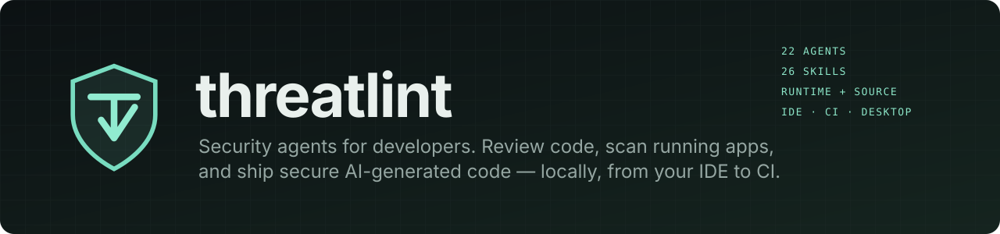
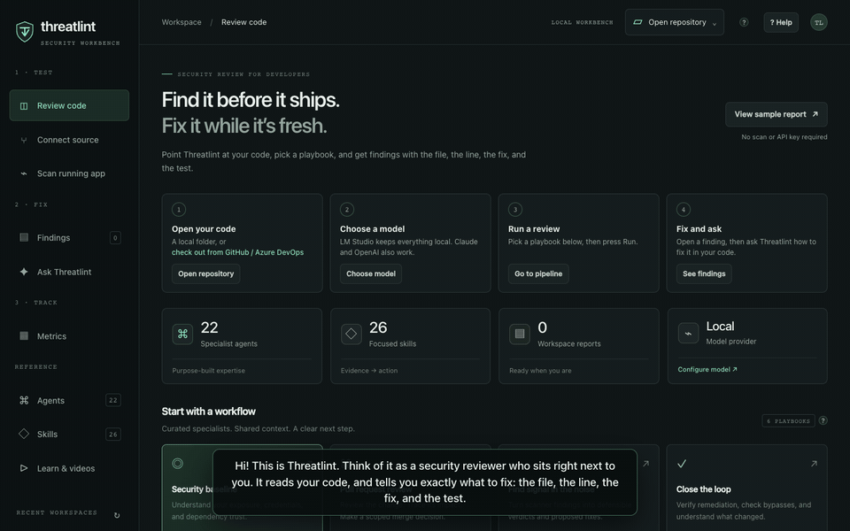

<p align="center">
  <picture>
    <source media="(prefers-color-scheme: dark)" srcset="docs/media/banner.svg">
    <source media="(prefers-color-scheme: light)" srcset="docs/media/banner-light.svg">
    
  </picture>
</p>

<p align="center">
  
  
  
  
</p>

# Threatlint

## Security should help you ship, not hand you another unread report

A scanner can give you hundreds of findings. Your next decision is smaller:
**Which one matters, why is it reachable, and what should we do about it?**

Threatlint brings evidence-led security reviewers into your editor, pull request,
terminal, and Workbench. It connects a finding to inspected code, explains the
attacker path, and proposes a fix and a regression assertion.

**Find. Explain. Act.** Less time translating security output into engineering work.
More time making the next change with a clear reason.

### What a useful answer looks like

An illustrative finding, not a result from your repository:

> **CR-001 · HIGH · `api/customers.py:42`**
>
> **Why it matters:** a request-controlled ID is concatenated into a SQL query.
>
> **Next action:** bind the ID as a query parameter.
>
> **Acceptance check:** submit a synthetic injection-shaped ID and assert that it
> cannot change query structure or return another customer's data. **NOT RUN.**

That is the handoff: a location, an explanation, a proposed change, and a way to
check it. Missing evidence stays an explicit unknown—not a confident-sounding guess.

## Try the workflow that fits your day

### Start in your editor

From this checkout, install the CLI and add instructions/hooks to your target repository:

```bash
python3 -m pip install -e .
cd /path/to/your-repository
threatlint ide install
threatlint guard . --fail-on medium
```

The offline guard reports known-insecure patterns with file/line locations and
secure alternatives. Review matches rather than treating them as automatic
vulnerabilities. Exit `1` means a finding met your threshold; a clean result is
not a security approval.

**Next:** [IDE setup and guard behavior](docs/ide.md).

### Prefer a visual review?

From this checkout:

```bash
npm --prefix web ci
npm --prefix web start
```

Open `http://127.0.0.1:3000`. View the bundled sample report before configuring a
model, or connect a provider and review a repository.
Claude supports your Claude Code login, an Anthropic API key, or an Amazon Bedrock API key.
Choose the method in Settings; see [credential setup](docs/setup.md#cloud-providers).

The desktop app uses the same Workbench:

```bash
npm --prefix web run desktop
```

**Next:** [your first Workbench review](docs/workbench.md).

### Already using an AI coding assistant?

Run one installer from your target repository:

```bash
threatlint install --local -y            # Claude Code
threatlint install --copilot --local -y  # Copilot agents and complete skills
```

Then choose a specialist or, in Claude Code, run `/security-review`.
For Codex, local models, cloud providers, and client-specific setup, use the
[setup guide](docs/setup.md).

## From a code question to a team decision

| Your question | Start here | The useful outcome |
| --- | --- | --- |
| "What can go wrong in this feature?" | Threat model | Assets, trust boundaries, attack paths, priorities |
| "Did this change weaken a control?" | Security code review | Source-backed findings and a merge recommendation |
| "Is this scanner result actionable?" | False-positive review | Disposition, missing evidence, proposed fixes, acceptance criteria |
| "Can one role see another role's data?" | Authorized runtime workflow | Identity-aware observations to correlate with source |
| "Was the root cause fixed?" | Fix verification | A remediation verdict, residual paths, and validation gaps |
| "Where should the portfolio focus?" | Sidekick | Loadouts, vReports, ownership, trends, and action history |

Pick a [specialist by outcome](docs/agents.md). The 22 agents receive shared
evidence/reporting workflows plus domain-specific skills—not just a role name.

## One workflow, several places to use it

- **While writing:** instructions for AI assistants, deterministic guard checks,
  and a VS Code extension.
- **Before merge:** Workbench playbooks, branch/diff review, and warn-first CI
  templates. Adopt blocking gates deliberately.
- **In the PR:** findings and `/threatlint` conversations where configured.
- **During triage:** ServiceNow AVITs, Semgrep, DefectDojo (findings management), SonarQube (scanning), and [community integrations](docs/integrations/README.md).
- **Across the team:** redacted report exports, dashboards, and a Teams bot for
  supplied evidence.

### See the experience

[](web/public/media/overview.mp4)

[Watch the narrated overview](web/public/media/overview.mp4) ·
[First review](web/public/media/first-review.mp4) ·
[Authenticated runtime workflow](web/public/media/runtime-scan.mp4)

The demonstrations use local fixtures and synthetic examples. More videos are
available in the Workbench under **Learn & videos**.
The existing voiceovers are synthetic; the [human narration workflow](docs/narration.md)
provides scripts and recording guidance for their replacement.

## Clear boundaries build trust

**Analysis agents propose; operational workflows can act.**

- Analysis is read-only with respect to repository source. Reports include
  inspected evidence, assumptions, and validation status.
- Proposed fixes and tests are not automatically applied or executed.
- Runtime work requires an authorized target and appropriate session state.
  SSO/MFA may require a manual handoff; do not bypass authentication.
- Resolution, closure, rule publishing, comments, issues, and optional auto-fix
  are separate write-capable workflows. Read their scope and controls before use.
- Cloud providers receive the source/evidence sent to them. Local-model options
  avoid a cloud model provider, but integrations may still contact their services.
- A model review, a clean guard result, and a compliance mapping are not security
  certification or proof of exploitability.

Use the [report guide](docs/reports.md) to turn findings into an accountable
engineering handoff without overstating what was verified.

## Go straight to the next task

| Task | Guide |
| --- | --- |
| Install for Claude, Copilot, Codex, or terminal use | [Setup](docs/setup.md) |
| Review code visually or inspect authorized runtime evidence | [Workbench](docs/workbench.md) |
| Choose one of the 22 specialists | [Agent guide](docs/agents.md) |
| See the architecture, data flows, and every agent and skill on one page | [Architecture](docs/architecture.md) |
| Add instructions, guard hooks, or the VS Code extension | [IDE guide](docs/ide.md) |
| Start warn-first reviews in GitHub or Azure Pipelines | [CI templates](docs/ci-templates.md) |
| Configure this repository's GitHub workflows | [GitHub Actions](docs/github-actions.md) |
| Connect a GitHub App | [GitHub authentication](docs/github-app.md) |
| Triage ServiceNow findings and resolve results | [AVIT integration](docs/avit-integration.md) |
| Manage queues and validate a handler with a canary | [AVIT orchestrator](docs/avit-orchestrator.md) |
| Bring portfolio data into a vReport | [Sidekick](docs/sidekick.md) |
| Review findings from a findings platform or scanning tool | [Integrations](docs/integrations/README.md): [DefectDojo](docs/integrations/defectdojo.md) (findings management) · [SonarQube](docs/integrations/sonarqube.md) (scanning) |
| Add your own integration | [Writing an integration](docs/integrations/authoring.md) |
| Read trends from reports and synced ServiceNow AVIT or DefectDojo findings | [Dashboards](docs/dashboards.md) |
| Export a report or fix missing Word output | [Reports](docs/reports.md) |
| Discuss supplied evidence in Teams | [Teams](docs/teams.md) |
| Test, extend, or understand the Python modules | [Development](docs/development.md) |

## Models

Use an explicit model when a task needs one. Otherwise, each provider follows its
configured defaults. Claude security-analysis and general-assistance policy,
environment overrides, and file settings are documented in
[model configuration](docs/setup.md#models).

## Start with one change

Choose a repository you know. Review one change or triage one finding. Ask for the
evidence, the next action, and the acceptance check. Judge the result on whether
it makes that engineering decision easier—not on how long the report is.

**Ready?** [Set up your preferred workflow](docs/setup.md), or
[open the Workbench guide](docs/workbench.md).

---

[MIT license](LICENSE) · [Contributing and source design](docs/development.md)
