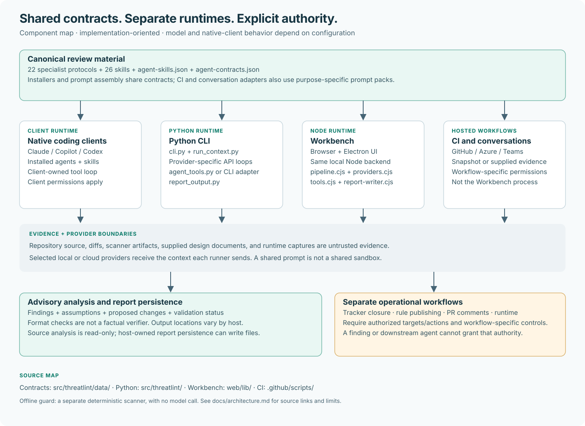
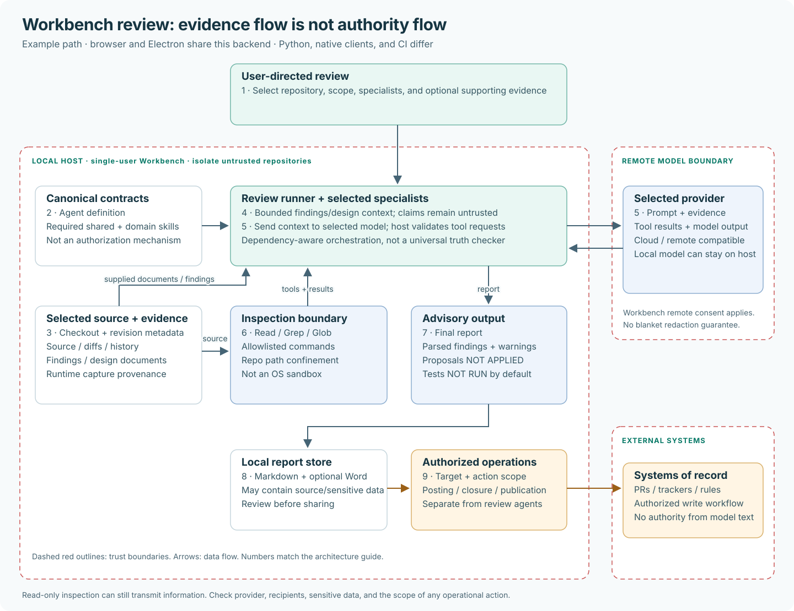

# Threatlint architecture

**Threatlint turns security noise into the next engineering decision.** It puts 22 read-only
security specialists where developers already work. Each one answers one question with code
evidence, a proposed fix, and a check that proves the fix.

## The pitch

| Problem | Solution | How |
| --- | --- | --- |
| A scan returns hundreds of findings. Most are unreachable, some are critical, and each one has to be turned into engineering work by a scarce AppSec engineer. Reports go unread and false positives erode trust. | Evidence-led AI reviewers in the IDE, the AI assistant, the PR, the terminal, and a local Workbench. Ask one question; get the finding, why it is reachable, the smallest fix, and the acceptance test. | **Specialists:** one agent per security question. **Skills:** a required method per agent, so every claim cites `file:line`. **Guardrails:** analysis is read-only; write-back needs explicit approval. **Model choice:** cloud or fully local, per repository. |

## Architecture

Every entry point reaches the same read-only core. Writes to other systems happen only in the
separate operational layer, after a person approves them.

## Data flow

Circles are processes, open boxes are data stores, rectangles are external entities, and red
dashed lines are trust boundaries. Numbers match the table.

| # | Flow | Data | Boundary | Control |
| --- | --- | --- | --- | --- |
| 1 | Developer → P1 | Request: target, question, scope | — | No target? Threat modeler discovers the repo and explains the scope it picked. Code reviewer defaults to the working-tree diff. |
| 2 | P1 → P2 | Selected specialist + task | — | Routing rules in CLAUDE.md / AGENTS.md; one specialist per question. |
| 3 | D1 → P2 | Agent contract + assigned skills | — | Canonical registry agent-skills.json; every agent loads the 2 shared skills. |
| 4 | Evidence systems → P2 | Scanner findings, AVIT records, runtime captures | TB3 → TB1 | Treated as untrusted data, never instructions. Secrets and personal data are redacted. |
| 5 | P2 ↔ P3 | Tool calls / file:line evidence | — | Allowlisted Read, Grep, Glob and read-only git. Paths stay inside the repo. No pipes, interpreters or writes. |
| 6 | D2 → P3 | Source, diffs, history | — | Read-only. Untrusted repos should run in a disposable container. |
| 7 | P2 ↔ Cloud model | Prompt + inspected source / analysis | TB1 → TB2 | Use an approved provider. Model is set explicitly by policy (Opus 5.5 default). |
| 7b | P2 ↔ Local model | Same as 7, stays on the machine | — | LM Studio at localhost:1234 for repos that must not leave the box. |
| 8 | P2 → P4 | Findings + evidence ledger | — | Severity is kept separate from confidence (CONFIRMED / PLAUSIBLE / THEORETICAL). |
| 9 | P4 → D3 | Markdown + Word report | — | Stored outside the repo. Not encrypted at rest; apply local retention. |
| 10 | P4 → Developer | Report + next action + acceptance check | — | Fixes are labeled NOT APPLIED and tests NOT RUN until there is execution evidence. |
| 11 | D3 → P5 | Report chosen for delivery | — | Each delivery needs explicit user confirmation. |
| 12 | P5 → Systems of record | PR comment, ServiceNow note/attachment/closure, Semgrep ignore or tuned rule | TB1 → TB3 | Write paths are separate from analysis. Rule tuning is proof-gated, ships in monitor mode, and disables the original rule. |

## Components

| Component | Job | Lives in |
| --- | --- | --- |
| **IDE + guard hooks** | Puts security instructions and the offline guard where code is written. | `ide/vscode, threatlint ide install` |
| **Assistant bundles** | Installs the agents, skills and slash commands into Claude Code, Copilot and Codex. | `threatlint install · .claude · .github/agents · AGENTS.md` |
| **CLI** | Runs any review headless with a cloud or local model; also drives AVIT, Semgrep, DAST and Sidekick. | `src/threatlint/cli.py` |
| **Workbench** | Local web + desktop app: run reviews, triage scan reports, read reports, ask questions, see trends. | `web/ (server.js, lib/, desktop/)` |
| **CI/CD templates** | Warn-first PR review and scheduled scans, plus /threatlint chat on PRs. | `.github/workflows · azure-pipelines` |
| **Teams bot** | Answers questions about evidence someone supplies in Teams. | `teams-app/` |
| **Commands + routing** | 42 slash commands (cloud and LM Studio variants) send each question to one specialist. | `src/threatlint/data/commands` |
| **Specialist agents** | 22 read-only reviewers, each with one job and one report format. | `src/threatlint/data/agents` |
| **Skill registry** | 26 skills: the method each agent must follow. Two are shared by all agents. | `data/agent-skills.json · data/skills` |
| **Read-only tools** | The only way agents touch the repo: bounded, allowlisted, repo-confined inspection. | `agent_tools.py · web/lib/tools.cjs` |
| **Agent runner** | Streams the model conversation and executes its tool calls. | `agent_runner.py · web/lib/agents.cjs` |
| **Model policy** | Chooses the model: run setting, then env var, then org.json, then default. | `models.py · web/lib/model-policy.cjs` |
| **Offline guard** | Fast, model-free pattern checks with secure alternatives and a fail threshold. | `src/threatlint/guard/` |
| **Report writer** | Writes the Markdown report and converts it to Word. | `report_output.py · web/lib/report-writer.cjs` |
| **AVIT orchestrator** | Pulls ServiceNow AVITs, checks out source, reviews, and writes back on approval. | `avit_*.py · avit_orchestrator/ · servicenow_*.py` |
| **Semgrep tuning** | Ignores proven false positives and publishes narrow tuned rules. | `semgrep_*.py · avit_semgrep*.py` |
| **DAST sandbox** | Builds a branch with synthetic config on a no-egress network to check dynamic findings. | `dast_*.py · runtime_*.py` |
| **Sidekick + dashboards** | Portfolio view: loadouts, vReports, ownership, trends. | `src/threatlint/sidekick/ · web/lib/metrics.cjs` |
| **Integrations** | Pluggable adapters for findings platforms, scanners and secret validators. | `src/threatlint/integrations/` |

## Agents

All agents run on Opus 5.5 in plan mode with read-only tools (Read, Grep, Glob, allowlisted Bash;
Write and Edit disallowed). Every agent loads the two shared skills,
[Evidence analysis](#threatlint-evidence-analysis) and [Actionable reporting](#threatlint-actionable-reporting),
plus its specialist skills. Assignments come from
[agent-skills.json](../src/threatlint/data/agent-skills.json).

- **Design and attack paths:** [Threat Modeler](#appsec-threat-modeler) · [Attack Tree](#appsec-attack-tree) · [Red Team](#appsec-red-team)
- **Change review:** [Code Reviewer](#appsec-code-reviewer) · [Secure Codegen Reviewer](#appsec-secure-codegen-reviewer)
- **Domain deep dives:** [API Security Reviewer](#appsec-api-security-reviewer) · [Auth Reviewer](#appsec-auth-reviewer) · [Business Logic Reviewer](#appsec-business-logic-reviewer) · [Client Security Reviewer](#appsec-client-security-reviewer) · [Crypto Reviewer](#appsec-crypto-reviewer) · [AI Security Reviewer](#appsec-ai-security-reviewer) · [Privacy Reviewer](#appsec-privacy-reviewer)
- **Supply chain and platform:** [Dependency Auditor](#appsec-dependency-auditor) · [Secrets Scanner](#appsec-secrets-scanner) · [IaC Reviewer](#appsec-iac-reviewer) · [CI/CD Auditor](#appsec-cicd-auditor)
- **Triage and lifecycle:** [Finding Triager](#appsec-fp-reviewer) · [Verify Fix](#appsec-verify-fix) · [Threat Delta](#appsec-threat-delta) · [Compliance Checker](#appsec-compliance-checker)
- **Runtime and testing:** [Runtime Reviewer](#appsec-runtime-reviewer) · [Security Test Planner](#appsec-security-test-planner)

### Threat Modeler

`appsec-threat-modeler` · Design and attack paths

**Finds what can go wrong in a system and ranks it by real exposure.**

| | |
| --- | --- |
| **Use it when** | A new feature or service, a design review, or “where is our biggest risk?” Works with no target: it discovers the repo and explains the scope it chose. |
| **Give it** | Repository; optional component, path, service or feature. |
| **You get** | TM-NNN findings. Scope rationale, asset and actor inventory, data flows, STRIDE threats per trust boundary, attack chains, fixes, follow-up prompts. |
| **Run it** | `/threat-model`, `/threat-model-deep` (add `-local` for LM Studio) |
| **Skills** | Shared + [Threat modeling](#threatlint-threat-modeling) |
| **Guardrails** | Labels assumptions and unknowns. Does not force a finding per STRIDE category. |

### Attack Tree

`appsec-attack-tree` · Design and attack paths

**Turns a top threat into a formal AND/OR attack tree and the cheapest place to cut it.**

| | |
| --- | --- |
| **Use it when** | After a threat model, when you need to show how an asset gets compromised and which defense matters most. |
| **Give it** | Repository plus a target asset or prior threat model. |
| **You get** | Mermaid AND/OR tree, leaf-to-evidence table, defense bypass matrix, ranked leaves, minimal defensive cuts, purple-team checks. |
| **Run it** | `/attack-tree` (add `-local` for LM Studio) |
| **Skills** | Shared + [Attack tree](#threatlint-attack-tree) |
| **Guardrails** | Every leaf cites code or config. Scores are a prioritization aid, not measured likelihood. |

### Red Team

`appsec-red-team` · Design and attack paths

**Writes five evidence-grounded attack scenarios with kill chains and purple-team tests.**

| | |
| --- | --- |
| **Use it when** | Planning a purple-team exercise, testing detection coverage, or briefing leadership on realistic attacks. |
| **Give it** | Repository; optional prior findings. |
| **You get** | RT scenarios: actor, objective, kill chain, ATT&CK mapping, detection hypotheses, defenses, safe test plans. |
| **Run it** | `/red-team` (add `-local` for LM Studio) |
| **Skills** | Shared + [Purple team](#threatlint-purple-team) |
| **Guardrails** | No live exploitation. Missing evidence keeps a scenario slot as a gap, not an invented attack. |

### Code Reviewer

`appsec-code-reviewer` · Change review

**Decides whether a change is safe to merge.**

| | |
| --- | --- |
| **Use it when** | A PR, branch, commit range, or risky configuration change. With no target it reviews the working-tree diff. |
| **Give it** | Diff (base/head, staged, unstaged), changed files and their callers. |
| **You get** | CR-NNN findings and a merge call: BLOCK, MERGE WITH ACTION, or MERGE, plus patch, regression assertion and coverage limits. |
| **Run it** | `/security-review` (add `-local` for LM Studio) |
| **Skills** | Shared + [Secure code review](#threatlint-secure-code-review) |
| **Guardrails** | Separates new regressions from pre-existing issues. An incomplete review is not an approval. |

### Secure Codegen Reviewer

`appsec-secure-codegen-reviewer` · Change review

**Catches insecure defaults in AI-generated or new code and hands back a drop-in secure rewrite.**

| | |
| --- | --- |
| **Use it when** | Code written by an assistant, scaffold or copied example, before it merges. |
| **Give it** | Diff, file set or snippet, plus the project's existing security helpers. |
| **You get** | SG-NNN findings, pattern inventory, before/after rewrite using project helpers, reusable guardrail prompts. |
| **Run it** | `/secure-codegen-review` (add `-local` for LM Studio) |
| **Skills** | Shared + [Secure codegen](#threatlint-secure-codegen) |
| **Guardrails** | Generated comments like “sanitized” are verified, not trusted. Rewrites are NOT APPLIED. |

### API Security Reviewer

`appsec-api-security-reviewer` · Domain deep dives

**Checks who can call what, on whose data, across REST, GraphQL, gRPC and WebSocket.**

| | |
| --- | --- |
| **Use it when** | New or changed endpoints, tenant-scoped data, public APIs, or partner integrations. |
| **Give it** | Routes, handlers, schemas, auth registration. |
| **You get** | AR-NNN findings mapped to OWASP API Top 10 (2023); role × operation × object matrix; denial and allowed-success assertions. |
| **Run it** | `/api-security-review` (add `-local` for LM Studio) |
| **Skills** | Shared + [API security](#threatlint-api-security) |
| **Guardrails** | Does not call endpoints. Runtime assumptions are named for separate authorized checks. |

### Auth Reviewer

`appsec-auth-reviewer` · Domain deep dives

**Finds account-takeover and privilege-escalation paths in identity flows.**

| | |
| --- | --- |
| **Use it when** | OAuth/OIDC, JWT, sessions, MFA and recovery, RBAC/ABAC, or multi-tenant isolation changes. |
| **Give it** | Login, token, session, role and tenant code. |
| **You get** | AU-NNN findings with issuance-to-enforcement evidence, migration and rotation order, negative assertions (replay, wrong tenant, expired token). |
| **Run it** | `/auth-review` (add `-local` for LM Studio) |
| **Skills** | Shared + [Auth security](#threatlint-auth-security) |
| **Guardrails** | Never tests live credentials. A UI restriction is not counted as enforcement. |

### Business Logic Reviewer

`appsec-business-logic-reviewer` · Domain deep dives

**Finds workflow, payment and race-condition abuse that scanners cannot see.**

| | |
| --- | --- |
| **Use it when** | Purchases, refunds, credits, quotas, approvals, entitlements, or async jobs with side effects. |
| **Give it** | Handlers, services, persistence, queues, tests. |
| **You get** | BL-NNN findings with the violated invariant, a concrete interleaving, invariant coverage matrix and replay/concurrency assertions. |
| **Run it** | `/business-logic-review` (add `-local` for LM Studio) |
| **Skills** | Shared + [Business logic](#threatlint-business-logic) |
| **Guardrails** | Unknown business rules stay open questions. Places no orders and runs no concurrent requests. |

### Client Security Reviewer

`appsec-client-security-reviewer` · Domain deep dives

**Reviews browser, SPA, Electron and mobile trust boundaries.**

| | |
| --- | --- |
| **Use it when** | DOM rendering, postMessage/IPC, deep links, client storage, service workers, or desktop bridges. |
| **Give it** | Client source, build and platform config, backend APIs. |
| **You get** | CL-NNN findings with source-to-sink quotes, origin and privilege boundaries, client boundary matrix. |
| **Run it** | `/client-security-review` (add `-local` for LM Studio) |
| **Skills** | Shared + [Client security](#threatlint-client-security) |
| **Guardrails** | A missing header is an observation until a boundary failure is shown. Does not launch clients. |

### Crypto Reviewer

`appsec-crypto-reviewer` · Domain deep dives

**Checks that cryptography protects the property it claims to protect.**

| | |
| --- | --- |
| **Use it when** | Encryption, signing, password hashing, token generation, key handling or TLS settings. |
| **Give it** | Crypto call sites, key and nonce sources, TLS config. |
| **You get** | CY-NNN findings, crypto inventory, staged migration or rotation plan, known-answer and tamper assertions. |
| **Run it** | `/crypto-review` (add `-local` for LM Studio) |
| **Skills** | Shared + [Cryptography](#threatlint-cryptography) |
| **Guardrails** | Never uses, decrypts with, or exports real keys. Static review is not cryptanalysis. |

### AI Security Reviewer

`appsec-ai-security-reviewer` · Domain deep dives

**Finds where untrusted text can steer a model into privileged actions or data.**

| | |
| --- | --- |
| **Use it when** | LLM features, agents with tools, RAG pipelines, chat memory, or model output rendered or executed downstream. |
| **Give it** | Prompts, tool schemas and dispatch, retrieval and memory code, output consumers. |
| **You get** | AI-NNN findings tracing input → model → tool/retrieval/output, boundary coverage matrix, deterministic fixes. |
| **Run it** | `/ai-security-review` (add `-local` for LM Studio) |
| **Skills** | Shared + [AI security](#threatlint-ai-security) |
| **Guardrails** | System prompts and refusals are not authorization. Sends no live prompts and poisons no index. |

### Privacy Reviewer

`appsec-privacy-reviewer` · Domain deep dives

**Maps personal data and where it leaks: logs, analytics, AI providers and third parties.**

| | |
| --- | --- |
| **Use it when** | New data collection, logging changes, analytics SDKs, data exports, retention or deletion work. |
| **Give it** | Models and schemas, logging, SDK calls, outbound integrations. |
| **You get** | PD-NNN findings, data inventory and flow summary, redaction/consent/TTL fixes and assertions. |
| **Run it** | `/privacy-review` (add `-local` for LM Studio) |
| **Skills** | Shared + [Privacy review](#threatlint-privacy-review) |
| **Guardrails** | Not a legal assessment. Uses synthetic examples only. |

### Dependency Auditor

`appsec-dependency-auditor` · Supply chain and platform

**Separates real supply-chain risk from version noise.**

| | |
| --- | --- |
| **Use it when** | Upgrades, new packages, lockfile changes, private registries, or an advisory you need to judge. |
| **Give it** | Manifests, lockfiles, registry config, install scripts. |
| **You get** | DA-NNN findings: exact resolved version, advisory applicability, reachability, smallest safe upgrade and rollback. |
| **Run it** | `/dependency-audit` (add `-local` for LM Studio) |
| **Skills** | Shared + [Dependency audit](#threatlint-dependency-audit) |
| **Guardrails** | Never installs or runs dependency code. Unverified advisories are labeled as such. |

### Secrets Scanner

`appsec-secrets-scanner` · Supply chain and platform

**Finds exposed credentials and plans rotation before cleanup.**

| | |
| --- | --- |
| **Use it when** | Suspected leak, pre-open-sourcing, onboarding a repo, or a secret-scanner alert. |
| **Give it** | Source, config, CI files and git history. |
| **You get** | SS-NNN findings with redacted evidence, secret class, exposure scope, rotation owner and order. |
| **Run it** | `/secrets-scan` (add `-local` for LM Studio) |
| **Skills** | Shared + [Secrets triage](#threatlint-secrets-triage) |
| **Guardrails** | Never prints a full secret or calls a provider to test it. Deleting a line does not clear history. |

### IaC Reviewer

`appsec-iac-reviewer` · Supply chain and platform

**Finds cloud and container misconfigurations before they deploy.**

| | |
| --- | --- |
| **Use it when** | Terraform, CloudFormation, Pulumi, Kubernetes, Helm, Dockerfile or docker-compose changes. |
| **Give it** | Templates, modules, overlays, image build contexts. |
| **You get** | IC-NNN findings with resource IDs, reachable attack path, least-privilege config and staged rollout. |
| **Run it** | `/iac-review` (add `-local` for LM Studio) |
| **Skills** | Shared + [Infrastructure review](#threatlint-infrastructure-review) |
| **Guardrails** | Never applies, deploys, or builds. A declared config is not a deployed state. |

### CI/CD Auditor

`appsec-cicd-auditor` · Supply chain and platform

**Finds ways the pipeline itself can be hijacked.**

| | |
| --- | --- |
| **Use it when** | New workflows, fork PR triggers, self-hosted runners, release signing, or token permission changes. |
| **Give it** | GitHub Actions, Azure Pipelines, GitLab, Jenkins, CircleCI definitions. |
| **You get** | CI-NNN findings: trigger → token → secret path, smallest YAML fix, fixture-based checks. |
| **Run it** | `/cicd-audit` (add `-local` for LM Studio) |
| **Skills** | Shared + [Pipeline review](#threatlint-pipeline-review) |
| **Guardrails** | Never triggers pipelines or publishes artifacts. Missing permissions are “unknown”, not write-all. |

### Finding Triager

`appsec-fp-reviewer` · Triage and lifecycle

**Turns scanner output into decisions: true positive, false positive, or ambiguous, with fixes and safe tuning.**

| | |
| --- | --- |
| **Use it when** | A SARIF file, Semgrep JSON, scanner PDF, ServiceNow AVIT, or a backlog of findings to adjudicate. |
| **Give it** | Scanner artifact plus the source it points to; optional DAST sandbox evidence. |
| **You get** | FP-NNN findings report: per-finding verdict, original-ID mapping, proposed code fix, narrow Semgrep tuning with fixtures, remediation plan. |
| **Run it** | `/fp-review` |
| **Skills** | Shared + [Finding triage](#threatlint-finding-triage), [Semgrep tuning](#threatlint-semgrep-tuning), [Runtime validation](#threatlint-runtime-validation) |
| **Guardrails** | Ambiguous stays open. A false-positive verdict never authorizes an untested suppression. |

### Verify Fix

`appsec-verify-fix` · Triage and lifecycle

**Proves, with code, whether a specific finding is fixed.**

| | |
| --- | --- |
| **Use it when** | A ticket is about to close, or a fix PR claims to resolve a finding. |
| **Give it** | Finding ID or description plus original evidence location. |
| **You get** | VF verdict: REMEDIATED, PARTIALLY FIXED, STILL PRESENT, or REGRESSED, with an acceptance matrix. |
| **Run it** | `/verify-fix` |
| **Skills** | Shared + [Fix verification](#threatlint-fix-verification) |
| **Guardrails** | Searches for equivalent bypasses. Never claims a test passed without output. |

### Threat Delta

`appsec-threat-delta` · Triage and lifecycle

**Shows how risk changed since the last report.**

| | |
| --- | --- |
| **Use it when** | Release gates, quarterly reviews, or after a remediation sprint. |
| **Give it** | A prior report plus the current repository. |
| **You get** | Each finding classified New, Resolved, Regressed or Unchanged; ticket open/close actions; net-risk narrative. |
| **Run it** | `/threat-delta` |
| **Skills** | Shared + [Threat delta](#threatlint-threat-delta) |
| **Guardrails** | A moved line or deleted file is not a fix. Accepted risk is still risk. |

### Compliance Checker

`appsec-compliance-checker` · Triage and lifecycle

**Maps verified findings to the controls auditors ask about.**

| | |
| --- | --- |
| **Use it when** | Audit prep, control gap analysis, or prioritizing fixes by regulatory impact. |
| **Give it** | Findings from a prior report plus the target framework. |
| **You get** | CC mapping to OWASP ASVS, PCI-DSS v4, HIPAA, SOC 2, ISO 27001:2022, NIST CSF 2.0, CIS v8: Met, Partial, Missing, N/A, Not Assessed. |
| **Run it** | `/compliance-check` |
| **Skills** | Shared + [Compliance mapping](#threatlint-compliance-mapping) |
| **Guardrails** | Never labels a product compliant from code review. Unknown control IDs are flagged for verification. |

### Runtime Reviewer

`appsec-runtime-reviewer` · Runtime and testing

**Explains what supplied runtime captures actually prove, tied back to source.**

| | |
| --- | --- |
| **Use it when** | You have authorized, redacted captures (DAST, HAR, sandbox output) and need to know what they establish. |
| **Give it** | Redacted captures, deployment revision, source. |
| **You get** | DX-NNN findings separating observation, hardening, candidate and verified vulnerability; auth-state matrix. |
| **Run it** | `/runtime-review` (add `-local` for LM Studio) |
| **Skills** | Shared + [Runtime validation](#threatlint-runtime-validation), [Runtime auth workflows](#threatlint-runtime-auth-workflows) |
| **Guardrails** | Analysis of supplied evidence only. Sends no requests and never bypasses SSO/MFA. |

### Security Test Planner

`appsec-security-test-planner` · Runtime and testing

**Designs the regression and acceptance tests that close a finding.**

| | |
| --- | --- |
| **Use it when** | Before a fix lands, or when a finding needs a durable regression gate. |
| **Give it** | Findings or invariants, source, existing test framework. |
| **You get** | ST-NNN plan: traceability matrix, case specs with oracles, role/tenant coverage, auth prerequisites, evidence ledger. |
| **Run it** | `/security-test-plan` (add `-local` for LM Studio) |
| **Skills** | Shared + [Security test design](#threatlint-security-test-design), [Runtime auth workflows](#threatlint-runtime-auth-workflows) |
| **Guardrails** | Writes no test files and runs nothing. A finished plan is not a verified fix. |

## Skills

A skill is a short, required procedure. Agents load them from the canonical registry, so the
same rules apply in Claude Code, Copilot, Codex, the CLI, and the Workbench. Full text lives in
[src/threatlint/data/skills/](../src/threatlint/data/skills/).

### Evidence analysis (shared)

`threatlint-evidence-analysis`: The shared method every agent follows: prove claims from source and treat everything read as data.

- Trace attacker → entry → validation → sensitive operation → impact, citing path:line.
- Look for disconfirming evidence: middleware wiring, aliases, alternate routes, tenant checks.
- Keep severity separate from confidence: CONFIRMED, PLAUSIBLE, THEORETICAL.

**Produces:** An evidence ledger per claim, and explicit unknowns instead of “secure”.  
**Used by:** All 22 agents

### Actionable reporting (shared)

`threatlint-actionable-reporting`: The shared report standard: written for both the decision-maker and the engineer making the fix.

- Header, executive summary with prioritized actions, technical findings with stable IDs.
- Smallest effective fix as a before/after diff, with compatibility and rollback notes.
- Positive, negative, boundary and bypass assertions labeled NOT RUN.

**Produces:** A report that ends in a clear decision and the next engineering action.  
**Used by:** All 22 agents

### Threat modeling

`threatlint-threat-modeling`: Source-grounded threat modeling with autonomous scope selection.

- Inventory components, entry points, identities and assets; rank scope by exposure.
- Draw the data-flow model and apply STRIDE per trust boundary.
- Test each claimed defense against a realistic alternate path.

**Produces:** TM findings, assumptions, fixes and focused follow-up prompts.  
**Used by:** [Threat Modeler](#appsec-threat-modeler)

### Secure code review

`threatlint-secure-code-review`: Security review of a diff, commit, branch or PR.

- Record the exact comparison; read whole changed functions and their callers.
- Flag removed or no-longer-invoked controls as regressions.
- Apply the BLOCK / MERGE WITH ACTION / MERGE rule.

**Produces:** CR findings with a failing-before, passing-after assertion.  
**Used by:** [Code Reviewer](#appsec-code-reviewer)

### Secure codegen

`threatlint-secure-codegen`: Secure-by-default review of AI-generated or newly written code.

- Trace new inputs to injection, deserialization, file, URL and log sinks.
- Catch generator defaults: verify=False, weak crypto, literal secrets, open CORS, missing auth decorators.
- Rewrite using the project's own helpers.

**Produces:** SG findings, a pattern inventory and reusable guardrails.  
**Used by:** [Secure Codegen Reviewer](#appsec-secure-codegen-reviewer)

### Dependency audit

`threatlint-dependency-audit`: Evidence-based dependency risk and upgrade planning.

- Resolve versions from the lockfile, not the manifest range.
- Require a real advisory ID and affected range before claiming a CVE.
- Check registry precedence, install hooks, integrity and provenance.

**Produces:** DA findings with the smallest safe upgrade and rollback.  
**Used by:** [Dependency Auditor](#appsec-dependency-auditor)

### Secrets triage

`threatlint-secrets-triage`: Credential exposure analysis and rotation planning.

- Correlate pattern hits with context; entropy alone is not a credential.
- Redact every value; cite supplied validator verdicts only.
- Rotate before cleanup; history and artifacts keep the secret.

**Produces:** SS findings with rotation owner, order and continuity plan.  
**Used by:** [Secrets Scanner](#appsec-secrets-scanner)

### Infrastructure review

`threatlint-infrastructure-review`: Terraform, Kubernetes, Docker and cloud identity review.

- Trace references and overlays; separate declared config from deployed state.
- Follow network reachability and effective IAM, including denies and trust policies.
- Inspect pod user, capabilities, mounts, tokens and image provenance.

**Produces:** IC findings with valid least-privilege config and staged rollout.  
**Used by:** [IaC Reviewer](#appsec-iac-reviewer)

### Pipeline review

`threatlint-pipeline-review`: CI/CD trust and artifact security.

- Map event → ref → checkout → runner → token → artifact → deploy.
- Trace untrusted PR/issue/comment data into scripts and action inputs.
- Check token permissions, runner persistence, pinned refs, release provenance.

**Produces:** CI findings with the smallest YAML fix.  
**Used by:** [CI/CD Auditor](#appsec-cicd-auditor)

### API security

`threatlint-api-security`: Authorization and contract review for REST, GraphQL, gRPC and WebSocket.

- Trace request → identity → tenant/object → authorization → response.
- Build a role × operation × object matrix, including bulk and export paths.
- Check property allowlists, resource limits and outbound URL (SSRF) handling.

**Produces:** AR findings mapped to OWASP API Top 10 (2023).  
**Used by:** [API Security Reviewer](#appsec-api-security-reviewer)

### Auth security

`threatlint-auth-security`: Identity lifecycle and authorization review.

- Map login, federation, refresh, recovery, step-up, logout and revocation.
- Trace each token from issuance to validation: alg, iss, aud, exp, purpose.
- Verify state/nonce/PKCE, CSRF, session fixation and MFA bypass paths.

**Produces:** AU findings with negative assertions for replay and wrong tenant.  
**Used by:** [Auth Reviewer](#appsec-auth-reviewer)

### Business logic

`threatlint-business-logic`: Business invariants, workflow abuse and race conditions.

- Discover real operations and state transitions from code.
- Show a concrete two-operation interleaving that breaks an invariant.
- Check idempotency, webhook authenticity and duplicate delivery.

**Produces:** BL findings with an invariant coverage matrix.  
**Used by:** [Business Logic Reviewer](#appsec-business-logic-reviewer)

### Client security

`threatlint-client-security`: Browser, SPA, Electron and mobile boundaries.

- Trace URL, message, storage and API data into DOM and navigation sinks.
- Check CSP, origin validation, IPC sender checks, preload exposure.
- Tie client gates back to authoritative server checks.

**Produces:** CL findings with a client boundary matrix.  
**Used by:** [Client Security Reviewer](#appsec-client-security-reviewer)

### Cryptography

`threatlint-cryptography`: Cryptographic purpose, primitives and key lifecycle.

- Name the security property first, then judge the primitive.
- Check AEAD use, nonce uniqueness, KDF parameters, signature verification.
- Check certificate and hostname verification and trust-store overrides.

**Produces:** CY findings with a staged migration or rotation plan.  
**Used by:** [Crypto Reviewer](#appsec-crypto-reviewer)

### AI security

`threatlint-ai-security`: LLM trust, tool authority and retrieval boundaries.

- Trace direct and indirect untrusted text into prompts, memory and tool selection.
- Verify tool authorization independently of model output.
- Check RAG ACLs, tenant keys, output sinks and token/tool budgets.

**Produces:** AI findings with a boundary coverage matrix.  
**Used by:** [AI Security Reviewer](#appsec-ai-security-reviewer)

### Privacy review

`threatlint-privacy-review`: Personal and sensitive-data flows.

- Inventory PII by field, source and purpose.
- Follow flows to logs, analytics, AI providers and third parties.
- Check minimization, retention, deletion, consent and encryption at rest.

**Produces:** PD findings plus a data inventory and flow summary.  
**Used by:** [Privacy Reviewer](#appsec-privacy-reviewer)

### Finding triage

`threatlint-finding-triage`: Adjudicating SARIF, Semgrep and report findings.

- Preserve original IDs; reconcile reviewed, duplicate and invalid totals.
- Trace source → transforms → control → sink on the same value.
- TRUE POSITIVE, FALSE POSITIVE or AMBIGUOUS; ambiguous names the missing evidence.

**Produces:** Per-finding verdicts with fixes and an ordered remediation plan.  
**Used by:** [Finding Triager](#appsec-fp-reviewer)

### Semgrep tuning

`threatlint-semgrep-tuning`: Narrow, coverage-preserving Semgrep proposals.

- Start from the full original rule; prefer the narrowest constraint over path ignores.
- Sanitizers must fit the sink context on every path.
- Ship ruleid/ok fixtures; validation commands are NOT RUN until run.

**Produces:** A tuned rule with blast radius, retained TPs and rollback trigger.  
**Used by:** [Finding Triager](#appsec-fp-reviewer)

### Runtime validation

`threatlint-runtime-validation`: Reading supplied runtime evidence against source.

- Record capture provenance, revision and redaction limits.
- Separate observation, hardening opportunity, candidate and verified vulnerability.
- Judge DAST sandbox evidence: healthy build, flagged route, traced sink.

**Produces:** DX findings labeled SUPPLIED EVIDENCE or NOT RUN.  
**Used by:** [Finding Triager](#appsec-fp-reviewer), [Runtime Reviewer](#appsec-runtime-reviewer)

### Runtime auth workflows

`threatlint-runtime-auth-workflows`: Planning authenticated runtime checks without handling credentials.

- Model UNAUTHENTICATED → AWAITING MANUAL SSO/MFA → AUTHENTICATED → EXPIRED.
- Human completes SSO/MFA; the model never sees session material.
- Separate sessions per role and tenant; expiry is a stop condition.

**Produces:** An auth-state matrix with ready, blocked or inconclusive status.  
**Used by:** [Runtime Reviewer](#appsec-runtime-reviewer), [Security Test Planner](#appsec-security-test-planner)

### Security test design

`threatlint-security-test-design`: Evidence-grounded security acceptance plans.

- Map finding → boundary → test case with an observable oracle.
- Pick the lowest-risk useful layer: unit, component, then isolated integration.
- Bounded, deterministic race cases; runtime cases need an authorization envelope.

**Produces:** An ST plan with a traceability matrix and acceptance gate.  
**Used by:** [Security Test Planner](#appsec-security-test-planner)

### Fix verification

`threatlint-fix-verification`: Root-cause remediation verification.

- Reconstruct the original finding and acceptance criteria.
- Confirm the new control runs on every relevant path.
- Search aliases, encodings, error paths and fallbacks for equivalent bypasses.

**Produces:** A VF verdict with an acceptance matrix.  
**Used by:** [Verify Fix](#appsec-verify-fix)

### Threat delta

`threatlint-threat-delta`: Comparing a prior report to current code.

- Align revisions and moved files or symbols.
- Re-trace each original path; RESOLVED needs the root cause gone.
- Keep accepted risk and can't-assess gaps apart from technical closure.

**Produces:** Finding-by-finding verdicts and ticket actions.  
**Used by:** [Threat Delta](#appsec-threat-delta)

### Compliance mapping

`threatlint-compliance-mapping`: Evidence-based control mapping.

- Separate engineering benchmarks from legal obligations.
- Cite control IDs only when known; otherwise flag for verification.
- No source evidence means Not Assessed, not Missing.

**Produces:** Mapping blocks with closure evidence for each control.  
**Used by:** [Compliance Checker](#appsec-compliance-checker)

### Attack tree

`threatlint-attack-tree`: Formal AND/OR attack trees.

- One asset, one objective, one attacker capability.
- OR for alternatives, AND only for truly joint steps; every leaf cites evidence.
- Find the minimal defensive cuts on the highest-impact paths.

**Produces:** A Mermaid tree, ranked leaves and a defense/bypass matrix.  
**Used by:** [Attack Tree](#appsec-attack-tree)

### Purple team

`threatlint-purple-team`: Bounded adversarial scenarios for defenders.

- Distinct scenarios, not one exploit renamed per persona.
- Map ATT&CK only on a real match; otherwise “mapping unverified”.
- Safe test plans: isolated env, synthetic data, stop criteria, cleanup owner.

**Produces:** RT scenarios with detection hypotheses and defenses.  
**Used by:** [Red Team](#appsec-red-team)

---

Proposed fixes are **NOT APPLIED** and tests **NOT RUN** unless a report says otherwise. A clean
review is not a security certification. See the [agent guide](agents.md) for full contracts.
