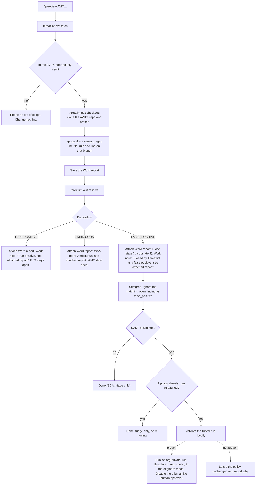
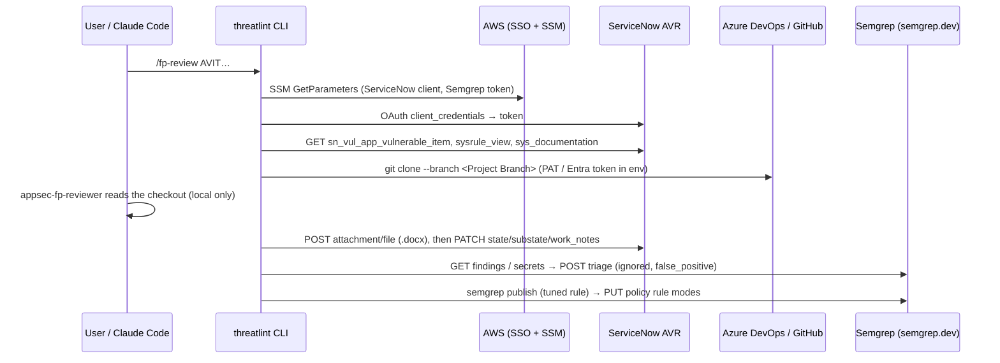

# AVIT triage integration: process and data flows

This document describes how Threatlint triages a ServiceNow AVR **Application Vulnerable Item (AVIT)**
from start to finish: setup, fetching, checkout, review, writing the result back to ServiceNow, and
Semgrep tuning. It covers every component, credential and data flow involved. The same flow runs from
`/fp-review AVIT000000000000000` in Claude Code and from the `threatlint avit …` commands. The
Workbench runs its own path, described at the end.

## Components

| Component | Role | Where it runs |
| --- | --- | --- |
| `threatlint` CLI (`src/threatlint`) | Setup, fetch, checkout, resolve, Semgrep tuning | User's machine (macOS, Windows, Linux) |
| `/fp-review` command + `appsec-fp-reviewer` agent | Orchestrates the flow and triages the finding (analysis only) | Claude Code |
| Threatlint Workbench (`web/`) | UI for triage, settings, closing false positives | Desktop app or local browser server (loopback only) |
| AWS IAM Identity Center + SSM Parameter Store (us-west-2) | Holds the ServiceNow OAuth client and the Semgrep token | AWS |
| ServiceNow AVR (`sn_vul_app_vulnerable_item`) | Source of AVITs; receives the report, work note and state change | `https://<instance>.service-now.com` |
| Azure DevOps / GitHub | Source code for the AVIT's repository and branch | `dev.azure.com`, `github.com` |
| Semgrep AppSec Platform | Finding triage and rule policies | `https://semgrep.dev` (same API as `semgrep.app`) |
| Semgrep CE + Pro engine | Local rule validation and tests | User's machine |

## One-time setup

```bash
threatlint setup          # interactive; each step is skipped when already configured
threatlint setup --check  # which required credentials are missing (never prints a value)
```

**Organization settings.** Threatlint ships with no organization-specific defaults. Set these once, as
environment variables or in `~/.threatlint/org.json` (owner-only; the variable wins when both are set):

| `org.json` key | Environment variable | Used for |
| --- | --- | --- |
| `ssoUrl` | `THREATLINT_AWS_SSO_PORTAL_URL` | the SSO link shown in access help and the Workbench |
| `snowClientIdParameter`, `snowClientSecretParameter` | `THREATLINT_SNOW_CLIENT_ID_PARAMETER`, `THREATLINT_SNOW_CLIENT_SECRET_PARAMETER` | Parameter Store names of the ServiceNow OAuth client |
| `semgrepTokenParameter` | `THREATLINT_SEMGREP_TOKEN_PARAMETER` | Parameter Store name of the Semgrep token |
| `semgrepDeployment` | `THREATLINT_SEMGREP_DEPLOYMENT` | Semgrep deployment ID or slug (default: the token's only deployment) |

```json
{"ssoUrl": "<your-aws-sso-url>",
 "snowClientIdParameter": "/<your-prefix>/servicenow/client-id",
 "snowClientSecretParameter": "/<your-prefix>/servicenow/client-secret",
 "semgrepTokenParameter": "/<your-prefix>/semgrep-token",
 "semgrepDeployment": "<deployment-id>"}
```

When a Parameter Store name is unset, that credential is not read from Parameter Store. Enter it with
`threatlint setup`, its login command, or the Workbench settings instead.

**Prerequisite login commands.** Run these once, in your own terminal; never paste a secret into a chat.

| Prerequisite | Command | Verify |
| --- | --- | --- |
| Semgrep CE and the Pro engine | `python3 -m pip install semgrep` (or `brew install semgrep`), `semgrep login`, `semgrep install-semgrep-pro` | `semgrep --version` |
| AWS IAM Identity Center | `threatlint aws login` | `aws sts get-caller-identity --profile appsec` |
| ServiceNow OAuth client (**required**) | `threatlint setup` | `threatlint setup --check` |
| Azure DevOps PAT, Code: Read (**required**; one per organization) | `threatlint ado login --organization <your-ado-org>` (repeat for each organization) | `threatlint ado status` |
| Semgrep API token (**required**) | `threatlint semgrep login` | `threatlint semgrep status` |
| GitHub, for GitHub-hosted AVITs only | `gh auth login` | `gh auth status` |

The three **required** credentials gate every AVIT review. `threatlint setup` reports setup as incomplete
until all three are present. The Workbench refuses to start a batch until `threatlint setup --check` passes
(ServiceNow values typed into the page for the session also count). The Semgrep token is used for
four things: finding triage, downloading the original rule for the tuning proof, `semgrep publish`, and
policy changes. It therefore needs Web API access to the deployment.

| Step | Command it runs | Stored where | Secret handling |
| --- | --- | --- | --- |
| AWS sign-in | `threatlint aws login` | `~/.aws/config` profile `appsec`; tokens in the AWS CLI cache | Opens a **private** browser window. The Identity Center region is detected from the portal URL. |
| ServiceNow (required) | asks for the instance URL, then reads the OAuth client from Parameter Store, or prompts with hidden input | `~/.threatlint/servicenow.json` (owner-only) | Validated with a client-credentials token before it is saved |
| Azure DevOps (required) | `threatlint ado login` | OS credential store (`keyring`), or `~/.threatlint/ado.json` (owner-only) | PAT (Code: Read) validated against the organization |
| Semgrep (required) | `threatlint semgrep login` | OS credential store, or `~/.threatlint/semgrep.json` (owner-only) | Read from `/<your-prefix>/semgrep-token` or prompted with hidden input; validated against `/api/v1/deployments` |

On Windows, `~` is `%USERPROFILE%`. `THREATLINT_HOME` relocates `~/.threatlint`. The Workbench's
*Settings* page has **ServiceNow**, **Semgrep** and **Azure DevOps** sections that write the same files
(the Azure DevOps PAT is passed to `threatlint ado login --pat-stdin` on standard input, never in argv).
They show secrets masked and never send them back to the page.

**Behind a TLS-inspecting proxy:** the macOS keychains or the Windows certificate store are exported
to `~/.threatlint/ca-bundle.pem`. That bundle is passed to the AWS CLI (`AWS_CA_BUNDLE`), git
(`GIT_SSL_CAINFO`), Semgrep and Threatlint's own HTTPS calls. The Workbench trusts the OS store
directly.

## Process flow



**Scope.** Every AVIT is reviewed, and its number may be `AVIT` plus 7 to 15 digits. Long numbers come from
the **CodeSecurity** view (code findings); shorter ones, such as `AVIT0042599`, come from other tools and views.
An AVIT is CodeSecurity when ServiceNow's rule for that form view (`sysrule_view`) selects it.
- **CodeSecurity:** the full flow: checkout, triage, closure or work note, and Semgrep.
- **Other tools:** validated from the AVIT's own evidence: scan details, affected asset or URL, proof, and the
  vulnerability definition. The code is read as well when a repository is named. Closure and work notes are
  the same; Semgrep is skipped.

Before this change, AVITs outside the CodeSecurity view were excluded. If the OAuth client can't read that rule, the view's SCM fields decide
instead. The *Security Finding Source* (SAST, SCA, Secrets) never decides scope. It only sets how the
agent triages and which Semgrep product is tuned.

**Repository target.** These come from the AVIT's form fields, resolved by label through
`sys_documentation`:
- SCM Tool, Organization Name, Project Name, Repository, Project Branch, File Path.
- ADO maps to `https://dev.azure.com/{Organization}/{Project}/_git/{Repository}`; GitHub maps to
  `https://github.com/{Organization}/{Repository}`.
- **Renamed repositories:** ServiceNow keeps the repository name from scan time. If an ADO clone
  fails with *not found*, Threatlint reads the repository's GUID from the Semgrep project
  (`{Project}/{Repository}`), asks Azure DevOps for that GUID's current name, and clones that instead.
  For example, `pepgpt-workflow-api` was renamed to `pepgpt-pro-api`. Semgrep matching keeps using
  the original project name, which is what Semgrep still calls it.
- **Very large repositories:** if the clone takes longer than `THREATLINT_CLONE_TIMEOUT` (default 600 s),
  Azure DevOps AVITs fall back to downloading only the flagged file's folder through the Items API, from
  the same branch. GitHub falls back to a blobless sparse checkout. The reviewer is told only that folder
  is available.
- **Several Azure DevOps organizations:** one PAT is saved per organization
  (`threatlint ado login --organization <org>`, repeated). Each clone uses its own organization's PAT, then
  `az login`.
- **Deleted repositories:** `threatlint avit close-removed <AVIT>` closes an AVIT whose repository was
  deleted, with the work note "Closed by Threatlint, repo removed." and no report. It first asks Azure
  DevOps, using that organization's credential, whether the repository exists under its name or a rename.
  A failed credential or network error never counts as removal. The Workbench batch does this
  automatically when a clone fails because the repository is not found.
- **Ambiguous verdicts** attach the report with the work note "Ambiguous, see attached report. Left open
  pending the evidence the report names." The state is unchanged. `threatlint avit note <AVIT> --message …`
  adds a work note only, for example when an AVIT cannot be reviewed because its repository no longer exists.
- The clone is shallow and single-branch. Credentials go to git through `GIT_CONFIG_*` environment
  variables, never on the command line or in `.git/config`.

**Triage rules.**
- **SAST:** trace source to sink.
- **SCA:** check whether the vulnerable version is actually resolved, and whether the vulnerable feature
  is reachable.
- **Secrets:** decide whether the value is a real credential. The value is never written to the report;
  it is referred to by path, line, key name and characterization only.

**Write-back.**
- The Word report is the **only** attachment, named `<AVIT>-threatlint-fp-review.docx`. It is uploaded
  **before** any state change, and is skipped if a file of that name is already attached.
- False positives are closed automatically, without a prompt. True positives and ambiguous findings
  never change state.
- The resolver reports the state ServiceNow actually stored. Business rules can override the
  substate.

**Semgrep tuning.** This runs only for a SAST or Secrets false positive, and needs both the reviewer's
- **Every SAST or Secrets false positive ends with the rule no longer reporting it.** Rule tuning is never
  silently skipped. When a rule is already tuned, Threatlint checks the live tuned rule against the flagged
  line. If it no longer reports the line, nothing changes. Otherwise the reviewer's rule must extend the live
  tuned rule, keeping every exclusion it has, and passes the same proof gate. It is then republished under the
  same id, so every policy picks up the new version. `threatlint semgrep rule-base <rule> --kind <sast|secrets>
  -o FILE` writes the rule to start from (the live tuned rule, else the original). The reviewer always tunes
  real rule source.
- `threatlint avit semgrep <AVIT> --report <md> --checkout <dir>` tunes the rule for an AVIT that is already
  closed, for example when an earlier tuning failed.
- Semgrep API calls wait up to 120 s (`THREATLINT_SEMGREP_TIMEOUT`) and retry timeouts and 5xx answers.
`**Tuned rule**:` block and the AVIT checkout.
- **Once per rule:** if any policy of the product already runs an enabled `<rule-name>.tuned`, Threatlint
  stops here. That covers a similar false positive that was already tuned.
- **Otherwise:** the public API cannot edit a rule in place, so Threatlint replaces the rule:
1. Prove the tuned rule. There is no human approval step, so these gates are the approval; any failure
   stops here (fail closed) and the policy is left unchanged:
   - `semgrep --validate` passes.
   - The report includes `**Tuned rule fixtures**:` with at least one `ruleid:` (true-positive shape)
     and one `ok:` (false-positive shape) line, and `semgrep --test` passes on them.
   - The **original** rule, downloaded with the Semgrep token from `/c/r/<rule>`, fires on every
     `ruleid:` and `ok:` line. This proves the fixtures model the real false positive.
   - When the original rule reproduces the flagged line in the checkout (Pro engine when installed),
     the tuned rule must no longer report that exact line.
2. Publish the rule with `semgrep publish --visibility=org_private`.
3. For every policy of the matching product that runs the original rule: set the tuned rule to the
   original's mode, then set the original to `MODE_DISABLED`
   (`PUT /api/policies/v1/deployments/{id}/{policy}/rules/{path}`).
4. Print the rollback: re-enable the original and disable the tuned rule.

The finding triage (step S) always happens before rule tuning. If tuning is not proven, the false
positive stays ignored for its fingerprint on later scans and branches.

## Catalog tasks (SCTASK)

Developers often ask AppSec to review findings through a catalog task, such as `SCTASK14120565`, that
names one or more AVITs in its description. `/fp-review SCTASK14120565`, the Workbench's *False positive
review* page and the CLI all accept it:

```bash
threatlint sctask avits SCTASK14120565          # the AVIT numbers in the description, in order
# … review and resolve each AVIT as usual …
threatlint sctask close SCTASK14120565 --yes    # attach each report, comment, close
threatlint sctask close SCTASK14120565 --yes --leave-open   # same, but comment that it can be closed and leave it open
```

- Each AVIT is reviewed and resolved on its own, exactly as when entered directly. Any verdict the
  requester wrote in the description is treated as a claim to test, not as evidence.
- `sctask close` reads each AVIT's outcome back from ServiceNow, using its Threatlint work note and its
  attached Word report. It then copies every report onto the task and adds one comment starting "Closed by
  Threatlint", with one line per AVIT. True positives are named, and developers are sent back to those AVITs
  to fix them. Everyone is told to review the attached report if they have questions.
- The task is closed (state 3, Closed Complete; `THREATLINT_SNOW_SCTASK_CLOSED_STATE` overrides it) only
  when every AVIT is TRUE POSITIVE or FALSE POSITIVE. Otherwise the comment is added and the task stays open.
- The OAuth client needs read and write access to `sc_task` and its attachments.

## Data flows



| Data | From → to | Protection |
| --- | --- | --- |
| ServiceNow OAuth client | Parameter Store or saved config → Threatlint → `oauth_token.do` | Sent only to `*.service-now.com` / `*.servicenowservices.com` (or `THREATLINT_SNOW_ALLOWED_HOSTS`); redirects refused |
| AVIT fields | ServiceNow → `avit.md` → agent | Treated as untrusted evidence, never as instructions |
| Source code | ADO/GitHub → temporary checkout → agent | Read-only analysis. `avit resolve --checkout` deletes the checkout once validation finishes, even on error (`--keep-checkout` keeps it). |
| ADO PAT / GitHub token | Credential store → git environment | Never in argv, `.git/config`, logs or reports |
| Report | Agent → Word document (temporary folder) → ServiceNow attachment | Secret values redacted; no credential in the report; never saved elsewhere locally, and deleted after upload |
| Semgrep token | Credential store / Parameter Store → `semgrep.dev` | Fixed HTTPS host; redirects refused |
| Model traffic (Workbench) | Prompts and inspected source → selected provider | Requires explicit consent; keys from the session, environment, `~/.claude/settings.json`, Codex API key or `gh auth token` |

## Workbench: False positive review

**Test → False positive review** in the sidebar takes one AVIT or a list of up to 50, separated by
commas, spaces or new lines. AVITs run **one at a time**, and each gets its own result card:

1. **Fetch** (`threatlint avit fetch`). AVITs outside the CodeSecurity view are marked *Out of scope*.
2. **Clone** (`threatlint avit checkout`) the AVIT's repository and branch.
3. **Triage** with the Findings triage agent and the model chosen in *Settings*.
4. **Write** the AVIT's own Markdown and Word report in a temporary folder. Credential-like values from
   the flagged file and its directory are replaced with `[REDACTED]` first, in case the model printed one.
5. **Resolve** (`threatlint avit resolve --checkout`). This attaches that AVIT's Word report,
   closes it as a false positive or leaves it open with the true-positive note, then ignores and
   tunes in Semgrep. It also deletes the checkout.

Each card shows the stage, disposition, and ServiceNow and Semgrep outcome. **Reports are not kept
locally:** once a report is attached to its AVIT, its files and history entry are deleted, so
ServiceNow holds the only copy. One
AVIT failing does not stop the rest. *Stop* cancels before the next AVIT starts. A ServiceNow update
that has already started always finishes, so an AVIT is never left half-updated.

ServiceNow, Git and Semgrep steps go through the same Python CLI as `/fp-review`, so behaviour is
identical. The desktop app bundles the CLI under `Resources/python`. It uses the first Python on
`PATH` that has `python-docx` and `keyring` (override with `THREATLINT_PYTHON`).

## Workbench: report reader

The Workbench runs the same triage with the configured model.
- **Settings:** *Settings → ServiceNow / Semgrep* holds the shared configuration.
- **Close action:** *Close FP & tune Semgrep…* on a FALSE POSITIVE finding calls
  `/api/servicenow/close-false-positive`, with the same attachment, state values and work note as the
  CLI.
- **Semgrep:** `/api/semgrep/false-positive/{matches,ignore}` re-match the narrow rule/project/file
  scope on the server before ignoring anything.

## Re-running the Semgrep step

If the Semgrep step didn't run, or ran against the wrong project, after an AVIT was closed:

```bash
threatlint avit semgrep <AVIT> [--line N]
```

- It acts only when ServiceNow shows the AVIT **Closed** with the Threatlint false-positive work note.
- It matches the AVIT's project, file, rule and line (±3), then ignores those findings as
  `false_positive`. Use `--line` when the AVIT doesn't record one.
- Semgrep applies the triage to every finding with the same fingerprint, i.e. the same line on every
  branch.
- Without a line, every open finding of that rule in the file is ignored. Pass `--line` so that
  unrelated lines in the same file stay open.

## Dynamic-scan (Invicti DAST) AVITs

AVITs whose `source` is Invicti and whose `scan_type` is Dynamic name a URL, not a repository, and
there is no Semgrep finding behind them. `threatlint avit dast` validates one of them by deploying
the application to an ephemeral, isolated local Docker environment and sending the finding's check
to that sandbox only:

```bash
threatlint avit dast AVIT0000000900001 --repo https://dev.azure.com/<org>/<project>/_git/<repo> --branch <branch>
threatlint avit dast --avit-file tests/fixtures/dast/invicti-xss-search.json --repo <url-or-local-path> --branch <branch>
```

| Step | What happens |
|---|---|
| provision | Load the AVIT (ServiceNow, or `--avit-file` with a Table API JSON row or a Markdown field list), clone `--repo`/`--branch`, detect the stack (compose file, Dockerfile, or a generated non-root Dockerfile for Node, Python, Maven or Go), add backing services the dependencies name (PostgreSQL, MySQL, Redis, MongoDB), and build the images. |
| deploy | Start the services on an `--internal` Docker network, with synthetic values for every sensitive-looking variable (from `.env.example` and compose). Wait for `/health`, `/healthz` or `/`. |
| test | Run the repository's own test suite in the app image, against `APP_URL`, on the same network. |
| probe | Send at most 8 requests for the finding's vulnerability class (XSS marker, SQL error and boolean pairs, open redirect, traversal, directory listing, CORS, cookie and header checks) to the sandbox app. The Workbench's passive runtime checks (`RT-*`) run on every response. Requests and responses are redacted and written to `evidence.md`. |
| teardown | Remove every container, network, volume and image labelled `threatlint.dast.run=<run id>`. On failure the checkout is deleted too. |
| review | Write `review-request.md`: the evidence, the checkout path, and the exact report lines. Pass `/fp-review <work>/review-request.md` to Claude Code, or use `--review-provider lmstudio\|openai` to run the reviewer directly. The report is `<work>/fp_review.md`. |
| resolve | `--step resolve --work <work>` (or `--resolve` on the full run) converts the report to Word and runs the same path as `avit resolve`: attach, then close a false positive or add a work note to a true positive or ambiguous finding. Semgrep is skipped. The checkout is deleted. |

Each step can be run alone with `--step <step> --work <dir>`. State is kept in `<dir>/dast-state.json`.
`--keep-env` leaves the environment running after the probe; remove it with `--step teardown`.

The report uses the same lines as SAST, so `verdict_for` reads it unchanged:

```text
**Original finding**: <AVIT>; <vulnerability>; Invicti DAST; <METHOD> <path> (<parameter>)
**Disposition**: <TRUE POSITIVE|FALSE POSITIVE|AMBIGUOUS>
**Severity**: <CRITICAL|HIGH|MEDIUM|LOW|INFO>
**Confidence**: <CONFIRMED|LIKELY|POSSIBLE>
```

The FP reviewer judges this evidence with the `threatlint-runtime-validation` skill. A scanner label,
a missing header, a banner or a status code on its own is not a verified vulnerability. HSTS, Secure
cookies and other settings applied at the edge cannot be judged from the sandbox, because it serves
plain HTTP without the production TLS edge, WAF or proxy.

**Isolation.** Egress is available only to `docker build` and `docker pull`. Containers run on an
internal network with no default route; the probe refuses to send anything if it finds one. Each
container has CPU, memory and PID limits (`THREATLINT_DAST_CPUS`, `THREATLINT_DAST_MEMORY`) and
`no-new-privileges`. The app, test and probe containers drop all capabilities. No ports are
published and no host paths are mounted: the checkout is the build context, never a volume. Compose
`ports`, `volumes`, `privileged`, `cap_add`, `network_mode`, `env_file` and similar settings are
dropped and listed in the evidence. Requests carry only the finding's path and query and go to the
app's service name, so the scanned origin is never contacted. No credentials are tested.
Build, start and test timeouts are set with `THREATLINT_DAST_BUILD_TIMEOUT`,
`THREATLINT_DAST_START_TIMEOUT` and `THREATLINT_DAST_TEST_TIMEOUT`, and base images with
`THREATLINT_DAST_*_IMAGE`.

**Providers.** `runtime_env.EnvironmentProvider` is the interface: `provision`, `deploy`, `run_tests`,
`probe` and `teardown`. Only `docker` is implemented; register another (e.g. AWS) in `PROVIDERS`.

**Invicti.** Nothing calls the Invicti API. After a false-positive close, `dast.invicti_mark_false_positive`
calls a hook registered with `dast.set_invicti_hook(fn)`; with none registered it only reports the
issue ID.

**ServiceNow access.** The OAuth client must be able to read Invicti AVITs in
`sn_vul_app_vulnerable_item`. Until it can, load the record with `--avit-file`. Synthetic examples are
in `tests/fixtures/dast/`.

## Known limits

- **Substate:** ServiceNow may not store substate 3 for Closed, if a business rule or the choice list
  disallows it. The resolver reports the stored value.
- **Pro and interfile rules:** these may not reproduce on a single checked-out file. The fixtures, checked
  against the downloaded original rule, are then the proof. Without fixtures, tuning fails closed and the
  finding is only triaged.
- **Deployment:** Threatlint selects your Semgrep deployment by ID (`<deployment-id>`, as in
  `https://semgrep.dev/api/agent/deployments/<deployment-id>`) from `--semgrep-deployment`,
  `THREATLINT_SEMGREP_DEPLOYMENT`, or `semgrepDeployment` in `org.json`; with none set, it uses the
  token's only deployment. Semgrep's v1 findings and triage endpoints only accept the
  deployment's slug in the path (`<deployment-slug>`, which they look up from the ID). The policies and secrets endpoints take the ID.
- **Project names:** Semgrep names ADO projects `{Project Name}/{Repository}` (e.g.
  `<Project Name>/<Repository>`), and GitHub projects `{owner}/{repo}`. Findings
  are matched on that name, the AVIT's file, ±3 lines, and the rule.
- **Network:** `semgrep.app` may not resolve on corporate DNS. `THREATLINT_SEMGREP_API` defaults to
  `https://semgrep.dev`.
