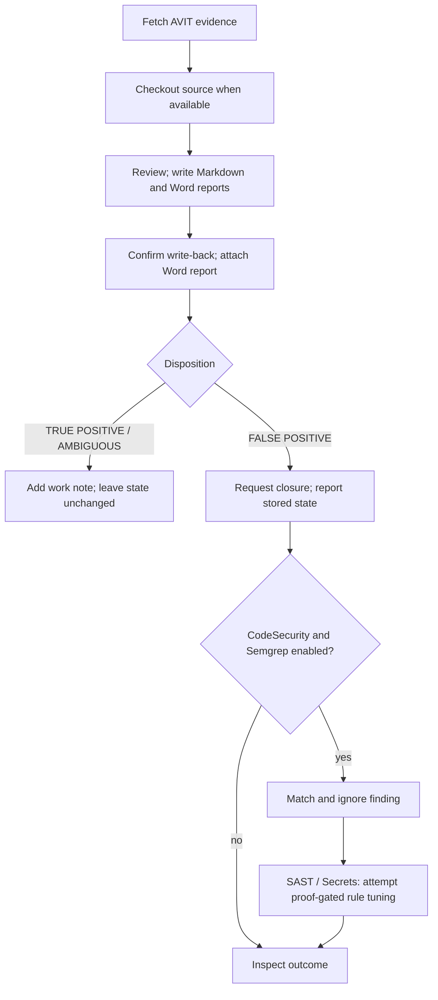

# AVIT triage integration: from finding to recorded decision

A scanner alert is not yet a decision. Threatlint connects a ServiceNow
Application Vulnerable Item (AVIT) to its source or runtime evidence, produces a
review report, and records the outcome where the team tracks the work.
False positives can be closed; true positives and ambiguous findings stay open.

**Review and write-back are separate responsibilities.** The reviewer supplies the
evidence and disposition. The CLI or Workbench performs authorized ServiceNow and
Semgrep writes. The optional [orchestrator](avit-orchestrator.md) only schedules
application-supplied handlers; it does not automate this integration by itself.

## Shortest working path

In your own terminal, complete setup. Never paste credentials into chat:

```bash
threatlint setup
threatlint setup --check
```

Then, in Claude Code with Threatlint installed:

```text
/fp-review AVIT000000095938462
```

Claude Code, Codex, Copilot, and the Claude API use the same headless review and
write-back runner. Select the provider you are signed in to (or supply the
Claude API key):

```bash
threatlint run fp-review --provider codex \
  --avit AVIT000000095938462 --resolve-avits --yes
# Or discover every AVIT associated with an ISST's exact repository and branch:
threatlint run fp-review --provider copilot \
  --isst ISST0035374 --resolve-avits --yes
```

Use `claude-code`, `claude`, `codex`, or `copilot` for `--provider`. Repeat
`--avit` for additional records or `--isst` for additional tasks. An ISST run
reads its organization, project, repository name or URL, and branch (including
a linked scan assessment when the task stores those fields there), then
reviews the AVITs matching that exact identity. Do not combine `--isst` with
an explicit AVIT list. This command fetches each AVIT,
checks out its recorded repository and branch, reviews the evidence, attaches
its Word report, and applies the disposition. It prints each result and removes
the temporary checkout and report files. An AVIT with a true-positive verdict
gets the report and a work note while staying open. A false positive gets the
report, a closure request, and scoped Semgrep triage; SAST and Secrets also get
proof-gated rule tuning. Before write-back, the runner asks the selected model
to repair a missing or invalid rule proposal and validates the result. The CLI
does this without Dia or UI actions. Omit `--resolve-avits --yes` for a
report-only AVIT review.

For an ISST, Threatlint also attaches each true-positive Word report to the
ISST and comments with direct links to those attachments. If every associated
AVIT completes as a false positive, it comments that the ISST and SCAN request
can be closed; it does not change the ISST state. A partial review or any true
positive keeps that closure suggestion out of the comment.

Or open **Test → Finding triage** in the Workbench, enter an AVIT, SCTASK, or ISST,
and start the review with the configured model. **These workflows can write to
ServiceNow and Semgrep**; use records and credentials you are authorized to change.

For explicit control, run the underlying stages:

```bash
threatlint avit fetch AVIT000000095938462 -o avit.md
threatlint avit checkout AVIT000000095938462 --dir avit-checkout
# Review avit.md against avit-checkout; create review.md and review.docx.
threatlint avit resolve AVIT000000095938462 \
  --report review.md --docx review.docx --checkout avit-checkout
```

The CLI asks before writing. Add `--yes` only after reviewing the verdict for a
noninteractive run. The report must name this AVIT in `**Original finding**:` and
state `**Disposition**: TRUE POSITIVE`, `FALSE POSITIVE`, or `AMBIGUOUS`.
`resolve` reads Markdown and attaches Word; it does not generate either report.
Use `--snow-instance URL` or saved instance settings, and `--aws-profile PROFILE`
when credentials come from a named AWS profile. Fetch also accepts repeated
`--avit` values or `--avit-file` containing a list of numbers.

**Check the output, not just the exit code.** ServiceNow can override requested
state values, and some Semgrep gaps are warnings even when `resolve` exits 0.
Attachment, closure, finding triage, and rule deployment are separate operations,
not one transaction.
The headless runner exits nonzero when an AVIT or a required Semgrep/ISST step
cannot be completed. The AVIT report and closure may already be stored when a
later ServiceNow or Semgrep operation fails.

## One-time setup

Setup checks for ServiceNow OAuth credentials, an Azure DevOps PAT, and a Semgrep
API token. The Workbench gates batches on these checks and local Semgrep
availability. Individual CLI stages use the credentials their operation needs.

| Need | Configure / verify |
| --- | --- |
| ServiceNow instance and OAuth client | `threatlint setup` / `threatlint setup --check` |
| Azure DevOps service-account PAT in Parameter Store | `threatlint ado service-account --parameter <adoPatParameter> --organization <org> --aws-profile <profile> --region <region>` / `threatlint ado status` |
| Semgrep deployment token with Web API access | `threatlint semgrep login` / `threatlint semgrep status` |
| Local rule validation | Install Semgrep CE, then `semgrep login` and `semgrep install-semgrep-pro`; verify `semgrep --version` |

When `adoPatParameter` is configured, it is the authoritative credential source
for the listed `adoOrganizations`, ahead of personal PATs in environment variables
or local credential stores. The service-account PAT is read at runtime and kept
only in memory, so Parameter Store rotation takes effect without copying a new
secret into local settings. An unavailable parameter or an organization outside
the configured list stops ADO access instead of using a personal identity.
`--aws-profile` selects the AWS identity for the run; `awsProfile` is the configured
default. Use Code: Read & write and repository permission to create branches and
pull requests for proposed fixes. Legacy `threatlint ado login` remains available
only when no shared parameter is configured.

For `--isst`, the ServiceNow OAuth client needs read access to the `task` table
or `sys_db_object` metadata, read and comment/attachment access to the concrete
ISST task table, read access to a linked scan assessment when used, and read
access to AVITs. The CLI follows `task.sys_class_name` or a unique Information
Security task class in metadata. Set
`THREATLINT_SNOW_ISST_TABLE` when the instance hides both discovery paths.
An empty task response can also mean the OAuth client lacks row access; grant
the table ACL before relying on an ISST run.
| GitHub-hosted source | `threatlint github login` ([GitHub App](github-app.md)) or `gh auth login`; verify `threatlint github status` |
| AWS-backed credentials, if used | `threatlint aws login`; verify `aws sts get-caller-identity --profile appsec` |

Organization defaults are optional. Environment variables override
`~/.threatlint/org.json`:

| `org.json` key | Environment variable |
| --- | --- |
| `ssoUrl` | `THREATLINT_AWS_SSO_PORTAL_URL` |
| `awsProfile` | `THREATLINT_AWS_PROFILE` |
| `awsRegion` | `THREATLINT_AWS_REGION` |
| `adoPatParameter` | `THREATLINT_ADO_PAT_PARAMETER` |
| `adoOrganizations` | `THREATLINT_ADO_ORGANIZATIONS` |
| `snowClientIdParameter` | `THREATLINT_SNOW_CLIENT_ID_PARAMETER` |
| `snowClientSecretParameter` | `THREATLINT_SNOW_CLIENT_SECRET_PARAMETER` |
| `semgrepTokenParameter` | `THREATLINT_SEMGREP_TOKEN_PARAMETER` |
| `semgrepDeployment` | `THREATLINT_SEMGREP_DEPLOYMENT` |

```json
{
  "ssoUrl": "<your-aws-sso-url>",
  "snowClientIdParameter": "/<prefix>/servicenow/client-id",
  "snowClientSecretParameter": "/<prefix>/servicenow/client-secret",
  "semgrepTokenParameter": "/<prefix>/semgrep-token",
  "semgrepDeployment": "<deployment-id>"
}
```

Unset parameter names disable that Parameter Store lookup; configure credentials
through setup, login commands, or Workbench Settings instead. ServiceNow settings
use `~/.threatlint/servicenow.json`; Azure DevOps and Semgrep use the OS credential
store when available, with owner-only JSON fallbacks. `THREATLINT_HOME` relocates
this configuration. On Windows, `~` means `%USERPROFILE%`.

Behind a TLS-inspecting proxy, Threatlint can build
`~/.threatlint/ca-bundle.pem` from macOS/Windows trust stores and pass it to its
HTTPS clients and external tools. Fix certificate trust rather than disabling TLS.

## Process flow



### Scope and repository target

AVIT numbers accept `AVIT` plus 7–15 digits. Non-CodeSecurity records are also
reviewable: use their affected asset, scan details, proof, and vulnerability
definition, plus source when present. They do not receive the resolver's Semgrep
step.

CodeSecurity classification prefers ServiceNow's evaluated `sysrule_view` rule;
when unavailable, it falls back to SCM Tool and Repository fields. Security
Finding Source selects SAST, SCA, or Secrets; it does not decide review scope.

Checkout uses form labels resolved through `sys_documentation`: SCM Tool,
Organization Name, Project Name, Repository, Project Branch, and File Path.

- **Azure DevOps:** `https://dev.azure.com/{Organization}/{Project}/_git/{Repository}`.
  Each organization uses its own saved PAT, with Entra authentication as a fallback.
- **GitHub:** `https://github.com/{Organization}/{Repository}`.
- **Renames:** after an ADO “not found,” Threatlint can follow the repository GUID
  retained by Semgrep to its current name. Semgrep matching keeps the original name.
- **Deleted branch:** checkout can fall back to the default branch and reports it.
  This is not evidence that the finding was absent on the scanned branch.
- **Large repository:** after `THREATLINT_CLONE_TIMEOUT` (default 600 seconds), ADO
  can download the flagged folder through the Items API; GitHub can use sparse
  checkout. State the reduced review scope.
- **No repository:** other-tool findings can be reviewed from AVIT evidence alone.

Clones are shallow and single-branch. Git credentials are supplied through the
environment rather than embedded in clone URLs.

For SAST, trace the source to the sink. For SCA, establish the resolved version and
whether the vulnerable feature is reachable. For Secrets, assess credential
plausibility without printing the value: cite path, line, and key name instead.

### Write-back

The Word report is the only report attachment. A manual `avit resolve` uses
`<AVIT>-threatlint-fp-review.docx` and skips an existing attachment with that
name. The headless workflow gives each review a UTC timestamp suffix so
reruns preserve the new report alongside earlier reviews. Reports are uploaded
before the state update; an SCTASK copies the latest AVIT report.

| Disposition | ServiceNow request | Semgrep |
| --- | --- | --- |
| FALSE POSITIVE | Close with state `3`, substate `3`; note “Closed by Threatlint as a false positive, see attached report.” | CodeSecurity only: triage, then eligible rule tuning |
| TRUE POSITIVE | Note “True positive, see attached report.”; no state change. If the AVIT was already closed, the command reports that state and exits nonzero. | Unchanged |
| AMBIGUOUS | Note “Ambiguous, see attached report. Left open pending the evidence the report names.”; no state change. If the AVIT was already closed, the command reports that state and exits nonzero. | Unchanged |

`THREATLINT_SNOW_FP_STATE` and `THREATLINT_SNOW_FP_SUBSTATE` override the requested
closure values. Business rules may store something else; read the printed result.
The resolver stops before Semgrep processing when ServiceNow does not retain
the requested closed state.

`--skip-semgrep` leaves Semgrep untouched. `--skip-rule-tuning` permits finding
triage but skips rule replacement. Neither option prevents ServiceNow write-back.

`resolve --checkout DIR` deletes a Git checkout in its cleanup path **even on
error**; `--keep-checkout` retains it. The standalone `semgrep --checkout` command
also cleans up. These CLI commands do not delete your report files.

### Semgrep tuning

Finding triage comes first. Code/Supply Chain matching uses project, file,
available rule ID, and line ±3; Secrets matching uses repository, branch, path, and line ±3.
A Secrets AVIT names only a service type (for example AWS), which is never treated as a rule:
when no `--semgrep-rule-hash-id` is given, the open Secrets finding at that exact location is
matched and its own `ruleHashId` is used. If findings with different rules share the location,
nothing is changed and you choose one with `--semgrep-rule-hash-id`.
**No flagged line means no match**, not file-wide suppression. Put the line in the
AVIT/report, or use `avit semgrep --line N`. Semgrep fingerprint triage can carry
across later scans and branches.

SCA receives triage only because it has no Code or Secrets rule to replace.
SAST and Secrets rule tuning uses the flagged file and a proposed rule with
fixtures:

1. Start from real rule source:
   `threatlint semgrep rule-base <rule> --kind <sast|secrets> -o rule-base.yaml`.
   This returns an active tuned rule when available, otherwise the original.
2. Put the complete YAML after `**Tuned rule**:` and a fenced fixture block after
   `**Tuned rule fixtures**:` in the report. Keep at least one `ruleid:` true-positive
   case and one `ok:` false-positive case.
3. Validation requires valid rule syntax, passing `semgrep --test` fixtures, and
   original-rule matches on both fixture shapes. If the original reproduces the
   exact flagged line locally, the tuned rule must drop it.
4. After proof, publish `org_private`. Legacy policy replacements enable the
   tuned rule in `MODE_MONITOR` before disabling the original. Unified policies
   use project-scoped inclusion and exclusion when the original rule selection
   is direct or an exact open finding proves the ruleset association. Inspect
   the printed policy changes and rollback instructions.

An existing tuning is checked against the flagged location. If it still reports
the line, the proposed extension must preserve its existing exclusions; conflicting
proposals are rejected. Pro/interfile findings may rely on fixture proof when the
local checkout cannot reproduce the line.

The headless runner checks the proposed rule and fixtures against the flagged
file **before** AVIT write-back. It asks the selected model for a corrected
report up to two more times when the proposal fails. If the source rule or
required proof remains unavailable, it leaves that AVIT unchanged and exits
nonzero. A manual `avit resolve` can attach or close the AVIT before its later
Semgrep step; publishing and policy updates can also fail independently, so
inspect remote state before retrying.

## Re-running the Semgrep step

For an AVIT already displayed as Closed with Threatlint's false-positive note:

```bash
threatlint avit semgrep AVIT000000095938462 --line 42
# Also retry tuning with a reviewed report and a fresh checkout:
threatlint avit semgrep AVIT000000095938462 --line 42 \
  --report review.md --checkout avit-checkout
```

This is a write command, not a preview; it has no confirmation prompt. Select the
deployment with `--semgrep-deployment`, `THREATLINT_SEMGREP_DEPLOYMENT`, or
`semgrepDeployment` in `org.json`. Without a selection, the token must have one
deployment. Findings endpoints use its slug; policies and Secrets use its ID.

## Catalog tasks (SCTASK)

Review the AVITs named in a task before closing the request:

```bash
threatlint sctask avits SCTASK14120565
# Review and resolve each returned AVIT.
threatlint sctask close SCTASK14120565 --yes
```

`/fp-review SCTASK14120565` and the Workbench also accept tasks. Each AVIT gets
its own decision; a requester's proposed verdict is not evidence. Task closure
reads AVIT outcomes and attached Word reports, copies reports to the task, and
adds a “Closed by Threatlint” summary. It requests Closed Complete (`3`, overridden
by `THREATLINT_SNOW_SCTASK_CLOSED_STATE`) only when every outcome is TRUE POSITIVE
or FALSE POSITIVE; otherwise it comments and leaves the task open. True-positive
AVITs still need remediation. OAuth access must include `sc_task` and attachments.

## Information Security tasks (ISST)

An ISST identifies its AVITs by its exact repository and branch rather than by a
list in a description. List and summarize them the same way as a catalog task:

```bash
threatlint isst avits ISST0012345
# Review and resolve each returned AVIT.
threatlint isst summarize ISST0012345 --yes
```

`/fp-review ISST0012345` and the Workbench also accept ISSTs, as does
`threatlint run --resolve-avits --isst ISST0012345 --yes`. Summarizing attaches
each **true-positive** AVIT's Word report to the ISST and adds a comment that lists
the attached reports (and, when every reviewed AVIT was a false positive, notes the
ISST and SCAN request can be closed). **Threatlint never closes an ISST**: true
positives need remediation, so closure stays with the owner. False-positive reports
are not attached to the ISST — they stay on their own AVIT, which is closed and whose
Semgrep rule is tuned. The ISST's concrete task table is resolved through
`task.sys_class_name` (override with `THREATLINT_SNOW_ISST_TABLE`); OAuth access must
include that table and its attachments.

## Workbench: Finding triage

The Workbench reviews any number of AVITs, one at a time, including AVITs expanded
from SCTASKs and ISSTs (an ISST may name any number). The run belongs to the Workbench,
not the page: leaving Finding triage, reloading, closing the tab, or a dropped connection
does not stop it. Returning, from any tab, replays the run's history and continues with
live progress. One run is active at a time; **Stop** works from any tab, and quitting the
Workbench ends the run. The headless CLI (`threatlint avit headless`) has no AVIT limit
either; long lists are fetched from ServiceNow in batches. Each card shows fetch, checkout, model review, report, and
write-back. One failure does not stop the remaining AVITs. Missing repositories
trigger an ADO removal check before a no-report closure is attempted. A SCTASK is
closed once its AVITs are decided; an ISST gets its true-positive reports attached
and a comment and is left open (Threatlint never closes an ISST).

**Stop is not rollback.** Review/fetch stages can be cancelled; the resolver is
started without the cancellation signal. Network or API failures can still leave
partial external updates.

The batch cleanup removes local reports, history entries, and working files even
on failure. Verify attachment before relying on ServiceNow as the retained copy.
Credential-like values in the flagged file and neighboring files are heuristically
redacted from the generated report; still review sensitive content before sharing.

The desktop app bundles Python source under `Resources/python`. It chooses an
interpreter favoring `python-docx` and `keyring`; set `THREATLINT_PYTHON` if needed.

## Workbench: report reader

**Close FP & tune Semgrep…** calls `/api/servicenow/close-false-positive`.
The separate `/api/semgrep/false-positive/{matches,ignore}` endpoints re-match
findings server-side. This is a separate Workbench path, not the queue orchestrator.

## Dynamic-scan (Invicti DAST) AVITs

An Invicti Dynamic finding names a URL, not a repository. Supply the source and
branch to validate in a local Docker sandbox, rather than contacting that origin:

```bash
threatlint avit dast AVIT0000000900001 --repo <https-repo-url> --branch <branch> --work dast-run
threatlint avit dast --avit-file tests/fixtures/dast/invicti-xss-search.json \
  --repo <url-or-local-path> --branch <branch> --work dast-fixture
```

The default sequence is **provision → deploy → test → probe → teardown → review**.
It builds the app and detected backing services, uses synthetic configuration,
runs repository tests, and sends at most eight planned vulnerability probes plus
passive response checks. Evidence is written to `evidence.md`; state is
`dast-state.json`. Builds and pulls can use the network; runtime containers use an
internal Docker network with no published ports or checkout mounts. The repository
is cloned under the configurable repo store (see
[Where scanned repositories are cloned](setup.md#where-scanned-repositories-are-cloned)).

Review is a handoff through `review-request.md` unless you explicitly select
`--review-provider lmstudio|openai|claude` (`--model` overrides the model).
The expected report is `fp_review.md`, with the same Original finding/Disposition
fields as above, plus Severity and Confidence. A sandbox missing production TLS,
WAF, proxy, or authentication context cannot prove those edge controls vulnerable.

```text
**Original finding**: <AVIT>; <vulnerability>; Invicti DAST; <METHOD> <path> (<parameter>)
**Disposition**: <TRUE POSITIVE|FALSE POSITIVE|AMBIGUOUS>
**Severity**: <CRITICAL|HIGH|MEDIUM|LOW|INFO>
**Confidence**: <CONFIRMED|LIKELY|POSSIBLE>
```

| Control | Use |
| --- | --- |
| Run one stage | `--step STEP --work DIR`, using a stage named above or `resolve` |
| Select app/test behavior | `--service`, `--port`, `--health-path`, `--start-command`, `--test-command` |
| Retain a successful environment | `--keep-env`; later run `--step teardown --work DIR` |
| Explicit write-back | `--step resolve --work DIR` or `--resolve` after a full model-reviewed run; `--report`, `--docx`, `--yes` control inputs/confirmation |
| Review provider | `--review-provider`, `--model`, `--base-url` (LM Studio); prefer provider key environment variables over `--api-key` in shell history |
| Resource limits | `THREATLINT_DAST_CPUS`, `THREATLINT_DAST_MEMORY` |
| Timeouts / images | `THREATLINT_DAST_BUILD_TIMEOUT`, `THREATLINT_DAST_START_TIMEOUT`, `THREATLINT_DAST_TEST_TIMEOUT`, `THREATLINT_DAST_*_IMAGE` |

Only the Docker environment provider is implemented. Resolve converts Word when
needed, uses the AVIT resolver, skips Semgrep, and deletes the checkout. No Invicti
API is called: `set_invicti_hook(fn)` supplies an optional callback; otherwise
`invicti_mark_false_positive` only reports the issue ID.

## Draft pull requests for proposed fixes

Finding triage opens a draft Azure DevOps or GitHub PR after a true-positive report
has been attached successfully. GitHub Enterprise Cloud and Enterprise Server
repositories are supported. The Workbench's **Open draft PRs for proposed fixes**
option is enabled by default. Headless `run fp-review
--resolve-avits --yes` includes the same step; pass `--no-fix-pr` to skip it.

Before saving or attaching the report, Threatlint checks whether the review
establishes the true positive and contains a concrete fix. A conservative-default
or non-confirmed decision, missing source evidence, or absent/invalid patch
triggers up to two follow-up investigations using the same reviewer and checkout.
Each follow-up receives the original AVIT and scanner context, the exact gaps,
bounded source excerpts, and the prior draft as untrusted evidence. The reviewer
uses its read/search tools to inspect the flagged function, callers, input or
exposure path, registered controls, configuration, and existing tests, then
returns a complete revised report and fix. A supported true positive is not
marked conservative merely because a false-positive interpretation was not proven.

Preparation requires a non-conservative `CONFIRMED` true positive, substantive
evidence and exploit/exposure reasoning, source references that exist in the
checkout, a fix rationale, regression assertions, and a `**Proposed fix patch**:`
field followed by a fenced `diff` block. The host checks the diff in an isolated
Git index without changing the reviewed files. These checks validate report
structure, source locations, and patch applicability; the reviewer remains
responsible for the semantic evidence and fix assessment.

Only the final report is attached, with a unique timestamped name so a rerun
retains the new evidence alongside earlier reviews. The publisher then confirms that the target
branch still points at the reviewed commit, publishes the proposed change on a
separate branch, and opens a draft PR for engineering review. A retry reuses the
matching PR or branch. The AVIT card and headless result include the PR link.
Static source evidence can confirm a vulnerability without executing an exploit.
Application tests are not run by this publishing step; the PR states that CI and
engineering validation remain due.

Azure DevOps PR publishing requires the service-account PAT referenced by the existing
`adoPatParameter`, access to the repository's organization in `adoOrganizations`,
and ADO permissions to create branches, contribute code, and create pull
requests. It never falls back to a personal PAT. Configure this source through
**Settings → Azure DevOps → AWS Parameter Store**, or `threatlint ado
service-account`; the shared secret is fetched at runtime and not saved locally.

GitHub PR publishing uses the existing GitHub authentication settings. A configured
GitHub App takes priority and never falls back to a personal credential if token
creation fails. Without an App, public GitHub uses `GH_TOKEN` / `GITHUB_TOKEN`, and
Enterprise Server or a data residency host uses `GH_ENTERPRISE_TOKEN` /
`GITHUB_ENTERPRISE_TOKEN`; otherwise the flow uses GitHub CLI credentials for the
configured host.
The App installation needs **Contents: Read and write** and **Pull requests: Read
and write** on the target repository; a PAT needs equivalent repository permissions.
Its private key can use the existing `githubAppPrivateKeyParameter` in AWS Parameter
Store. Configure `THREATLINT_GITHUB_API_URL` or the saved GitHub App API URL as
`https://<enterprise-host>/api/v3` for Enterprise Server, or
`https://api.<subdomain>.ghe.com` for Enterprise Cloud with data residency. The
default is `https://api.github.com`. AVIT checkout and proposed-fix PR operations
use that configured host. See [GitHub App setup](github-app.md).

If further investigation disproves the claim, the final false-positive report
follows the existing closure and rule-tuning flow. If the two follow-ups still
cannot confirm the finding or produce a validated fix, Threatlint attaches the
honest final report, records the remaining gaps, and marks automated remediation
blocked without opening a PR. It does not manufacture confirmation to satisfy
the publishing gate. Unsupported SCM providers or checkouts without the exact
reviewed Git branch produce an explicit skip. If publishing fails after the
report was attached, the completed ServiceNow work remains recorded and the PR
failure is reported separately. The workflow never merges a PR.

For an existing review and checkout, the standalone entry point is:

```sh
threatlint avit fix-pr AVIT000000095938462 \
  --report review.md --checkout /path/to/repo --target reviewed-target.json \
  --aws-profile appsec --yes
```

`reviewed-target.json` contains the JSON repository metadata from `avit checkout`.
The command validates that its repository and branch match the checkout before
publishing.

`threatlint avit prepare-fix AVIT... --report review.md --checkout /path/to/repo
--target reviewed-target.json` performs the shared read-only readiness assessment
and returns JSON with its status, issues, and follow-up instructions. It does not
invoke the reviewer, change a tracker, or open a PR; the Workbench and headless
flows use that assessment to drive the investigations described above.

## Data flows

| Data | Route / retention |
| --- | --- |
| OAuth client | Saved config or AWS Parameter Store → ServiceNow token endpoint |
| AVIT evidence | ServiceNow → Markdown → reviewer; treat record content as untrusted data |
| Source | ADO/GitHub → checkout → reviewer/model tools; not just a local-only operation when using a hosted model |
| Report | Reviewer → local Markdown/Word → ServiceNow Word attachment; manual CLI stages retain their reports, while the headless Codex AVIT workflow and Workbench batch clean up temporary reports |
| Semgrep token | Credential source → Semgrep API and rule publishing |
| ADO service-account PAT | Configured AWS parameter → runtime memory → Azure DevOps; no local PAT copy |
| Proposed fix | Reviewed diff → isolated applicability check → separate Azure DevOps or GitHub branch and draft PR |
| Model input | Prompts and inspected source → selected provider; use approved provider/data settings |

## Known limits

| Symptom | Next action |
| --- | --- |
| ServiceNow kept another state/substate | Inspect stored values and business rules before claiming closure. |
| Wrong/missing repository or branch | Check AVIT form fields, per-organization credentials, rename/default-branch messages, and actual checkout scope. |
| Semgrep unchanged / no match | Check deployment, original project name, file, rule, and flagged line. Do not broaden suppression to make it match. |
| Rule not tuned | Check local Semgrep, report blocks, fixtures, and checkout; refresh the checkout if cleanup removed it. |
| ServiceNow succeeded, Semgrep failed | Reconcile both systems, then rerun the standalone Semgrep step rather than assuming an atomic rollback. |
| Need a work note only | `threatlint avit note <AVIT> --message "Reason" --yes` leaves state unchanged. |
| ADO repository appears deleted | `threatlint avit close-removed <AVIT> --yes` checks the credential-visible repository list before closing with “Closed by Threatlint, repo removed.” No report is attached. Access/network failures are not proof of deletion; restricted visibility remains a review concern. |
| Corporate DNS blocks `semgrep.app` | The default API host is `https://semgrep.dev`; `THREATLINT_SEMGREP_API` overrides it. |
