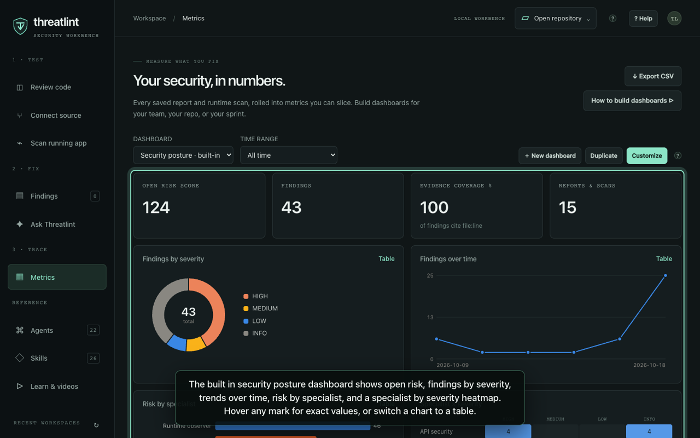

#  Metrics and dashboards

The **Metrics** view turns every report saved in the workbench, and every runtime scan run in the
current session, into numbers you can track. Data never leaves your machine; dashboards are stored
in `dashboards.json` beside the workbench history.

▶ Watch: [Metrics and custom dashboards](../web/public/media/dashboards.mp4) (narrated, ~45 s), or
open **Learn & videos** in the app.



## The built-in dashboard

*Security posture* is read-only and always available:

| Widget | Meaning |
| --- | --- |
| Open risk score | Σ severity weight of findings not marked FALSE POSITIVE, REMEDIATED, or RESOLVED. CRITICAL 10, HIGH 6, MEDIUM 3, LOW 1, INFO 0, unspecified 1 |
| Findings | Count of parsed findings across reports and runtime scans |
| Evidence coverage % | Share of findings that cite a `file:line` (runtime findings always carry request evidence) |
| Reports & scans | Number of distinct reports and runtime scans |
| Findings by severity | Donut, fixed severity colors |
| Findings over time | Line by day, with hover crosshair |
| Risk by specialist | Bar chart of open risk per agent |
| Specialist × severity | Heatmap; darker blue means more findings |
| Risk by workspace | Table you can sort into your backlog |

Use the **Time range** selector to limit every widget to the last 7, 30, or 90 days.

## Build your own

1. Press **New dashboard**, or **Duplicate** / **Customize** to start from the built-in one.
2. Name it, for example `API team · sprint 42`.
3. **Add widget** and choose:
   - **Metric**: `findings`, `riskScore`, `uniqueFindings` (deduplicated by fingerprint), `evidenceCoverage`, `reports`.
   - **Group by** (dimension): `severity`, `agent` (specialist), `category` (discipline), `workspace`, `day`, `week`, `disposition`, `confidence`, `source` (report or runtime), `rule` (finding type, e.g. `CR`, `RT-CORS-REFLECT`).
   - **Chart**: stat tile, column, bar, line, donut, table, or heatmap. A heatmap also needs **Columns** (a second dimension).
   - **Size**: small (¼ row), medium (½), or full width.
   - **Filter**: optionally restrict to one severity.
4. Reorder with ↑ ↓, remove with ×, then **Save dashboard**.

Every chart has hover/focus tooltips with exact values and a **Table** toggle, so no value depends on
color alone. Severity colors are fixed across all charts; other categories keep a stable color per
entity.

### Recipes

| Goal | Metric | Group by | Chart | Filter |
| --- | --- | --- | --- | --- |
| What blocks this release? | findings | workspace | bar | HIGH (add a second widget for CRITICAL) |
| Is triage paying off? | findings | disposition | donut | — |
| Which agent finds the most real risk? | riskScore | agent | bar | — |
| Trend for the weekly review | findings | week | line | — |
| Where are runtime issues? | findings | rule | table | source = runtime (via API) |
| Hot spots | findings | workspace × severity | heatmap | — |

## Export and API

- **Export CSV** downloads every finding (timestamp, source, workspace, agent, ID, title, severity,
  confidence, disposition, evidence flag). Cells starting with `= + - @` are prefixed to prevent
  spreadsheet formula injection.
- The same data is available on the loopback API for scripts:

```bash
curl -s http://127.0.0.1:3000/api/metrics/overview
curl -s http://127.0.0.1:3000/api/metrics/query -H 'Content-Type: application/json' \
  -d '{"metric":"riskScore","groupBy":"workspace","filters":{"severity":"HIGH","since":"2026-10-01"}}'
curl -s http://127.0.0.1:3000/api/metrics/schema      # valid metrics, dimensions, charts
```

`filters` accepts `severity`, `agent` (agent ID), `category`, `workspace`, `source`,
`disposition`, and `since` (ISO date). The API only answers same-origin loopback requests.

## Limits

Metrics count what agents and the runtime observer reported. They are not a certification, a
coverage guarantee, or proof that unreported issues are absent. Runtime scans are kept in memory
for the session (last 25), so restart the workbench and they drop out of metrics; saved reports
persist.
