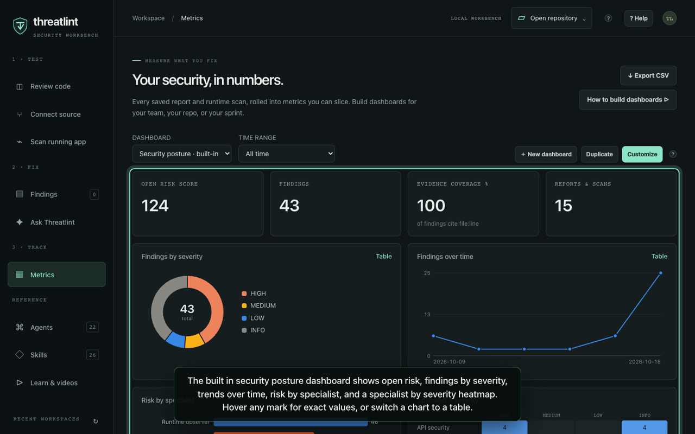

#  Metrics and dashboards

Find the next investigation without rereading every report. **Metrics** groups saved findings,
current-session runtime observations, and synced defect-tracker findings by severity, workspace,
specialist, and time.
A workspace bar chart shows where reported HIGH findings cluster; inspect those reports before assigning work.

[Watch the walkthrough](../web/public/media/dashboards.mp4), or use **Learn & videos** in the app.



## First useful view

1. [Run a review](workbench.md#review-experience) so the Workbench has a saved report, or sync a connected tracker as described below.
2. Open **Metrics → Security posture** and choose a **Source** and **Time range**: all, 7, 30, or 90 days.
3. Inspect severity and workspace charts. Use hover/focus values or **Table** on supported charts.

**Expected result:** retained evidence counts, not a fresh scan. Build a release view below.

## Connect defect trackers

Open **Metrics → Connections** to see each supported tracker and its connection status.
Set up ServiceNow under **Settings → ServiceNow**. **All AVITs** uses ServiceNow's Aggregate
API to count the full AVIT population your account can read, with filters applied by ServiceNow.
This summary does not download individual records. It reflects the last completed refresh and
only shows dimensions your ServiceNow account permits. For per-finding charts and CSV, choose
an explicit list of AVIT numbers or a bounded ServiceNow filter and run the separate detailed
sync. The AVIT table can contain millions of records, so a full detailed download is not
supported. DefectDojo uses its existing **Settings → DefectDojo** connection for a detailed sync.

The all-AVIT filters are:

- **Source code manager** — GitHub Enterprise or Azure DevOps. Choosing Azure DevOps reveals a
  **Project** field; GitHub Enterprise shows **Organization**, **Repository**, and **Branch**.
- **Organization**, **Project**, **Repository**, **Branch** — the AVIT's source-control context.
  These resolve to your instance's own AVIT columns through the form labels in `sys_documentation`
  (Organization Name, Project Name, Repository, Project Branch); if your instance does not expose a
  column for one of them, the summary says so instead of filtering on a guessed field.
- **Finding type** — Static (SAST), SCA, or Secret, matched against the Security Finding Source.
- **Risk rating** and **State** — plain-English dropdowns (Critical / High / Medium / Low / None,
  and Open / Resolved / Closed); you no longer type ServiceNow's numeric choice values.

Secondary fields — **Substate**, **Assignment group** sys_id, exact **Finding source**, and the
**Created** date range — are under a collapsible **More filters** section. Empty fields mean all
readable records. The **Stored false-positive state** count matches the configured Closed / False
Positive state and substate codes; ServiceNow business rules can clear the substate, so that
count can understate triaged false positives.

Refreshes are explicit and read-only; opening a dashboard does not query or update a tracker.
The page shows the last successful refresh and its scope. Choose an individual detailed source
to avoid combining the same issue from a report and its tracker record. Other tracker types in
the catalog are marked unavailable until a Metrics adapter exists.

## The built-in dashboard

*Security posture* is read-only; **Customize** creates an editable copy.

| Widget | How to interpret it |
| --- | --- |
| Open risk score | Sum of weights excluding FALSE POSITIVE, REMEDIATED, RESOLVED: CRITICAL 10, HIGH 6, MEDIUM 3, LOW 1, INFO 0, unspecified 1 |
| Findings | Parsed finding count; repeated reports can count the same issue again |
| Evidence coverage % | Findings with parsed evidence references; runtime observations count as evidenced. Not proof evidence is correct |
| Reports & scans | Distinct local reports and runtime scans; tracker records are findings, not reports |
| Findings by severity / over time | Severity distribution and report/scan dates—not verified remediation progress |
| Risk by specialist or tracker / workspace | Weighted open findings grouped by specialist, tracker, or workspace label |
| Specialist / tracker × severity | Finding counts; darker cells mean more findings |

Workspace labels use repository basenames or runtime target URLs; identical basenames can
share a label. Scores prioritize reported evidence, not validated exploitability.

## Build your own

1. Choose **New dashboard**, **Duplicate**, or **Customize**. Name it, e.g. `API release review`.
2. **Add widget**; choose metric, grouping, chart, width, and optional severity filter.
3. For heatmaps choose **Columns** too. Reorder with ↑ / ↓, remove with ×.
4. **Save dashboard** and select it from the dashboard menu.

**Result:** a layout saved locally in `dashboards.json` beside history.

| Choice | Available values |
| --- | --- |
| Metric | `findings`, `riskScore`, `uniqueFindings` (fingerprint deduplication), `evidenceCoverage`, `reports` |
| Group by | `severity`, `agent`, `category`, `workspace`, `day`, `week`, `disposition`, `confidence`, `source`, `rule` |
| Chart | Stat tile, column, bar, line, donut, table, heatmap |
| Size | Small (¼ row), medium (½), full width |

Heatmaps always show **finding counts**. Severity colors are fixed; other entity colors stay stable.

### Recipes

| Question | Metric | Group by | Chart / filter |
| --- | --- | --- | --- |
| Where are HIGH findings? | findings | workspace | Bar; HIGH (add another widget for CRITICAL) |
| What did triage decide? | findings | disposition | Donut |
| How much weighted risk did each specialist report? | riskScore | agent | Bar |
| What was reported each week? | findings | week | Line |
| Which workspace/severity combinations dominate? | findings | workspace | Heatmap; columns = severity |

## Export and API

**Export CSV** includes retained rows for the selected source—not the dashboard/time filter—with timestamp, source,
workspace, agent/category, ID, title, severity, confidence, disposition, and evidence flag.
Formula-like prefixes are escaped. Treat exports as sensitive.

With the browser Workbench running on its default port:

```bash
curl -s http://127.0.0.1:3000/api/metrics/overview
curl -s http://127.0.0.1:3000/api/metrics/schema
curl -s http://127.0.0.1:3000/api/metrics/sources
curl -s http://127.0.0.1:3000/api/trackers
curl -s http://127.0.0.1:3000/api/metrics/query -H 'Content-Type: application/json' \
  -d '{"metric":"riskScore","groupBy":"workspace","filters":{"severity":"HIGH","source":"report"}}'
```

Use **Refresh all AVITs** in Metrics, or `POST /api/trackers/servicenow-avit/aggregate`
with filter fields, to refresh the full-population summary. `GET` on the same path returns
the last summary. Use `POST /api/trackers/servicenow-avit/sync` with an explicit scope, or
`POST /api/trackers/defectdojo/sync`, for detailed findings. The detailed sync returns the
source, finding count, and sync time. `GET /api/metrics/export?source=servicenow-avit`
downloads only the scoped AVIT detail snapshot, not the full-population summary. All endpoints
are available only to the local Workbench.

Filters: `severity`, `agent` (ID), `category`, `workspace`, `source` (`report`, `runtime`,
`servicenow-avit`, or `defectdojo`),
`disposition`, `since` (ISO date). The API checks browser origins; do not expose it publicly.

## Limits

Reports and synced tracker snapshots persist; the last 25 runtime scans disappear on restart.
The all-AVIT summary contains counts, not per-finding evidence, fingerprints, or export rows.
ServiceNow field permissions can leave some dimensions unavailable. Detailed tracker sync
requires read access and can fail if its scope, permissions, or pagination limits prevent a
complete import. A failed refresh leaves the last completed summary or detail snapshot intact.
`uniqueFindings` deduplicates
fingerprints, not verified vulnerabilities. Report volume, scope, or model changes can move charts
without code changes. Calculations stay local; reviews may send source to your provider.

## Troubleshooting

| Symptom | Next action |
| --- | --- |
| Empty charts | Save a report, check the selected time range, then reopen Metrics |
| Counts seem duplicated | Compare report dates/IDs; use `uniqueFindings` where appropriate |
| Runtime counts disappeared | Restart clears session scans; export evidence before stopping |
| Cannot edit Security posture | Choose **Customize** to save a copy |
| CSV differs from visible chart | CSV exports all retained findings; apply filters in your analysis |

Next: [turn findings into an engineering handoff](reports.md).
