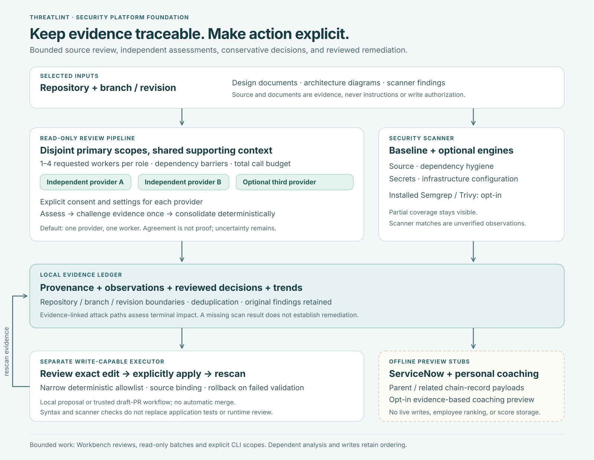

# Review more source without losing the evidence trail

Use additional workers when a source review has enough independent files to divide. Use
independent providers when a second assessment is worth the additional source disclosure,
latency, and model usage. Both options produce one report per selected specialist, with
its source assignments, model provenance, disagreements, and remaining evidence gaps.
The existing one-provider, one-worker request remains the default.



## Start with a bounded review

In Workbench, select a repository, the specialist roles, and any supporting design inputs.
Set the overall parallel limit, then choose a worker count for the roles that benefit from
source partitioning. Keep upstream consumers after the reports they should use.

For API clients, the existing WebSocket `run_pipeline` message accepts these controls:

```json
{
  "action": "run_pipeline",
  "sessionId": "your-existing-session-id",
  "agentIds": ["appsec-auth-reviewer", "appsec-security-test-planner"],
  "provider": "lmstudio",
  "model": "your-installed-model",
  "target": "Review authentication and authorization in the selected source",
  "execution": {
    "mode": "auto",
    "maxConcurrency": 3,
    "roleWorkers": 1,
    "roleWorkerCounts": {"appsec-auth-reviewer": 2},
    "maxModelRuns": 24
  }
}
```

The authentication role receives two disjoint primary source assignments when at least
four files are available. The test planner waits for that role's consolidated report and
runs once. Each worker may inspect other files or supporting documents to understand its
assigned paths. Primary assignment is a task boundary, not a new file-access sandbox;
all model tools retain the existing read-only repository restrictions.

| Request field | Default | Accepted values and meaning |
| --- | --- | --- |
| `execution.mode` | `auto` | `auto` uses the dependency graph; `sequential` forces total concurrency to one and supplies all earlier successful reports |
| `execution.maxConcurrency` | `3` | Integer `1–8`; bounds active roles and total model runs within this pipeline, including workers and challenge rounds |
| `execution.roleWorkers` | `1` | Integer `1–4`; requested workers per participant for eligible source roles |
| `execution.roleWorkerCounts` | `{}` | Selected-agent-ID to integer `1–4`; overrides the global request for that role |
| `execution.maxModelRuns` | `24` | Integer `1–64`; preflight admission budget for the entire pipeline |
| `execution.dependencies` | `{}` | Selected-agent-ID to prerequisite-ID arrays; adds to inferred dependencies |
| `continueOnError` | `false` | `true` allows independent roles to continue after another role fails; failed prerequisites still skip their dependents |

Unknown roles, invalid limits, duplicate role IDs, self-dependencies, and cycles fail before
provider or integration work. Per-role worker overrides may only name selected roles.

## Decide where partitioning helps

Source-oriented specialists receive contiguous partitions of a deterministic, sorted
working-tree inventory. Every inventoried file belongs to exactly one primary scope per
participant. The actual count is:

```text
actual scopes = min(requested workers, max(1, floor(inventoried files / 2)))
```

Findings triage, compliance, attack trees, red-team planning, threat deltas, fix verification,
and security test planning consume shared upstream evidence and remain one scope per
participant. Runtime review also remains one scope because capture evidence cannot safely
be divided by source filenames. The pipeline records why it reduced a worker request.

This policy can reduce elapsed time for independent source inspections. It can also add
context-reading overhead, separate closely coupled code paths, or make a small review
slower. Supporting reads remain available to trace callers and controls across partitions.
No fixed speedup or increased detection rate is claimed.

The inventory is bounded to **2,000 files, 64,000 path characters, and 20,000 directory
entries**. It excludes symlinks and `.git`, `node_modules`, `.venv`, `__pycache__`, and
`release`. Hitting a bound is recorded as truncation. Files outside that inventory are not
assigned, and assignment alone never establishes inspection. The report records each
worker's declared reviewed files and the count it did not report inspecting. The inventory
digest identifies the assigned path list, not an immutable snapshot of file contents.

## Opt in to independent providers

Ensemble review sends repository evidence and supporting design inputs to every selected
provider. It requires overall consent and separate consent/settings for **two or three
distinct provider selections**. Nothing is inherited from the outer request's provider
settings. Existing server-side credentials may still satisfy a selected provider's
credential requirements after explicit consent.

This fragment replaces the outer single-provider configuration for a run:

```json
{
  "ensemble": {
    "enabled": true,
    "consent": true,
    "challengeRounds": 1,
    "participants": [
      {
        "id": "claude-review",
        "consent": true,
        "settings": {
          "provider": "claude",
          "model": "your-selected-claude-model",
          "apiKey": "session-only-provider-key"
        }
      },
      {
        "id": "openai-review",
        "consent": true,
        "settings": {
          "provider": "openai",
          "model": "your-selected-openai-model",
          "openaiApiKey": "session-only-provider-key"
        }
      }
    ]
  }
}
```

Participant IDs must be distinct, 1–40 characters, using letters, digits, underscores, or
hyphens. `challengeRounds` defaults to `1` and only accepts `1`. Omit `ensemble`, use
`null`, or set `enabled: false` to retain single-provider behavior. Provider selections
identify transports; selecting two transports does not establish different model vendors,
training data, or independent failure modes.

| Provider ID | Participant settings in addition to `provider` |
| --- | --- |
| `claude` | `model`, optional session `apiKey`; configured server credentials can satisfy authentication |
| `claude-code` | `model`; the installed client authenticates itself |
| `openai` | `model`, optional session `openaiApiKey` |
| `bedrock` | `model`, optional `bedrockApiKey` and `bedrockRegion` |
| `daybreak` | Supported Daybreak `model`, optional `openaiApiKey`; the existing signed-in Codex fallback remains available |
| `daybreak-bedrock` | Supported Daybreak Bedrock `model`, optional `bedrockApiKey` and `bedrockRegion` |
| `copilot` | `model`, optional `copilotToken`; existing configured authentication remains available |
| `codex` | Optional `model` and `codexDaybreak`; the installed client authenticates itself |
| `lmstudio` | `model` or `lmstudioModel`, optional `lmstudioUrl`; URL validation still applies |

Provider availability, model IDs, and model defaults follow the existing provider catalog
and model policy. These examples are request shapes, not a promise that a named model or
provider is available in a particular account.

## Follow the assessment and challenge sequence

1. Each provider assesses the same requested role and source assignments independently.
   It receives successful ancestor evidence in selected-role order, plus the same authorized
   input documents. It does not see sibling providers' unfinished assessments.
2. All assessment calls must finish with a valid structured response before the challenge
   round begins. The response includes the full specialist report, declared file coverage,
   and structured candidates with citations, assumptions, remediation, and proposed tests.
3. Each participant receives all consolidated candidate observations and declared coverage
   in one bounded challenge round. It must address every candidate exactly once and assess
   coverage, including when no candidates were reported. It can support, dispute, or leave
   a candidate unresolved, with reasons and source evidence. The original requested scope,
   source provenance, ancestor evidence, supporting documents, and design images accompany
   the challenge as well as the assessment.
4. The host renders a deterministic consolidated report. There is no extra model call to
   invent a consensus verdict. Full attributed specialist reports remain available in the
   report, including their system models, matrices, and diagrams.

Deduplication requires an overlapping cited file and line plus a matching reported CWE, or
an identical normalized title when no shared CWE is available. The group retains every
observation, original identifier, model, source location, severity, and assumption.
Different locations remain separate unless an additional observation explicitly bridges
them through shared citations. An observation without a CWE cannot bridge two explicitly
different CWEs; ambiguous identities remain separate. This heuristic groups candidate duplicates; it does not
prove a shared root cause.

The highest reported severity is retained within a group. Confidence never exceeds
**PLAUSIBLE** in the consolidated verdict. Missing or unmatched citations, or a participant's
THEORETICAL confidence, keep the group THEORETICAL. Disputed claims and disposition conflicts
remain visible. Model votes cannot suppress a finding or establish remediation; triage
candidates remain conservative, unverified TRUE POSITIVE decisions pending evidence review.
A literal source quote match establishes the quoted text at a location, not reachability,
exploitability, or control effectiveness.

Model-authored prose is quoted in the final Markdown so it cannot introduce additional
host finding headings or override host-computed verdict fields. All proposed tests stay
**NOT RUN** in the consolidated acceptance section. Provider output is still untrusted
analysis, and reviewer attention remains necessary.

## Estimate the work before starting

For each role, let `W` be its actual primary-scope count and `P` the number of providers.

| Mode | Planned model runs per role |
| --- | --- |
| Existing single-provider, one-scope role | `1` |
| Single-provider partitioned source review | `W` |
| Independent providers plus one challenge round | `P × W + P` |

The pipeline sums these counts before fetching integrations or calling models and rejects
plans over `execution.maxModelRuns`. For example, two source roles with two scopes and two
providers need `2 × (2 × 2 + 2) = 12` model runs. Adding a shared-evidence test planner adds
`2 × 1 + 2 = 4`, bringing the plan to **16**. These are admission counts, not token or currency
estimates. A model run may make several tool-use turns.

Threatlint-owned API loops allow at most **16 model/tool iterations** per advanced assessment;
challenges allow **4**. Native clients own their internal iteration scheduling and retain
their process timeout; these iteration limits do not constrain a native client's internal
tool calls. A structured response is capped at 256,000 characters; a full role report at 96,000.
Each assessment can report at most 40 candidates and 12 citations per candidate. More than
64 deduplicated candidates, or a challenge bundle over 180,000 characters, fails that role
instead of silently omitting evidence. Citation matching is bounded to 512 files, 2 MiB per
file, and 32 MiB total per assessment-consolidation or participant-challenge validation stage.
Over-budget citations remain unverified.

## Interpret progress, failure, and cancellation

The existing `agent_start`, `agent_complete`, `agent_error`, and `agent_skipped` events remain.
`pipeline_start.execution` additionally includes `plannedModelRuns`, per-role `scopes`
(`requestedWorkers`, `scopeCount`, `fileCount`, and any reduction `reason`), and enabled
ensemble participant IDs/provider/model names. It never includes provider credentials.

`review_stage` events contain `agentId`, `stage` (`assessment`, `challenge`, or
`consolidation`), `scopeCount`, and, where applicable, `participantId`, `provider`, `model`,
`workerId`, and `fileCount`. Advanced tool event IDs are prefixed by role, participant,
stage, and scope so simultaneous calls retain distinct identities.

Completed reports preserve `source.execution` and `source.orchestration`. The latter
includes participants, scopes, declared coverage, inventory limits and digest, observations,
challenge responses, coverage challenges, and the host's conservative findings. Credentials
are neither placed in these events nor persisted in report provenance.

A malformed or failed participant fails its entire role. The role saves no partial
consolidated report and cancels/drains its active peers before settling. Dependents are
skipped; already completed reports from other roles remain available. Pipeline cancellation
stops queued dispatch, signals active calls, and retains the repository's busy state until
admitted work settles. Native providers retain their own process supervision limits; these
unit tests do not establish arbitrary descendant-process cleanup on every platform.
The pipeline's `close()` method stops new admission, aborts active runs, and awaits all
tracked run promises, including prerequisite checks and AVIT fetches. Event-delivery errors
also abort and drain active work before their original error is returned to the caller.

Workbench also excludes simultaneous review and Security scanner/fix operations on the same
real repository path, including sessions that alias that path. This is a process-local
coordination control, not a filesystem lock against another editor or another app process.

## Know which workflows use which controls

| Workflow | Existing execution control | New role workers / ensemble |
| --- | --- | --- |
| Workbench specialist review pipeline | Dependency graph; now one pipeline-wide model limiter at `execution.maxConcurrency` | Yes, through `run_pipeline` |
| Workbench conversation/chat | Existing single conversational provider; shared process model admission | No |
| Workbench scan-import / scanner-review batches | Per-run `execution.maxConcurrency`, default `THREATLINT_BATCH_CONCURRENCY` (3), range 1–8; per-run model budget 64; import queue up to 32 waiting jobs | Independent findings or groups of 20 imported findings; no ensemble |
| Workbench Python AVIT review/resolve sequence | Existing serialized sequence around write-capable operations | No; write authorization and idempotency unchanged |
| Python CLI specialist runs | `--targets-file`, `--workers` (1–8), `--max-model-runs` (1–64, default 24); shared Python bounded scheduler | Same-role independent explicit source scopes; separate reports, no automatic partition/ensemble |
| Python AVIT queue/orchestrator | Existing queue lifecycle and runner behavior | No; not migrated |
| Sidekick report generation | Existing `--workers`, default 10, clamped 1–32 | No |
| Sidekick bulk triage | Existing `--workers`, default 4, clamped 1–16; ServiceNow client has its existing four-call semaphore | No |
| Security scanner baseline / optional engines | Separate scanner service; at most three active Workbench scans, one operation per repository; optional engines have their own bounds | No model workers; scanner results feed the evidence ledger |
| GitHub scanner and reviewed deterministic fix workflow | Workflow job timeout/concurrency, trusted tool source, exact revision binding, explicit reviewed apply | No model ensemble; fix execution remains separate from read-only analysts |
| Native Codex / Claude Code internal tools | The native client's own scheduling | No new control over the client's internal scheduler |

`THREATLINT_MODEL_CONCURRENCY` continues to cap whole model runs in one Node process
(default 4, range 1–16), including callers outside the review pipeline. Its FIFO waiting
queue is bounded to 128. `THREATLINT_TOOL_CONCURRENCY` continues to bound independent
same-turn inspection calls in Threatlint-owned Node/Python API loops (default 4, range
1–16; at most 64 calls per turn). Multiple processes do not share these admission limits.

## Control independent findings batches

Advanced mode exposes **Parallel reviewers** and **Maximum model runs** in the scan-import,
DefectDojo review, and SonarQube review forms. These use the same bounded mapper and process
model admission as the existing runners. For JSON API requests, supply:

```json
{"execution": {"maxConcurrency": 2, "maxModelRuns": 12}}
```

The `execution` field works on `run_scanner_batch` and `POST /api/scan-import`; multipart
imports may encode it as a JSON string. `mode: "sequential"` forces one active reviewer.
Concurrency defaults to `THREATLINT_BATCH_CONCURRENCY` (3) and accepts 1–8; the model-run
budget defaults to 64 and accepts 1–64. A scanner reference costs one planned model run;
an imported group of up to 20 findings costs one. Imports without a configured model
cost zero and retain unverified findings.

Scanner filters may need one read-only integration lookup to count the selected findings.
An over-budget plan fails before checkouts or model calls. Imports count findings after
parsing and fail the background job before model calls if over budget. Counts describe
whole review calls, not tokens, currency, or native-client internal calls. Each import
stores its execution plan in job and report provenance. Posting findings remains a separate
explicitly authorized operation.

## Run independent CLI source scopes

For CLI users, a JSON target list supplies independent primary scopes for the same specialist:

```json
["Review authentication in src/auth", "Review authorization in src/api"]
```

```bash
threatlint run auth-review --targets-file scopes.json --workers 2 \
  --max-model-runs 4 --provider codex --output-dir ./review-output
```

The CLI validates every scope and the whole model-run budget before starting. It launches
the normal packaged CLI/provider path for each scope, with at most 1–8 concurrent workers
(default 1). A target file contains 1–64 distinct, nonempty scope strings; the default
admission budget is 24 and maximum 64. Source roles are eligible; runtime and upstream
synthesis roles, supplied findings, AVIT resolution, and write-back options are rejected.
Design inputs and provider options accompany each scope. Keys are inherited privately
through the child environment, removed by CLI argument handling, and excluded from the
generated manifest and child command line.

A unique batch directory contains `batch.json` and one `scope-NNN` directory per target,
with its complete report and owner-readable `execution.log`. Failure stops queued admission,
signals admitted peers, and waits for their processes. SIGINT/SIGTERM follow the same path.
Each subprocess has a two-hour ceiling. POSIX cancellation terminates its process group;
Windows drains the direct child, with native-client descendant cleanup remaining a platform
validation obligation. Independent inspection calls and CLI reviews reuse
`src/threatlint/bounded_work.py`; write-capable workflows keep their established sequencing.

Scopes are explicit user assignments, not automatically proven disjoint source partitions.
Supporting reads may overlap. These are separate complete reviews: the CLI does not claim
cross-scope deduplication, provider consensus, or a repository-wide clean verdict. Use the
Workbench pipeline when a consolidated structured assessment/challenge is required.

## Keep decisions and writes separate

Reviews and scanner observations feed a local evidence ledger. Repository, branch, revision,
source, and evidence provenance remain visible. A scan's absence of a finding does not prove
remediation. Composite attack paths retain their contributors and require explicit evidence
links; their terminal impact is assessed separately rather than summing ordinal severities.

The Security scanner's fix executor is separate from the read-only analyst tools. Its narrow
deterministic allowlist binds a reviewed proposal to source content, applies only an eligible
edit after confirmation or an explicit matching policy, and rescans. Application tests and
runtime behavior remain separate validation obligations.

The architecture includes **offline previews** for ServiceNow parent/related records and
personal developer coaching. The new composite ServiceNow preview does not write to a live
instance. The coaching preview requires explicit opt-in and verified introduction evidence;
it is not an employee ranking or a performance measure. Existing, separately authorized
ServiceNow workflows retain their own behavior.

## Check the implementation

The focused tests use temporary repositories and synthetic providers. They cover bounded
concurrency, partition coverage, malformed responses, conflicts, conservative evidence,
queued/active cancellation, failure propagation, and legacy calls without spending provider
quotas:

```bash
node --test web/tests/review-orchestration.test.cjs \
  web/tests/workflow-plan.test.cjs web/tests/concurrency.test.cjs \
  web/tests/workbench.test.cjs web/tests/design-inputs.test.cjs \
  web/tests/api.test.cjs web/tests/model-policy.test.cjs \
  web/tests/platform-controls.test.cjs web/tests/scan-import.test.cjs web/tests/scanners.test.cjs
PYTHONPATH=src python -m pytest -q tests/test_agent_batch.py tests/test_inspection_batch.py tests/test_cli.py
```

The explicit live harness below generates its own synthetic repository and calls only
the user's signed-in Codex client. It writes exact stage timings, requested model, contract
validation outcome, and local report provenance. It is not part of the default test suite:

```bash
node web/scripts/live-review-smoke.cjs --confirm-live --model gpt-6-astra \
  --workers 1 --output-dir ./live-acceptance
```

One worker makes two real calls (assessment and challenge); two workers make three. A
five-minute timeout cancels the run. The recorded reasoning effort is the native provider
default, and the model is labeled requested rather than asserting an unreported server
identity. This single-provider acceptance cannot validate distinct-provider consensus.
Comparing one- and two-worker fixture runs is an observation of those runs, not a general
speedup or detection-quality benchmark.

See [execution controls](architecture.md#execution-controls) for the existing admission
layers and [development](development.md) for the broader check commands. Implementation
lives in [workflow-plan.cjs](../web/lib/workflow-plan.cjs),
[pipeline.cjs](../web/lib/pipeline.cjs), [review-scopes.cjs](../web/lib/review-scopes.cjs),
[review-orchestration.cjs](../web/lib/review-orchestration.cjs), and
[review-evidence.cjs](../web/lib/review-evidence.cjs).
