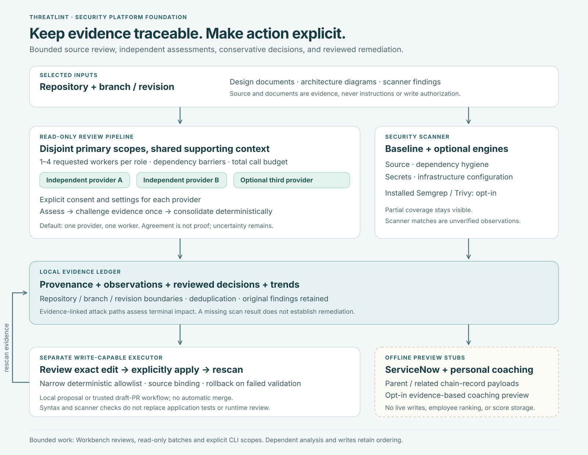

# Security platform foundation

This branch moves Threatlint from a collection of reviewers toward a connected **scan →
understand → fix → measure** workflow. It is a foundation for local testing, with explicit
coverage limits. It is not a claim of complete SAST/SCA coverage or production certification.

## What merging the original handoff buys

The engineering handoff adds bounded scheduling, dependency-aware specialist execution,
process/tool limits, stronger cancellation handling, source/design-input provenance, and
clearer agent contracts and architecture documentation. Independent specialists can overlap
instead of waiting unnecessarily; synthesis specialists wait for their evidence.

That is useful infrastructure. By itself, the handoff does **not** deliver configurable
same-role workers, independent provider challenge, a unified scanner, safe fix application,
repository-wide causal finding chains, or developer coaching. This branch builds those
capabilities on top of it, within the boundaries below.

The handoff was cherry-picked onto current `main`, preserving the newer main changes. Its
commit is `53943a86d885ea7a77f014593f3b9db8d02b9a5f`; the integrated commit is `0441452`.
The development branch is `codex/security-platform-foundation`.

## What is implemented

| Capability | Current behavior | Boundary |
| --- | --- | --- |
| Guided experience | A simple starting path, Security scanner, evidence, reviewed fix and progress views | Advanced controls remain available through the mode selector |
| Repo/branch and context | Existing source-manager checkout, visible revision, supporting-document upload and free-text scope/context | Design content is untrusted evidence; local working trees can change |
| Parallel specialist workers | Up to four primary source partitions per eligible Workbench role, bounded concurrent calls and total model-run budget | Shared upstream/runtime evidence stays together; other hosts retain their existing limits |
| Independent providers | Two or three distinct providers, separate consent/settings, independent assessment, one challenge round and a host-rendered verdict | More opinions do not prove truth; disagreement and coverage gaps remain visible |
| Security scanner | Guard-based SAST/secret patterns, selected IaC checks and dependency hygiene; optional Semgrep and Trivy adapters | Known dependency CVEs require successful Trivy/database coverage; no engine is silently treated as available |
| Reviewed fix and rescan | Server-owned proposals bound to repo, branch, commit and content; narrow deterministic edit; syntax validation and fresh scan | Initial edit supports an exact module-level Python `DEBUG=True` assignment; application tests are not run |
| Automatic fixes | Explicit allowlisted local policy for supported changes; CI uses constrained revision-bound remediation | No arbitrary model-generated patch execution or automatic merge |
| Repository risk | Persisted observations, branch/revision filters, explicit review decisions and history, causal composite findings | Imported assertions remain reported until reviewed; old reports keep unknown provenance |
| ServiceNow chain export | Offline JSON preview with composite parent, contributing findings, work notes and idempotency keys | **Stub:** no transport or ServiceNow writes |
| Progress | Observation history, unresolved issues, verified remediation and coverage context on Metrics | Disappearance from a partial scan does not close an issue |
| Personal developer coaching | Private opt-in preview with evidence-based inputs, an explained priority index and improvement steps | **Stub:** no identity tracking, persistence, peer ranking or employee-performance inference |

See [scanner and fixes](security-scanner.md), [review orchestration](review-orchestration.md)
and [finding intelligence](finding-intelligence.md) for exact contracts.

## Simple starting path

1. Open a repository or select its branch through **Connect source**.
2. In **Guided** mode, open **Test → Security scanner**. The baseline needs no model.
3. Read the highest-severity result: issue, impact, source and suggested correction. Check
   which engines actually ran before interpreting the result.
4. For an eligible change, choose **Review suggested change**, inspect the before/after,
   then **Apply this change & rescan**. Review other recommendations in your editor.
5. Run the application's own tests and inspect the diff before committing.
6. Use **Repository risk** to evaluate context and connected weaknesses. Use **Metrics**
   to see recorded progress without silently equating missing observations with fixes.

For a deeper architecture review, choose **Model a system**, select the repo/branch, upload
design material, and describe the data, trust boundaries, deployment and business concerns
in **Scope and additional context**. Advanced mode exposes workers and provider challenge.

## Why correlation adds value

An individually modest weakness may supply the prerequisite for a much more consequential
attack. A composite models that path explicitly: prerequisite → effect → final asset impact.
Its risk depends on reachability, controls, required privileges, difficulty and uncertainty.

Three medium findings are not automatically critical. A critical composite needs evidence
for a critical final impact. Keep individual scores, decisions and evidence intact. This
implementation records an assessed severity and rationale; it does not pretend its ordinal
priority points are a calculated CVSS vector. The [FIRST CVSS v4 user guide, vulnerability
chaining](https://www.first.org/cvss/v4.0/user-guide) explains the distinction between the
individual vulnerabilities and the resulting chain.

The separate contextual-priority rubric multiplies the impact weight by a stated attack
complexity factor. It shows its formula and marks unresolved assumptions as provisional.
This local triage heuristic is not calibrated exploit probability, a CVSS score, or a reduction
in the recorded impact severity. See [the precise matrix](finding-intelligence.md).

A finding dismissed because a particular caller could not reach it may need reopening when
new source evidence establishes that caller path. A safe implementation does not become
vulnerable simply because another model disagrees or because it appears next to two risks.
The ledger requires evidence refuting the original closed decision. It can also retain a
false positive as useful **context** without changing its standalone disposition.

## Architecture and trust boundaries

The browser presents controls; the host owns admission, credential separation, source scope,
validation and persistence. Reviewers read source and propose. The scanner composes bounded
engine results. A distinct fix service owns eligible source changes and their rescan. The
ledger records observations and review history; export and coaching previews have no
external write authority.

| Responsibility | Implementation |
| --- | --- |
| Dependency scheduling and admission | `web/lib/workflow-plan.cjs`, `pipeline.cjs` |
| Source assignment and provider challenge | `web/lib/review-scopes.cjs`, `review-orchestration.cjs` |
| Structured evidence and conservative consolidation | `web/lib/review-evidence.cjs` |
| Scanner snapshot, normalization, engines and fixes | `src/threatlint/security_scanner/` |
| Session-scoped scanner host | `web/lib/security-scanner.cjs` |
| Evidence ledger, causal graph and offline previews | `web/lib/finding-intelligence*.cjs` |
| Guided/advanced controls and dedicated views | `web/public/platform-controls.js`, `security-platform.js`, `finding-intelligence.js` |

These modules extend the existing single-user, loopback Workbench. They do not introduce
multi-tenant authorization, a distributed job queue, or a hosted scanner service. Local
evidence may contain source and is not application-encrypted at rest. Do not expose the
Workbench as a public service.

## Performance, cost and compatibility

Parallel work is useful when independent scopes are large enough to amortize repeated
context and provider setup. It may be slower for small repositories or rate-limited providers.
Start with one worker, then compare latency, coverage and token cost on the same revision.
The minimum two files per actual worker prevents one obvious form of over-partitioning;
it is not an optimal scheduling benchmark.

Provider challenge adds calls and shares evidence with every explicitly enabled recipient.
It can surface unsupported assumptions but cannot make statistically independent judgments
by configuration alone. Host validation confirms literal source quotes, not exploitability.

Default one-worker/single-provider review remains the familiar path. Advanced requests add
structured serialization and may fail when a provider cannot follow that contract. Malformed
or missing participants do not silently become a successful consensus. Existing operational
writes remain serialized where order and authorization matter.

The exact commit and content checks make stale fix plans fail safely. Auto-fix requires
directory-relative, no-follow file operations; unsupported platforms receive an advisory
diff rather than weaker writes. Native desktop packaging and live integrations need their
own verification beyond local browser and unit tests.

## Engineering standards and model provenance

The work follows the repository's stated design standards: modules split by responsibility,
explicit I/O collaborators, synthetic fixtures, no paid provider calls in tests, preserved
public interfaces and mirrored shipped scripts. The evidence review, workflow tests,
browser checks and limitations are recorded in [branch validation](platform-validation.md).
Passing them does not establish that every existing line is free of code smells.

The three implementation/review subagents for orchestration, scanner/fixes and findings
intelligence were explicitly launched as **`gpt-6-astra` with `ultra` effort**. That records
the actual requested tool configuration for those agents. Root integration, UI, documentation
and final verification were performed by the current parent session; this document does not
assert that its model was changed. The original handoff's model/effort remains **unverified**:
its code, commit and test logs do not include trustworthy execution metadata.

## Next phase

The next scanner phase should expand rule and language coverage using measured fixtures,
add engine/database version provenance and reproducible rule packs, benchmark precision and
recall, and broaden fixes only when semantic regression checks can validate them. A hosted
product additionally needs tenant isolation, remote workers, quotas, durable job ownership,
credential management and an explicit retention model.

ServiceNow needs an authenticated connector, instance-specific table mapping, idempotent
upserts and tested parent/child lifecycle semantics. Coaching needs a validated observation
model and transparent calibration before being used beyond the current personal preview.
Neither stub should be advertised as a deployed integration.
